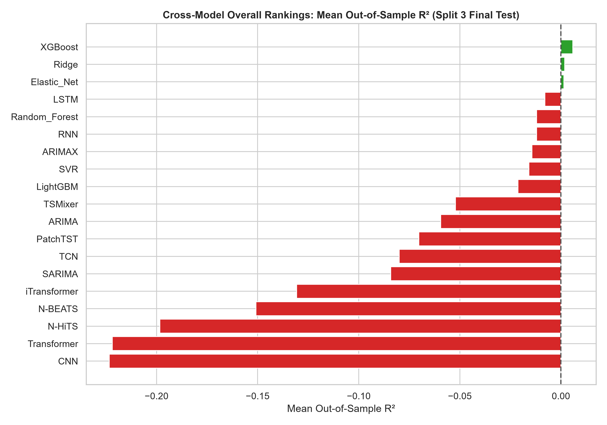
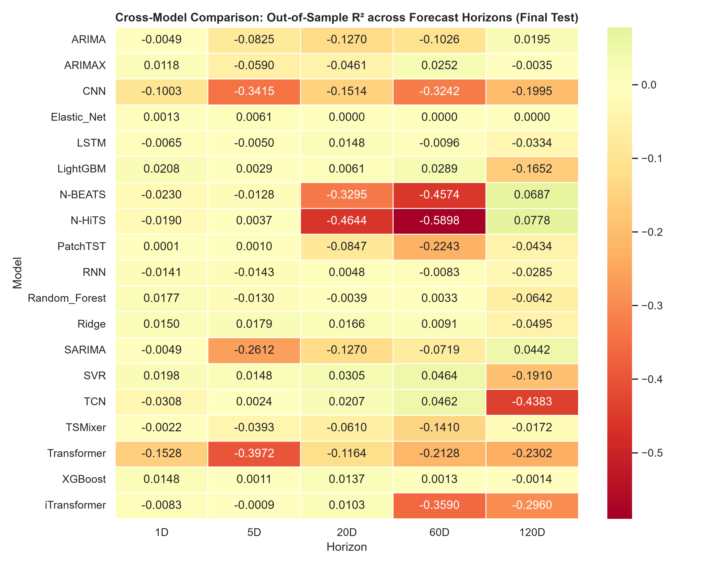
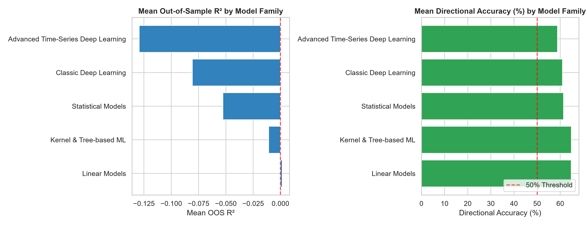

# CROSS-MODEL COMPARATIVE RESEARCH REPORT
**Research Project:** *When Does Equity Return Predictability Decay? A Multi-Horizon and Regime-Dependent Out-of-Sample Analysis*
**Evaluated Models:** Exactly 19 Regression Models + 1 Classification Model (Logistic Regression) + Historical Mean Benchmark
**Out-of-Sample Evaluation Dataset:** S&P 500 (^GSPC), Split 3 (2020-11-02 to 2026-04-07, 1,362 trading days)

---

## 1. Overall Regression Model Rankings (Primary Metric: Campbell–Thompson OOS R²)
The table below presents the overall ranking of all 19 regression forecasting models, averaged across all five horizons (1D to 120D) on the independent Final Test set.

| Model         | Family                             |   OOS_R2 |    RMSE |     MAE |      DA |   Excess_DA |   Rank_OOS_R2 |
|:--------------|:-----------------------------------|---------:|--------:|--------:|--------:|------------:|--------------:|
| XGBoost       | Kernel & Tree-based ML             |  0.0059  | 0.04646 | 0.03704 | 0.66388 |    -0.00222 |             1 |
| Ridge         | Linear Models                      |  0.00182 | 0.04678 | 0.03692 | 0.63538 |    -0.03068 |             2 |
| Elastic_Net   | Linear Models                      |  0.00148 | 0.0465  | 0.03702 | 0.65904 |    -0.00706 |             3 |
| LSTM          | Classic Deep Learning              | -0.00794 | 0.04686 | 0.0371  | 0.64332 |    -0.02276 |             4 |
| Random_Forest | Kernel & Tree-based ML             | -0.01202 | 0.04712 | 0.03776 | 0.6505  |    -0.01556 |             5 |
| RNN           | Classic Deep Learning              | -0.01208 | 0.04686 | 0.03562 | 0.63026 |    -0.03582 |             6 |
| ARIMAX        | Statistical Models                 | -0.01432 | 0.0467  | 0.03658 | 0.61468 |    -0.0514  |             7 |
| SVR           | Kernel & Tree-based ML             | -0.0159  | 0.04772 | 0.03822 | 0.63538 |    -0.03068 |             8 |
| LightGBM      | Kernel & Tree-based ML             | -0.0213  | 0.04774 | 0.03806 | 0.64216 |    -0.02394 |             9 |
| TSMixer       | Advanced Time-Series Deep Learning | -0.05214 | 0.04792 | 0.03676 | 0.5652  |    -0.1009  |            10 |
| ARIMA         | Statistical Models                 | -0.0595  | 0.04768 | 0.03614 | 0.61512 |    -0.05094 |            11 |
| PatchTST      | Advanced Time-Series Deep Learning | -0.07026 | 0.04866 | 0.03828 | 0.65844 |    -0.00764 |            12 |
| TCN           | Advanced Time-Series Deep Learning | -0.07996 | 0.04984 | 0.03854 | 0.61908 |    -0.047   |            13 |
| SARIMA        | Statistical Models                 | -0.08416 | 0.04764 | 0.03626 | 0.61262 |    -0.05346 |            14 |
| iTransformer  | Advanced Time-Series Deep Learning | -0.13078 | 0.05122 | 0.03962 | 0.66124 |    -0.00484 |            15 |
| N-BEATS       | Advanced Time-Series Deep Learning | -0.1508  | 0.04992 | 0.04108 | 0.51262 |    -0.15344 |            16 |
| N-HiTS        | Advanced Time-Series Deep Learning | -0.19834 | 0.05098 | 0.0417  | 0.52894 |    -0.13716 |            17 |
| Transformer   | Classic Deep Learning              | -0.22188 | 0.0513  | 0.04104 | 0.55448 |    -0.1116  |            18 |
| CNN           | Advanced Time-Series Deep Learning | -0.22338 | 0.05166 | 0.04096 | 0.56828 |    -0.09782 |            19 |

## 2. Forecast Horizon Decay & Horizon-Specific Rankings
Multi-horizon comparative matrix evaluating predictability decay from 1D to 120D:

| Model         |      1D |      5D |     20D |     60D |    120D |
|:--------------|--------:|--------:|--------:|--------:|--------:|
| ARIMA         | -0.0049 | -0.0825 | -0.127  | -0.1026 |  0.0195 |
| ARIMAX        |  0.0118 | -0.059  | -0.0461 |  0.0252 | -0.0035 |
| CNN           | -0.1003 | -0.3415 | -0.1514 | -0.3242 | -0.1995 |
| Elastic_Net   |  0.0013 |  0.0061 |  0      |  0      |  0      |
| LSTM          | -0.0065 | -0.005  |  0.0148 | -0.0096 | -0.0334 |
| LightGBM      |  0.0208 |  0.0029 |  0.0061 |  0.0289 | -0.1652 |
| N-BEATS       | -0.023  | -0.0128 | -0.3295 | -0.4574 |  0.0687 |
| N-HiTS        | -0.019  |  0.0037 | -0.4644 | -0.5898 |  0.0778 |
| PatchTST      |  0.0001 |  0.001  | -0.0847 | -0.2243 | -0.0434 |
| RNN           | -0.0141 | -0.0143 |  0.0048 | -0.0083 | -0.0285 |
| Random_Forest |  0.0177 | -0.013  | -0.0039 |  0.0033 | -0.0642 |
| Ridge         |  0.015  |  0.0179 |  0.0166 |  0.0091 | -0.0495 |
| SARIMA        | -0.0049 | -0.2612 | -0.127  | -0.0719 |  0.0442 |
| SVR           |  0.0198 |  0.0148 |  0.0305 |  0.0464 | -0.191  |
| TCN           | -0.0308 |  0.0024 |  0.0207 |  0.0462 | -0.4383 |
| TSMixer       | -0.0022 | -0.0393 | -0.061  | -0.141  | -0.0172 |
| Transformer   | -0.1528 | -0.3972 | -0.1164 | -0.2128 | -0.2302 |
| XGBoost       |  0.0148 |  0.0011 |  0.0137 |  0.0013 | -0.0014 |
| iTransformer  | -0.0083 | -0.0009 |  0.0103 | -0.359  | -0.296  |

## 3. Horizon × Volatility Regime Extremes (Best vs Weakest Models)
Identifies the leading and lagging model in each cell of the 5 × 3 Horizon × Regime state space:

| Horizon   | Regime   |   Observations | Best_Model   |   Best_OOS_R2 |   Best_DA | Weakest_Model   |   Weakest_OOS_R2 |   Weakest_DA |
|:----------|:---------|---------------:|:-------------|--------------:|----------:|:----------------|-----------------:|-------------:|
| 1D        | Low      |            332 | LightGBM     |        0.0049 |    0.5331 | CNN             |          -0.3359 |       0.4849 |
| 1D        | Normal   |            599 | LightGBM     |        0.0089 |    0.5326 | Transformer     |          -0.297  |       0.4825 |
| 1D        | High     |            431 | SVR          |        0.031  |    0.529  | Transformer     |          -0.072  |       0.4872 |
| 5D        | Low      |            332 | iTransformer |        0.0048 |    0.5934 | CNN             |          -0.675  |       0.4759 |
| 5D        | Normal   |            599 | N-BEATS      |        0.0111 |    0.596  | Transformer     |          -0.7018 |       0.5309 |
| 5D        | High     |            431 | RNN          |        0.042  |    0.5151 | CNN             |          -0.3696 |       0.5429 |
| 20D       | Low      |            332 | TCN          |        0.0289 |    0.6657 | N-HiTS          |          -1.709  |       0.3253 |
| 20D       | Normal   |            599 | SVR          |        0.0708 |    0.7429 | N-HiTS          |          -1.0129 |       0.2571 |
| 20D       | High     |            431 | TCN          |        0.0306 |    0.5336 | PatchTST        |          -0.172  |       0.5592 |
| 60D       | Low      |            332 | SVR          |        0.0349 |    0.747  | N-HiTS          |          -1.4275 |       0.3253 |
| 60D       | Normal   |            599 | SVR          |        0.1654 |    0.8381 | N-HiTS          |          -0.8624 |       0.3589 |
| 60D       | High     |            431 | LightGBM     |        0.0932 |    0.6125 | iTransformer    |          -0.7347 |       0.6288 |
| 120D      | Low      |            332 | N-HiTS       |        0.0675 |    0.762  | TCN             |          -0.7092 |       0.6867 |
| 120D      | Normal   |            599 | RNN          |        0.1586 |    0.8698 | SVR             |          -0.3319 |       0.7195 |
| 120D      | High     |            431 | N-HiTS       |        0.0648 |    0.6705 | iTransformer    |          -0.6961 |       0.6705 |

## 4. Model Architectural Family Comparison
Consolidated performance aggregated across the 5 primary structural families:

| Family                             |     OOS_R2 |      RMSE |       MAE |       DA |   Excess_DA |
|:-----------------------------------|-----------:|----------:|----------:|---------:|------------:|
| Linear Models                      |  0.00165   | 0.04664   | 0.03697   | 0.64721  |  -0.01887   |
| Kernel & Tree-based ML             | -0.01083   | 0.04726   | 0.03777   | 0.64798  |  -0.0181    |
| Statistical Models                 | -0.05266   | 0.04734   | 0.0363267 | 0.61414  |  -0.0519333 |
| Classic Deep Learning              | -0.0806333 | 0.04834   | 0.03792   | 0.609353 |  -0.0567267 |
| Advanced Time-Series Deep Learning | -0.12938   | 0.0500286 | 0.0395629 | 0.587686 |  -0.0784    |

## 5. Group III – Logistic Regression (Standalone Classification Analysis)
Logistic Regression produces directional probability predictions rather than continuous returns. It is evaluated independently using classification metrics:

| Model               | Horizon   |   ROC_AUC |   Accuracy |   Balanced_Accuracy |   Precision |   Recall |     F1 |     DA |   Sign_pvalue |
|:--------------------|:----------|----------:|-----------:|--------------------:|------------:|---------:|-------:|-------:|--------------:|
| Logistic_Regression | 120D      |    0.5756 |     0.7805 |              0.5    |      0.7805 |   1      | 0.8767 | 0.7805 |        0      |
| Logistic_Regression | 1D        |    0.4974 |     0.489  |              0.492  |      0.5288 |   0.4522 | 0.4875 | 0.489  |        0.7995 |
| Logistic_Regression | 20D       |    0.5212 |     0.6689 |              0.5    |      0.6689 |   1      | 0.8016 | 0.6689 |        0      |
| Logistic_Regression | 5D        |    0.5226 |     0.5117 |              0.5135 |      0.6071 |   0.5043 | 0.551  | 0.5117 |        0.2005 |
| Logistic_Regression | 60D       |    0.6264 |     0.746  |              0.4976 |      0.7487 |   0.9951 | 0.8545 | 0.746  |        0      |
