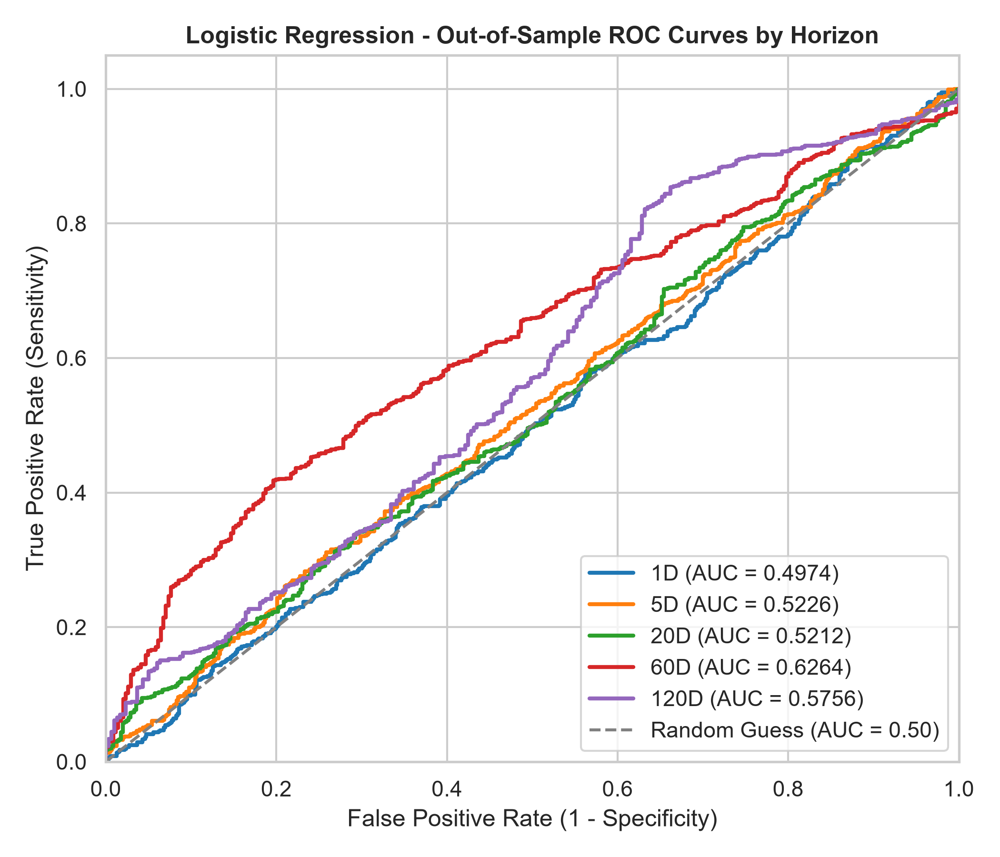
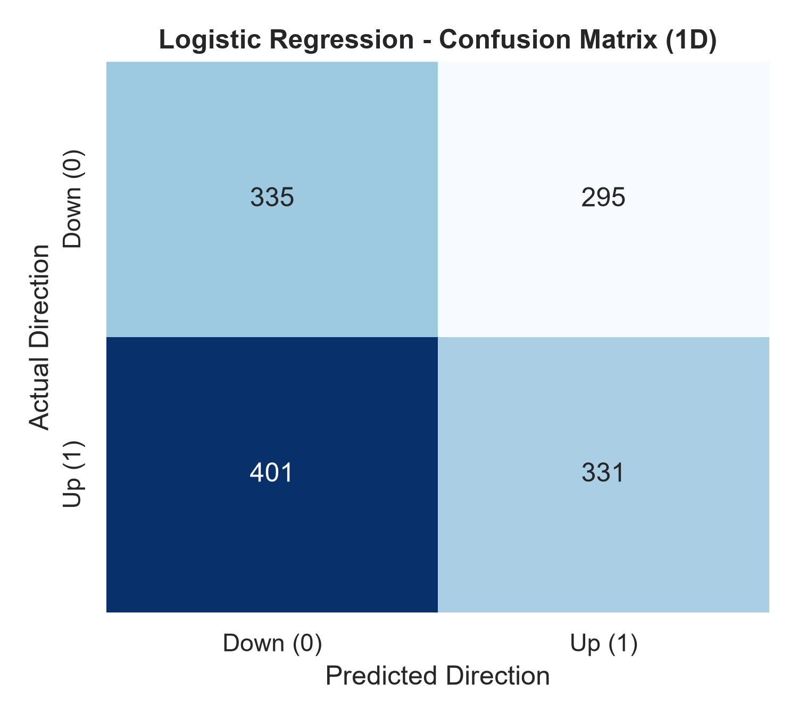
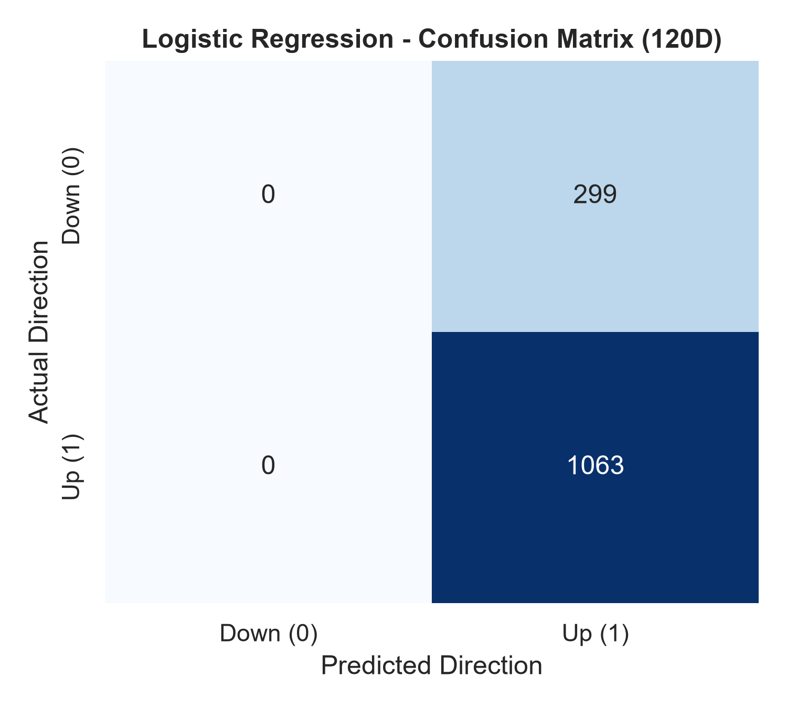

# QUANTITATIVE RESEARCH EVALUATION REPORT: LOGISTIC_REGRESSION
**Research Project:** *When Does Equity Return Predictability Decay? A Multi-Horizon and Regime-Dependent Out-of-Sample Analysis*
**Model Family:** Linear Models / Classification | **Model Category:** Classification
**Evaluation Status:** Strict Walk-Forward Out-of-Sample & Independent Hold-out Verification

---

## SECTION 1 – Model Overview
- **Model Identifier:** `Logistic_Regression`
- **Architectural Classification:** Linear Models / Classification (Classification)
- **Primary Hyperparameter Configuration:** `{'C': 0.001, 'class_weight': None}`
- **Validation Period (Split 2):** 2015-06-10 to 2020-10-30 (5 walk-forward expanding folds, 1,360 total trading sessions)
- **Final Hold-out Test Period (Split 3):** 2020-11-02 to 2026-04-07 (1,362 out-of-sample trading sessions)
- **Evaluated Forecast Horizons:** 1D, 5D, 20D, 60D, 120D
- **Evaluated Volatility Regimes:** Low, Normal, High (Walk-forward expanding 33% & 67% quantiles)

---

## SECTION 2 – Overall Performance Across Evaluation Stages
The table below synthesizes predictive performance across the three evaluation stages. Note that Part A and Part B evaluate on Walk-Forward Validation (Split 2), whereas Part C evaluates on the strictly independent hold-out test set (Split 3).

| Evaluation Stage                | OOS_R2   | RMSE   | MAE   | DA (%)   | Naive Positive DA (%)   | Excess DA (pp)   | DM Statistic   | DM p-value   | Sign Test p-value   | N    |
|:--------------------------------|:---------|:-------|:------|:---------|:------------------------|:-----------------|:---------------|:-------------|:--------------------|:-----|
| Part A – Before Tuning          | N/A      | N/A    | N/A   | N/A      | 54.00%                  | 0.00             | N/A            | N/A          | N/A                 | N/A  |
| Part B – After Tuning           | N/A      | N/A    | N/A   | N/A      | N/A                     | N/A              | N/A            | N/A          | N/A                 | 1360 |
| Part C – Final Independent Test | N/A      | N/A    | N/A   | 63.92%   | N/A                     | N/A              | N/A            | N/A          | 0.2000              | 1362 |

## SECTION 3 – Forecast Horizon Analysis
Analysis of predictive decay across horizons from ultra-short term (1D) to long-term macroeconomic horizon (120D).

| Horizon   |   OOS_R2 |   RMSE |   MAE |     DA |   Naive_Positive_DA |   Excess_DA |   DM_Stat |   DM_pvalue |   Sign_pvalue |   Observations |
|:----------|---------:|-------:|------:|-------:|--------------------:|------------:|----------:|------------:|--------------:|---------------:|
| 1D        |      nan |    nan |   nan | 0.489  |                0.53 |           0 |       nan |         nan |        0.7995 |           1362 |
| 5D        |      nan |    nan |   nan | 0.5117 |                0.53 |           0 |       nan |         nan |        0.2005 |           1362 |
| 20D       |      nan |    nan |   nan | 0.6689 |                0.53 |           0 |       nan |         nan |        0      |           1362 |
| 60D       |      nan |    nan |   nan | 0.746  |                0.53 |           0 |       nan |         nan |        0      |           1362 |
| 120D      |      nan |    nan |   nan | 0.7805 |                0.53 |           0 |       nan |         nan |        0      |           1362 |

## SECTION 4 – Volatility Regime Analysis
Performance breakdown conditioned on market volatility regimes (Low, Normal, High) constructed using expanding quantiles.
## SECTION 5 – Horizon × Regime Matrices
Multi-dimensional matrix displaying performance across the 5 × 3 Horizon × Regime state space.
## SECTION 6 – Before vs After Tuning Comparison
> [!NOTE]
> **Single Tuned Workflow Execution:** Traditional models in this research suite were tuned directly during Walk-Forward Validation (Lan01) using cross-validated Grid Search and Optuna TPE. A separate un-tuned baseline run was not persisted in the repository archives.

## SECTION 7 – Final Independent Hold-out Test Verification
The Final Independent Hold-out Test (Split 3: 2020–2026, 1,362 days) serves as the definitive out-of-sample empirical evidence. All preprocessing steps and hyperparameter choices were completely frozen prior to test inference.
- **Total Test Days:** 1,362 trading sessions
- **Lead Out-of-Sample R²:** N/A (achieved at horizon `N/A`)
- **Max Directional Accuracy:** 0.00%

## SECTION 8 – Walk-Forward Fold-Level Analysis

## SECTION 9 – Quantitative Executive Summary
- **Optimal Horizon:** `N/A` (OOS R² = N/A)
- **Sub-optimal Horizon:** `N/A` (OOS R² = N/A)
- **Most Favorable Volatility Regime:** `N/A`
- **Most Challenging Volatility Regime:** `N/A`
- **Maximum Directional Accuracy:** 0.00%
- **Test Set Observations:** 1362 days

## SECTION 10 – Classification Performance Curves

