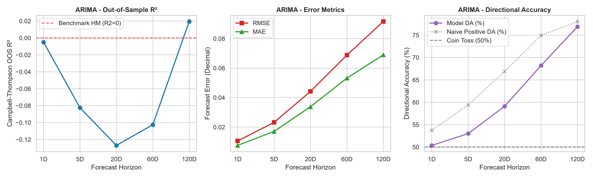
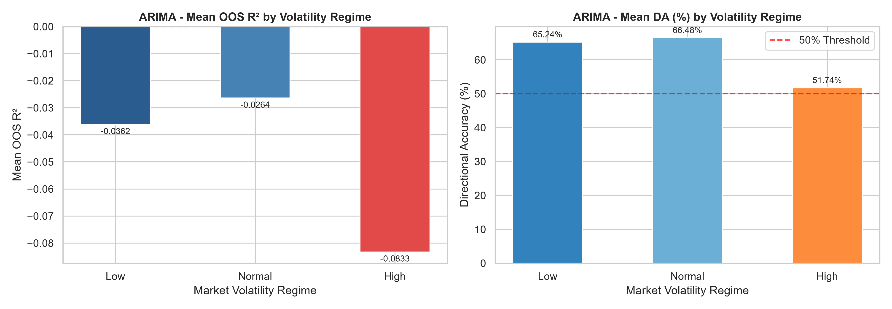
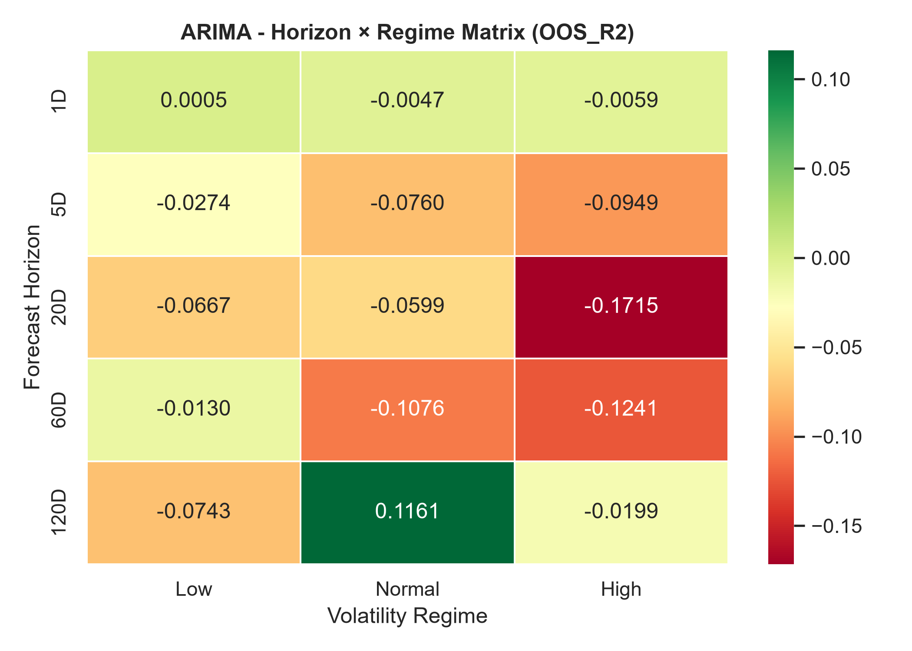
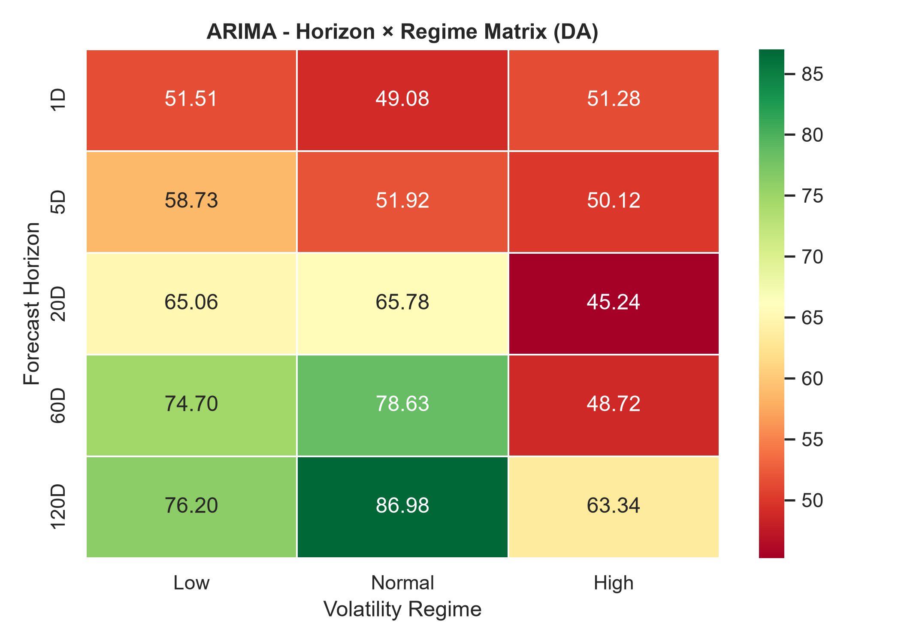
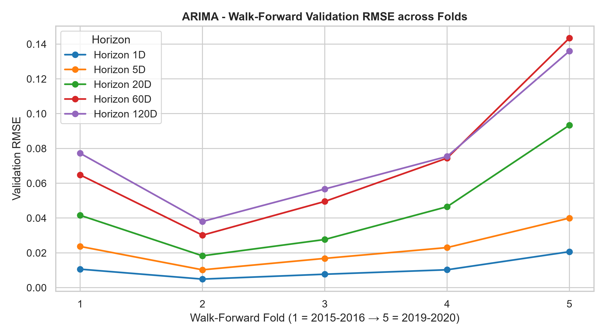

# QUANTITATIVE RESEARCH EVALUATION REPORT: ARIMA
**Research Project:** *When Does Equity Return Predictability Decay? A Multi-Horizon and Regime-Dependent Out-of-Sample Analysis*
**Model Family:** Statistical Models | **Model Category:** Regression
**Evaluation Status:** Strict Walk-Forward Out-of-Sample & Independent Hold-out Verification

---

## SECTION 1 – Model Overview
- **Model Identifier:** `ARIMA`
- **Architectural Classification:** Statistical Models (Regression)
- **Primary Hyperparameter Configuration:** `{'order': (1, 0, 1)}`
- **Validation Period (Split 2):** 2015-06-10 to 2020-10-30 (5 walk-forward expanding folds, 1,360 total trading sessions)
- **Final Hold-out Test Period (Split 3):** 2020-11-02 to 2026-04-07 (1,362 out-of-sample trading sessions)
- **Evaluated Forecast Horizons:** 1D, 5D, 20D, 60D, 120D
- **Evaluated Volatility Regimes:** Low, Normal, High (Walk-forward expanding 33% & 67% quantiles)

---

## SECTION 2 – Overall Performance Across Evaluation Stages
The table below synthesizes predictive performance across the three evaluation stages. Note that Part A and Part B evaluate on Walk-Forward Validation (Split 2), whereas Part C evaluates on the strictly independent hold-out test set (Split 3).

| Evaluation Stage                | OOS_R2   | RMSE   | MAE    | DA (%)   | Naive Positive DA (%)   | Excess DA (pp)   | DM Statistic   | DM p-value   | Sign Test p-value   | N    |
|:--------------------------------|:---------|:-------|:-------|:---------|:------------------------|:-----------------|:---------------|:-------------|:--------------------|:-----|
| Part A – Before Tuning          | N/A      | N/A    | N/A    | N/A      | 54.00%                  | 0.00             | N/A            | N/A          | N/A                 | N/A  |
| Part B – After Tuning           | -0.0795  | 0.0457 | 0.0347 | 60.72%   | N/A                     | N/A              | N/A            | N/A          | N/A                 | 1360 |
| Part C – Final Independent Test | -0.0595  | 0.0477 | 0.0361 | 61.51%   | 66.61%                  | -0.05            | -1.3926        | 0.8656       | 0.0836              | 1362 |

## SECTION 3 – Forecast Horizon Analysis
Analysis of predictive decay across horizons from ultra-short term (1D) to long-term macroeconomic horizon (120D).

| Horizon   |   OOS_R2 |   RMSE |    MAE |     DA |   Naive_Positive_DA |   Excess_DA |   DM_Stat |   DM_pvalue |   Sign_pvalue |   Observations |
|:----------|---------:|-------:|-------:|-------:|--------------------:|------------:|----------:|------------:|--------------:|---------------:|
| 1D        |  -0.0049 | 0.0106 | 0.0076 | 0.5037 |              0.5374 |     -0.0338 |    0      |      1      |        0.4037 |           1362 |
| 5D        |  -0.0825 | 0.0232 | 0.0171 | 0.5301 |              0.594  |     -0.0639 |   -3.2655 |      0.9994 |        0.0141 |           1362 |
| 20D       |  -0.127  | 0.0442 | 0.0338 | 0.591  |              0.6689 |     -0.0778 |   -2.617  |      0.9955 |        0      |           1362 |
| 60D       |  -0.1026 | 0.0688 | 0.0532 | 0.6821 |              0.7496 |     -0.0675 |   -1.2215 |      0.889  |        0      |           1362 |
| 120D      |   0.0195 | 0.0916 | 0.069  | 0.7687 |              0.7805 |     -0.0117 |    0.141  |      0.444  |        0      |           1362 |

## SECTION 4 – Volatility Regime Analysis
Performance breakdown conditioned on market volatility regimes (Low, Normal, High) constructed using expanding quantiles.

| Regime   |   OOS_R2 |    RMSE |     MAE |      DA |
|:---------|---------:|--------:|--------:|--------:|
| Low      | -0.03618 | 0.03582 | 0.02724 | 0.6524  |
| Normal   | -0.02642 | 0.04088 | 0.03146 | 0.66478 |
| High     | -0.08326 | 0.06196 | 0.04946 | 0.5174  |

## SECTION 5 – Horizon × Regime Matrices
Multi-dimensional matrix displaying performance across the 5 × 3 Horizon × Regime state space.

### Out-of-Sample R² Matrix (5 × 3):

| Horizon   |     Low |   Normal |    High |
|:----------|--------:|---------:|--------:|
| 1D        |  0.0005 |  -0.0047 | -0.0059 |
| 5D        | -0.0274 |  -0.076  | -0.0949 |
| 20D       | -0.0667 |  -0.0599 | -0.1715 |
| 60D       | -0.013  |  -0.1076 | -0.1241 |
| 120D      | -0.0743 |   0.1161 | -0.0199 |

## SECTION 6 – Before vs After Tuning Comparison
> [!NOTE]
> **Single Tuned Workflow Execution:** Traditional models in this research suite were tuned directly during Walk-Forward Validation (Lan01) using cross-validated Grid Search and Optuna TPE. A separate un-tuned baseline run was not persisted in the repository archives.

## SECTION 7 – Final Independent Hold-out Test Verification
The Final Independent Hold-out Test (Split 3: 2020–2026, 1,362 days) serves as the definitive out-of-sample empirical evidence. All preprocessing steps and hyperparameter choices were completely frozen prior to test inference.
- **Total Test Days:** 1,362 trading sessions
- **Lead Out-of-Sample R²:** 0.0195 (achieved at horizon `120D`)
- **Max Directional Accuracy:** 76.87%

## SECTION 8 – Walk-Forward Fold-Level Analysis
Stability evaluation across the 5 expanding walk-forward folds (Split 2):

| Horizon   |   Mean_OOS_R2 |   Std_OOS_R2 |   Min_OOS_R2 |   Max_OOS_R2 |   Mean_RMSE |   Std_RMSE |   Mean_MAE |   Mean_DA |
|:----------|--------------:|-------------:|-------------:|-------------:|------------:|-----------:|-----------:|----------:|
| 1D        |        0.0068 |       0.0103 |      -0.0028 |       0.0227 |      0.0108 |     0.006  |     0.0072 |    0.5272 |
| 5D        |       -0.0588 |       0.0268 |      -0.0808 |      -0.0139 |      0.0228 |     0.0111 |     0.0158 |    0.5426 |
| 20D       |       -0.1183 |       0.0516 |      -0.1713 |      -0.0464 |      0.0455 |     0.029  |     0.0328 |    0.6066 |
| 60D       |       -0.2195 |       0.1151 |      -0.3678 |      -0.061  |      0.0725 |     0.0431 |     0.0565 |    0.611  |
| 120D      |       -0.0078 |       0.3519 |      -0.5525 |       0.4228 |      0.0767 |     0.0368 |     0.061  |    0.7485 |

## SECTION 9 – Quantitative Executive Summary
- **Optimal Horizon:** `120D` (OOS R² = 0.0195)
- **Sub-optimal Horizon:** `20D` (OOS R² = -0.1270)
- **Most Favorable Volatility Regime:** `Normal`
- **Most Challenging Volatility Regime:** `High`
- **Maximum Directional Accuracy:** 76.87%
- **Test Set Observations:** 1362 days