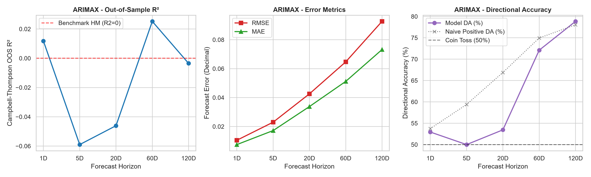
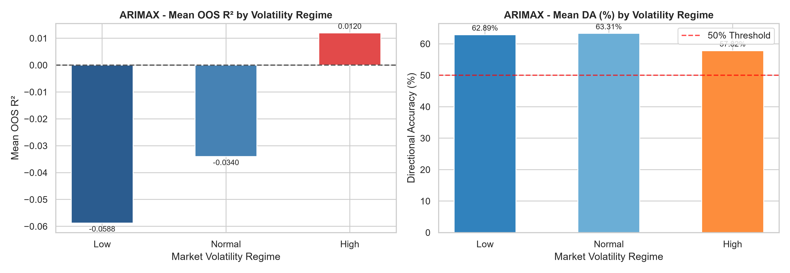
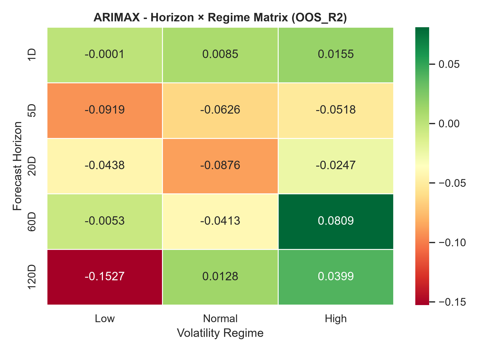
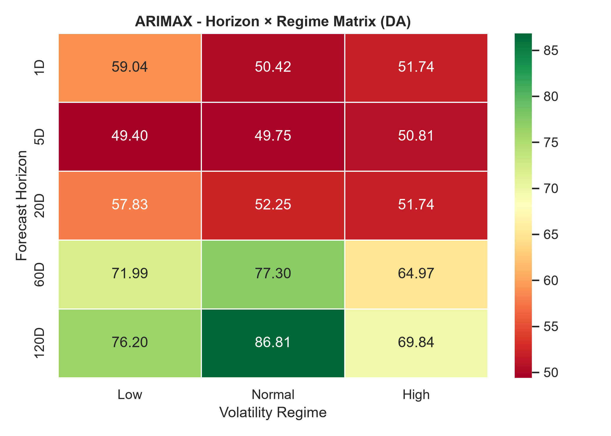
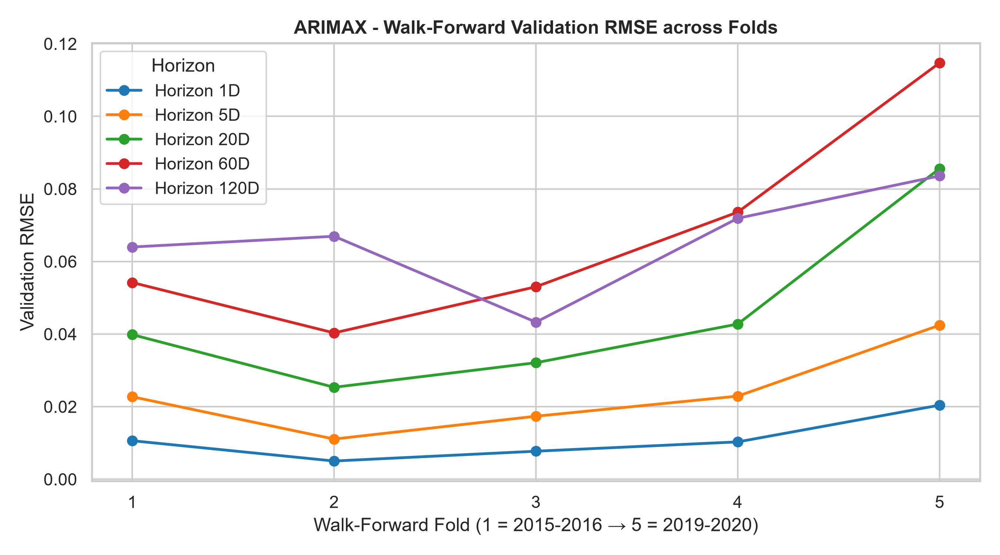

# QUANTITATIVE RESEARCH EVALUATION REPORT: ARIMAX
**Research Project:** *When Does Equity Return Predictability Decay? A Multi-Horizon and Regime-Dependent Out-of-Sample Analysis*
**Model Family:** Statistical Models | **Model Category:** Regression
**Evaluation Status:** Strict Walk-Forward Out-of-Sample & Independent Hold-out Verification

---

## SECTION 1 – Model Overview
- **Model Identifier:** `ARIMAX`
- **Architectural Classification:** Statistical Models (Regression)
- **Primary Hyperparameter Configuration:** `{'order': (1, 0, 1)}`
- **Validation Period (Split 2):** 2015-06-10 to 2020-10-30 (5 walk-forward expanding folds, 1,360 total trading sessions)
- **Final Hold-out Test Period (Split 3):** 2020-11-02 to 2026-04-07 (1,362 out-of-sample trading sessions)
- **Evaluated Forecast Horizons:** 1D, 5D, 20D, 60D, 120D
- **Evaluated Volatility Regimes:** Low, Normal, High (Walk-forward expanding 33% & 67% quantiles)

---

## SECTION 2 – Overall Performance Across Evaluation Stages
The table below synthesizes predictive performance across the three evaluation stages. Note that Part A and Part B evaluate on Walk-Forward Validation (Split 2), whereas Part C evaluates on the strictly independent hold-out test set (Split 3).

| Evaluation Stage                | OOS_R2   | RMSE   | MAE    | DA (%)   | Naive Positive DA (%)   | Excess DA (pp)   | DM Statistic   | DM p-value   | Sign Test p-value   | N    |
|:--------------------------------|:---------|:-------|:-------|:---------|:------------------------|:-----------------|:---------------|:-------------|:--------------------|:-----|
| Part A – Before Tuning          | N/A      | N/A    | N/A    | N/A      | 54.00%                  | 0.00             | N/A            | N/A          | N/A                 | N/A  |
| Part B – After Tuning           | -0.1199  | 0.0425 | 0.0335 | 55.96%   | N/A                     | N/A              | N/A            | N/A          | N/A                 | 1360 |
| Part C – Final Independent Test | -0.0143  | 0.0467 | 0.0366 | 61.47%   | 66.61%                  | -0.05            | -0.2277        | 0.5570       | 0.1066              | 1362 |

## SECTION 3 – Forecast Horizon Analysis
Analysis of predictive decay across horizons from ultra-short term (1D) to long-term macroeconomic horizon (120D).

| Horizon   |   OOS_R2 |   RMSE |    MAE |     DA |   Naive_Positive_DA |   Excess_DA |   DM_Stat |   DM_pvalue |   Sign_pvalue |   Observations |
|:----------|---------:|-------:|-------:|-------:|--------------------:|------------:|----------:|------------:|--------------:|---------------:|
| 1D        |   0.0118 | 0.0105 | 0.0075 | 0.5294 |              0.5374 |     -0.0081 |    0.845  |      0.1991 |        0.0161 |           1362 |
| 5D        |  -0.059  | 0.023  | 0.0172 | 0.5    |              0.594  |     -0.094  |   -1.5503 |      0.9394 |        0.5108 |           1362 |
| 20D       |  -0.0461 | 0.0426 | 0.0338 | 0.5345 |              0.6689 |     -0.1344 |   -0.791  |      0.7855 |        0.0059 |           1362 |
| 60D       |   0.0252 | 0.0647 | 0.0512 | 0.721  |              0.7496 |     -0.0286 |    0.3873 |      0.3493 |        0      |           1362 |
| 120D      |  -0.0035 | 0.0927 | 0.0732 | 0.7885 |              0.7805 |      0.0081 |   -0.0293 |      0.5117 |        0      |           1362 |

## SECTION 4 – Volatility Regime Analysis
Performance breakdown conditioned on market volatility regimes (Low, Normal, High) constructed using expanding quantiles.

| Regime   |   OOS_R2 |    RMSE |     MAE |      DA |
|:---------|---------:|--------:|--------:|--------:|
| Low      | -0.05876 | 0.03642 | 0.02936 | 0.62892 |
| Normal   | -0.03404 | 0.04142 | 0.03278 | 0.63306 |
| High     |  0.01196 | 0.05864 | 0.04746 | 0.5782  |

## SECTION 5 – Horizon × Regime Matrices
Multi-dimensional matrix displaying performance across the 5 × 3 Horizon × Regime state space.

### Out-of-Sample R² Matrix (5 × 3):

| Horizon   |     Low |   Normal |    High |
|:----------|--------:|---------:|--------:|
| 1D        | -0.0001 |   0.0085 |  0.0155 |
| 5D        | -0.0919 |  -0.0626 | -0.0518 |
| 20D       | -0.0438 |  -0.0876 | -0.0247 |
| 60D       | -0.0053 |  -0.0413 |  0.0809 |
| 120D      | -0.1527 |   0.0128 |  0.0399 |

## SECTION 6 – Before vs After Tuning Comparison
> [!NOTE]
> **Single Tuned Workflow Execution:** Traditional models in this research suite were tuned directly during Walk-Forward Validation (Lan01) using cross-validated Grid Search and Optuna TPE. A separate un-tuned baseline run was not persisted in the repository archives.

## SECTION 7 – Final Independent Hold-out Test Verification
The Final Independent Hold-out Test (Split 3: 2020–2026, 1,362 days) serves as the definitive out-of-sample empirical evidence. All preprocessing steps and hyperparameter choices were completely frozen prior to test inference.
- **Total Test Days:** 1,362 trading sessions
- **Lead Out-of-Sample R²:** 0.0252 (achieved at horizon `60D`)
- **Max Directional Accuracy:** 78.85%

## SECTION 8 – Walk-Forward Fold-Level Analysis
Stability evaluation across the 5 expanding walk-forward folds (Split 2):

| Horizon   |   Mean_OOS_R2 |   Std_OOS_R2 |   Min_OOS_R2 |   Max_OOS_R2 |   Mean_RMSE |   Std_RMSE |   Mean_MAE |   Mean_DA |
|:----------|--------------:|-------------:|-------------:|-------------:|------------:|-----------:|-----------:|----------:|
| 1D        |        0.0019 |       0.0294 |      -0.0351 |       0.047  |      0.0108 |     0.0058 |     0.0072 |    0.5206 |
| 5D        |       -0.1151 |       0.1011 |      -0.2583 |       0.0058 |      0.0233 |     0.0117 |     0.0167 |    0.4794 |
| 20D       |       -0.3059 |       0.4957 |      -1.0829 |       0.0398 |      0.0451 |     0.0236 |     0.0339 |    0.4625 |
| 60D       |       -0.2496 |       0.4421 |      -0.8982 |       0.1813 |      0.0672 |     0.0291 |     0.0542 |    0.5765 |
| 120D      |        0.069  |       0.5506 |      -0.7903 |       0.6077 |      0.066  |     0.0147 |     0.0554 |    0.7588 |

## SECTION 9 – Quantitative Executive Summary
- **Optimal Horizon:** `60D` (OOS R² = 0.0252)
- **Sub-optimal Horizon:** `5D` (OOS R² = -0.0590)
- **Most Favorable Volatility Regime:** `High`
- **Most Challenging Volatility Regime:** `Low`
- **Maximum Directional Accuracy:** 78.85%
- **Test Set Observations:** 1362 days