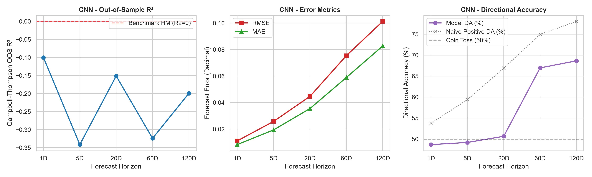
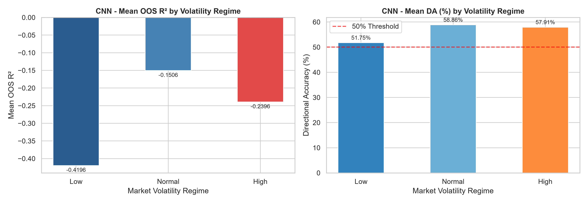
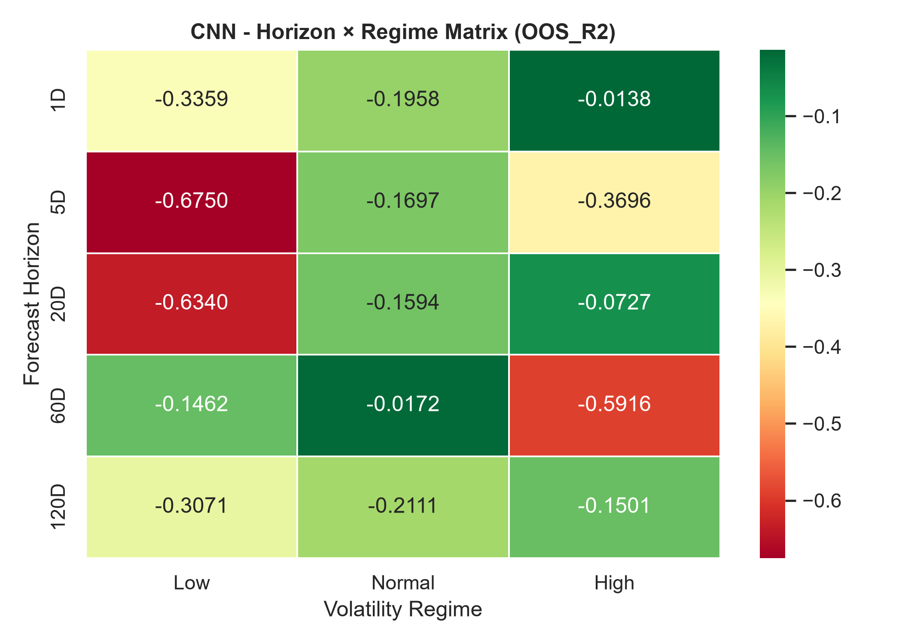
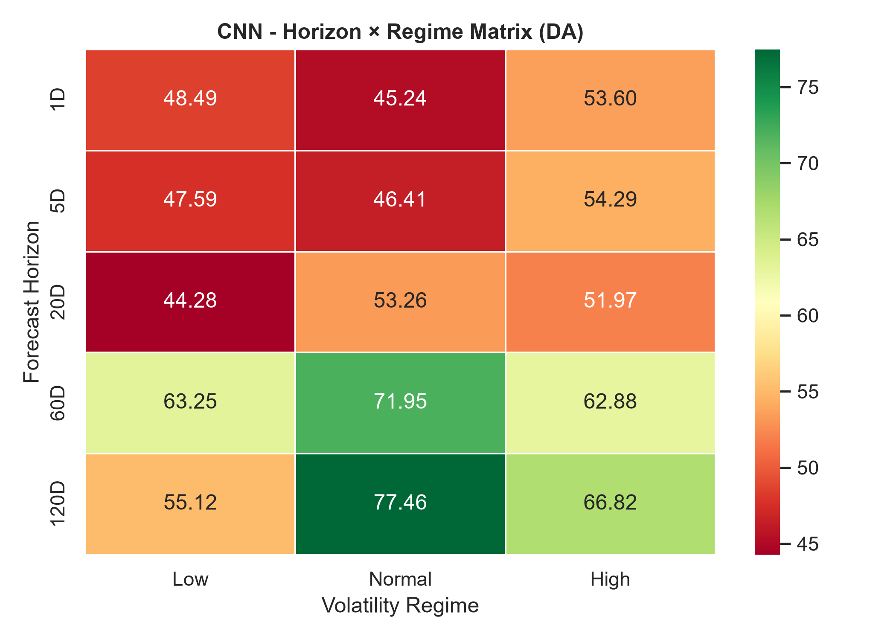
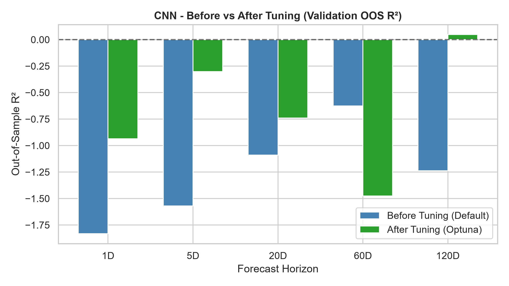
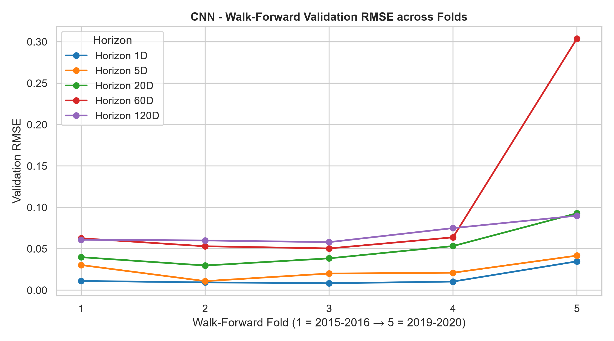

# QUANTITATIVE RESEARCH EVALUATION REPORT: CNN
**Research Project:** *When Does Equity Return Predictability Decay? A Multi-Horizon and Regime-Dependent Out-of-Sample Analysis*
**Model Family:** Advanced Time-Series Deep Learning | **Model Category:** Regression
**Evaluation Status:** Strict Walk-Forward Out-of-Sample & Independent Hold-out Verification

---

## SECTION 1 – Model Overview
- **Model Identifier:** `CNN`
- **Architectural Classification:** Advanced Time-Series Deep Learning (Regression)
- **Primary Hyperparameter Configuration:** `{'lookback': 20, 'num_filters': 32, 'kernel_size': 3, 'num_layers': 2, 'dropout': 0.2818139519329972, 'learning_rate': 0.0004771079247357168, 'weight_decay': 0.0001, 'batch_size': 16, 'epochs': 1000, 'patience': 7}`
- **Validation Period (Split 2):** 2015-06-10 to 2020-10-30 (5 walk-forward expanding folds, 1,360 total trading sessions)
- **Final Hold-out Test Period (Split 3):** 2020-11-02 to 2026-04-07 (1,362 out-of-sample trading sessions)
- **Evaluated Forecast Horizons:** 1D, 5D, 20D, 60D, 120D
- **Evaluated Volatility Regimes:** Low, Normal, High (Walk-forward expanding 33% & 67% quantiles)

---

## SECTION 2 – Overall Performance Across Evaluation Stages
The table below synthesizes predictive performance across the three evaluation stages. Note that Part A and Part B evaluate on Walk-Forward Validation (Split 2), whereas Part C evaluates on the strictly independent hold-out test set (Split 3).

| Evaluation Stage                |   OOS_R2 |   RMSE |    MAE | DA (%)   | Naive Positive DA (%)   | Excess DA (pp)   | DM Statistic   | DM p-value   | Sign Test p-value   |    N |
|:--------------------------------|---------:|-------:|-------:|:---------|:------------------------|:-----------------|:---------------|:-------------|:--------------------|-----:|
| Part A – Before Tuning          |  -1.2707 | 0.0613 | 0.0476 | 52.25%   | N/A                     | N/A              | N/A            | N/A          | N/A                 | 1360 |
| Part B – After Tuning           |  -0.681  | 0.0532 | 0.0405 | 55.44%   | N/A                     | N/A              | N/A            | N/A          | N/A                 | 1360 |
| Part C – Final Independent Test |  -0.2234 | 0.0517 | 0.041  | 56.83%   | 66.61%                  | -0.10            | -1.8413        | 0.9128       | 0.3796              | 1362 |

## SECTION 3 – Forecast Horizon Analysis
Analysis of predictive decay across horizons from ultra-short term (1D) to long-term macroeconomic horizon (120D).

| Horizon   |   OOS_R2 |   RMSE |    MAE |     DA |   Naive_Positive_DA |   Excess_DA |   DM_Stat |   DM_pvalue |   Sign_pvalue |   Observations |
|:----------|---------:|-------:|-------:|-------:|--------------------:|------------:|----------:|------------:|--------------:|---------------:|
| 1D        |  -0.1003 | 0.0111 | 0.0083 | 0.4868 |              0.5374 |     -0.0507 |   -3.1422 |      0.9991 |        0.842  |           1362 |
| 5D        |  -0.3415 | 0.0258 | 0.0194 | 0.4919 |              0.594  |     -0.1021 |   -2.8374 |      0.9977 |        0.7334 |           1362 |
| 20D       |  -0.1514 | 0.0447 | 0.0355 | 0.5066 |              0.6689 |     -0.1623 |   -1.298  |      0.9028 |        0.3225 |           1362 |
| 60D       |  -0.3242 | 0.0754 | 0.0589 | 0.6696 |              0.7496 |     -0.08   |   -1.0192 |      0.8459 |        0      |           1362 |
| 120D      |  -0.1995 | 0.1013 | 0.0827 | 0.6865 |              0.7805 |     -0.094  |   -0.9098 |      0.8184 |        0      |           1362 |

## SECTION 4 – Volatility Regime Analysis
Performance breakdown conditioned on market volatility regimes (Low, Normal, High) constructed using expanding quantiles.

| Regime   |   OOS_R2 |    RMSE |     MAE |      DA |
|:---------|---------:|--------:|--------:|--------:|
| Low      | -0.41964 | 0.04044 | 0.03462 | 0.51746 |
| Normal   | -0.15064 | 0.0437  | 0.03604 | 0.58864 |
| High     | -0.23956 | 0.06692 | 0.05266 | 0.57912 |

## SECTION 5 – Horizon × Regime Matrices
Multi-dimensional matrix displaying performance across the 5 × 3 Horizon × Regime state space.

### Out-of-Sample R² Matrix (5 × 3):

| Horizon   |     Low |   Normal |    High |
|:----------|--------:|---------:|--------:|
| 1D        | -0.3359 |  -0.1958 | -0.0138 |
| 5D        | -0.675  |  -0.1697 | -0.3696 |
| 20D       | -0.634  |  -0.1594 | -0.0727 |
| 60D       | -0.1462 |  -0.0172 | -0.5916 |
| 120D      | -0.3071 |  -0.2111 | -0.1501 |

## SECTION 6 – Before vs After Tuning Comparison
Comparison between baseline default architecture parameters (Part A) and Optuna-optimized hyperparameters (Part B) on Walk-Forward Validation.

| Horizon   |   Before_OOS_R2 |   After_OOS_R2 |   Delta_OOS_R2 |   Before_RMSE |   After_RMSE |   Delta_RMSE |   Before_DA |   After_DA |   Delta_DA |
|:----------|----------------:|---------------:|---------------:|--------------:|-------------:|-------------:|------------:|-----------:|-----------:|
| 1D        |         -1.8313 |        -0.9365 |         0.8948 |        0.015  |       0.0148 |      -0.0002 |      0.5051 |     0.4897 |    -0.0154 |
| 5D        |         -1.5707 |        -0.3011 |         1.2696 |        0.0359 |       0.0248 |      -0.0111 |      0.4721 |     0.5434 |     0.0713 |
| 20D       |         -1.0891 |        -0.7404 |         0.3487 |        0.0581 |       0.0508 |      -0.0072 |      0.5029 |     0.489  |    -0.014  |
| 60D       |         -0.6255 |        -1.475  |        -0.8495 |        0.0837 |       0.1067 |       0.0231 |      0.6368 |     0.4912 |    -0.1456 |
| 120D      |         -1.237  |         0.0479 |         1.2848 |        0.114  |       0.0688 |      -0.0452 |      0.4956 |     0.7588 |     0.2632 |

## SECTION 7 – Final Independent Hold-out Test Verification
The Final Independent Hold-out Test (Split 3: 2020–2026, 1,362 days) serves as the definitive out-of-sample empirical evidence. All preprocessing steps and hyperparameter choices were completely frozen prior to test inference.
- **Total Test Days:** 1,362 trading sessions
- **Lead Out-of-Sample R²:** -0.1003 (achieved at horizon `1D`)
- **Max Directional Accuracy:** 68.65%

## SECTION 8 – Walk-Forward Fold-Level Analysis
Stability evaluation across the 5 expanding walk-forward folds (Split 2):

| Horizon   |   Mean_OOS_R2 |   Std_OOS_R2 |   Min_OOS_R2 |   Max_OOS_R2 |   Mean_RMSE |   Std_RMSE |   Mean_MAE |   Mean_DA |
|:----------|--------------:|-------------:|-------------:|-------------:|------------:|-----------:|-----------:|----------:|
| 1D        |       -0.9365 |       1.1929 |      -2.6283 |      -0.0266 |      0.0148 |     0.0112 |     0.0105 |    0.4897 |
| 5D        |       -0.3011 |       0.349  |      -0.7718 |       0.1162 |      0.0248 |     0.0117 |     0.0183 |    0.5434 |
| 20D       |       -0.7404 |       0.7913 |      -1.8798 |       0.0404 |      0.0508 |     0.0249 |     0.0387 |    0.489  |
| 60D       |       -1.475  |       2.0529 |      -4.7401 |      -0.0045 |      0.1067 |     0.1103 |     0.0791 |    0.4912 |
| 120D      |        0.0479 |       0.3486 |      -0.4399 |       0.5458 |      0.0688 |     0.0136 |     0.056  |    0.7588 |

## SECTION 9 – Quantitative Executive Summary
- **Optimal Horizon:** `1D` (OOS R² = -0.1003)
- **Sub-optimal Horizon:** `5D` (OOS R² = -0.3415)
- **Most Favorable Volatility Regime:** `Normal`
- **Most Challenging Volatility Regime:** `Low`
- **Maximum Directional Accuracy:** 68.65%
- **Test Set Observations:** 1362 days