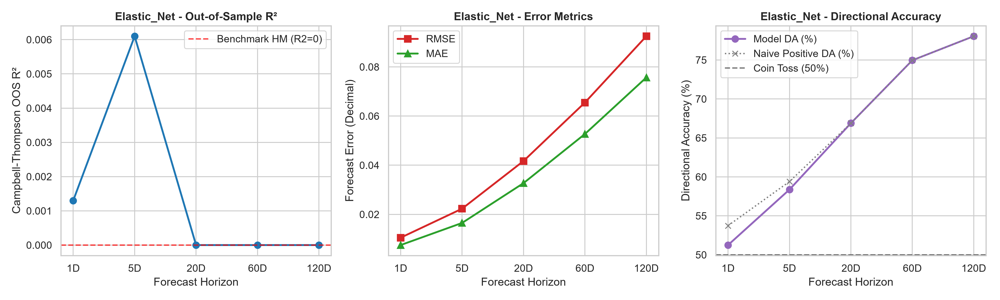
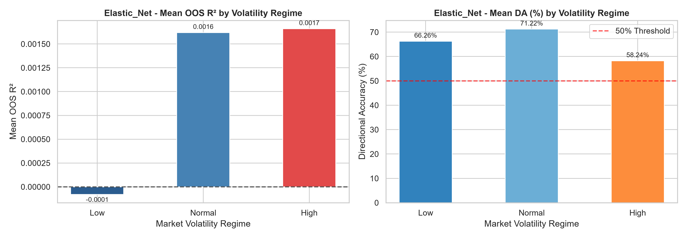
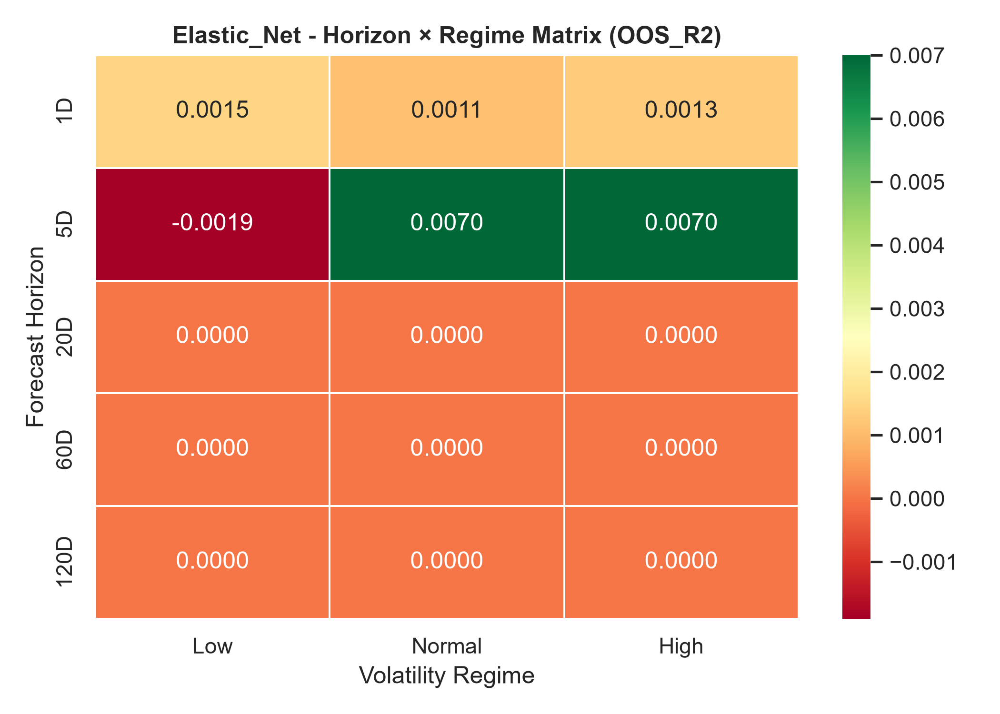
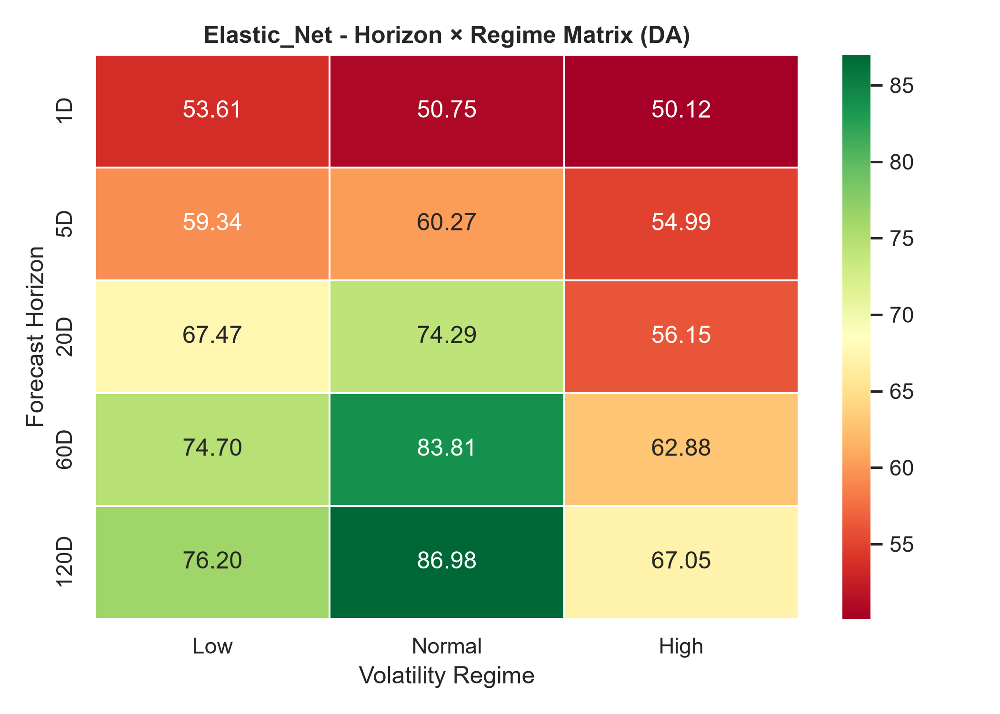
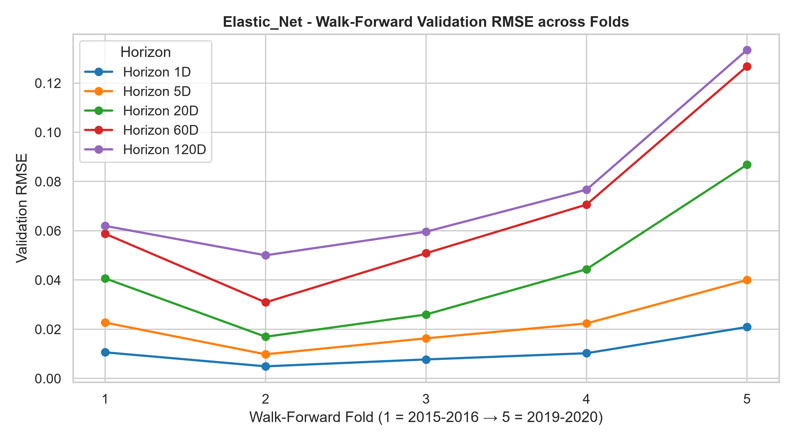

# QUANTITATIVE RESEARCH EVALUATION REPORT: ELASTIC_NET
**Research Project:** *When Does Equity Return Predictability Decay? A Multi-Horizon and Regime-Dependent Out-of-Sample Analysis*
**Model Family:** Linear Models | **Model Category:** Regression
**Evaluation Status:** Strict Walk-Forward Out-of-Sample & Independent Hold-out Verification

---

## SECTION 1 – Model Overview
- **Model Identifier:** `Elastic_Net`
- **Architectural Classification:** Linear Models (Regression)
- **Primary Hyperparameter Configuration:** `{'alpha': 0.001, 'l1_ratio': 0.7}`
- **Validation Period (Split 2):** 2015-06-10 to 2020-10-30 (5 walk-forward expanding folds, 1,360 total trading sessions)
- **Final Hold-out Test Period (Split 3):** 2020-11-02 to 2026-04-07 (1,362 out-of-sample trading sessions)
- **Evaluated Forecast Horizons:** 1D, 5D, 20D, 60D, 120D
- **Evaluated Volatility Regimes:** Low, Normal, High (Walk-forward expanding 33% & 67% quantiles)

---

## SECTION 2 – Overall Performance Across Evaluation Stages
The table below synthesizes predictive performance across the three evaluation stages. Note that Part A and Part B evaluate on Walk-Forward Validation (Split 2), whereas Part C evaluates on the strictly independent hold-out test set (Split 3).

| Evaluation Stage                | OOS_R2   | RMSE   | MAE    | DA (%)   | Naive Positive DA (%)   | Excess DA (pp)   | DM Statistic   | DM p-value   | Sign Test p-value   | N    |
|:--------------------------------|:---------|:-------|:-------|:---------|:------------------------|:-----------------|:---------------|:-------------|:--------------------|:-----|
| Part A – Before Tuning          | N/A      | N/A    | N/A    | N/A      | 54.00%                  | 0.00             | N/A            | N/A          | N/A                 | N/A  |
| Part B – After Tuning           | -0.0225  | 0.0440 | 0.0345 | 64.66%   | N/A                     | N/A              | N/A            | N/A          | N/A                 | 1360 |
| Part C – Final Independent Test | 0.0015   | 0.0465 | 0.0370 | 65.90%   | 66.61%                  | -0.01            | 0.2314         | 0.8247       | 0.0371              | 1362 |

## SECTION 3 – Forecast Horizon Analysis
Analysis of predictive decay across horizons from ultra-short term (1D) to long-term macroeconomic horizon (120D).

| Horizon   |   OOS_R2 |   RMSE |    MAE |     DA |   Naive_Positive_DA |   Excess_DA |   DM_Stat |   DM_pvalue |   Sign_pvalue |   Observations |
|:----------|---------:|-------:|-------:|-------:|--------------------:|------------:|----------:|------------:|--------------:|---------------:|
| 1D        |   0.0013 | 0.0105 | 0.0075 | 0.5125 |              0.5374 |     -0.025  |    0      |      1      |        0.1856 |           1362 |
| 5D        |   0.0061 | 0.0223 | 0.0165 | 0.5837 |              0.594  |     -0.0103 |    1.1571 |      0.1237 |        0      |           1362 |
| 20D       |   0      | 0.0417 | 0.0327 | 0.6689 |              0.6689 |      0      |    0      |      1      |        0      |           1362 |
| 60D       |   0      | 0.0655 | 0.0527 | 0.7496 |              0.7496 |      0      |    0      |      1      |        0      |           1362 |
| 120D      |   0      | 0.0925 | 0.0757 | 0.7805 |              0.7805 |      0      |    0      |      1      |        0      |           1362 |

## SECTION 4 – Volatility Regime Analysis
Performance breakdown conditioned on market volatility regimes (Low, Normal, High) constructed using expanding quantiles.

| Regime   |   OOS_R2 |    RMSE |     MAE |      DA |
|:---------|---------:|--------:|--------:|--------:|
| Low      | -8e-05   | 0.035   | 0.02906 | 0.66264 |
| Normal   |  0.00162 | 0.0409  | 0.03302 | 0.7122  |
| High     |  0.00166 | 0.05946 | 0.04878 | 0.58238 |

## SECTION 5 – Horizon × Regime Matrices
Multi-dimensional matrix displaying performance across the 5 × 3 Horizon × Regime state space.

### Out-of-Sample R² Matrix (5 × 3):

| Horizon   |     Low |   Normal |   High |
|:----------|--------:|---------:|-------:|
| 1D        |  0.0015 |   0.0011 | 0.0013 |
| 5D        | -0.0019 |   0.007  | 0.007  |
| 20D       |  0      |   0      | 0      |
| 60D       |  0      |   0      | 0      |
| 120D      |  0      |   0      | 0      |

## SECTION 6 – Before vs After Tuning Comparison
> [!NOTE]
> **Single Tuned Workflow Execution:** Traditional models in this research suite were tuned directly during Walk-Forward Validation (Lan01) using cross-validated Grid Search and Optuna TPE. A separate un-tuned baseline run was not persisted in the repository archives.

## SECTION 7 – Final Independent Hold-out Test Verification
The Final Independent Hold-out Test (Split 3: 2020–2026, 1,362 days) serves as the definitive out-of-sample empirical evidence. All preprocessing steps and hyperparameter choices were completely frozen prior to test inference.
- **Total Test Days:** 1,362 trading sessions
- **Lead Out-of-Sample R²:** 0.0061 (achieved at horizon `5D`)
- **Max Directional Accuracy:** 78.05%

## SECTION 8 – Walk-Forward Fold-Level Analysis
Stability evaluation across the 5 expanding walk-forward folds (Split 2):

| Horizon   |   Mean_OOS_R2 |   Std_OOS_R2 |   Min_OOS_R2 |   Max_OOS_R2 |   Mean_RMSE |   Std_RMSE |   Mean_MAE |   Mean_DA |
|:----------|--------------:|-------------:|-------------:|-------------:|------------:|-----------:|-----------:|----------:|
| 1D        |        0.0016 |       0.0009 |       0.0005 |       0.0028 |      0.0109 |     0.006  |     0.0072 |    0.5493 |
| 5D        |        0.002  |       0.0103 |      -0.0146 |       0.0126 |      0.0222 |     0.0112 |     0.0156 |    0.5846 |
| 20D       |        0.0006 |       0.0478 |      -0.0666 |       0.0685 |      0.043  |     0.0269 |     0.0319 |    0.6199 |
| 60D       |       -0.1167 |       0.1169 |      -0.2365 |       0      |      0.0676 |     0.0361 |     0.0548 |    0.7015 |
| 120D      |        0      |       0      |       0      |       0      |      0.0764 |     0.0333 |     0.063  |    0.7779 |

## SECTION 9 – Quantitative Executive Summary
- **Optimal Horizon:** `5D` (OOS R² = 0.0061)
- **Sub-optimal Horizon:** `20D` (OOS R² = 0.0000)
- **Most Favorable Volatility Regime:** `High`
- **Most Challenging Volatility Regime:** `Low`
- **Maximum Directional Accuracy:** 78.05%
- **Test Set Observations:** 1362 days