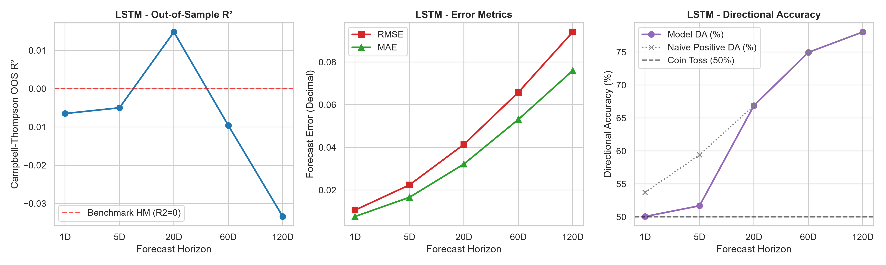
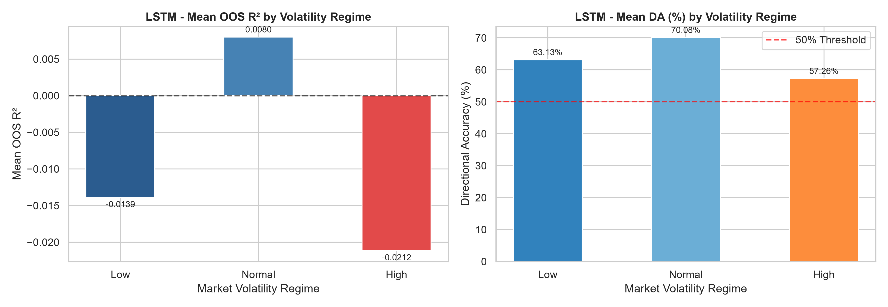
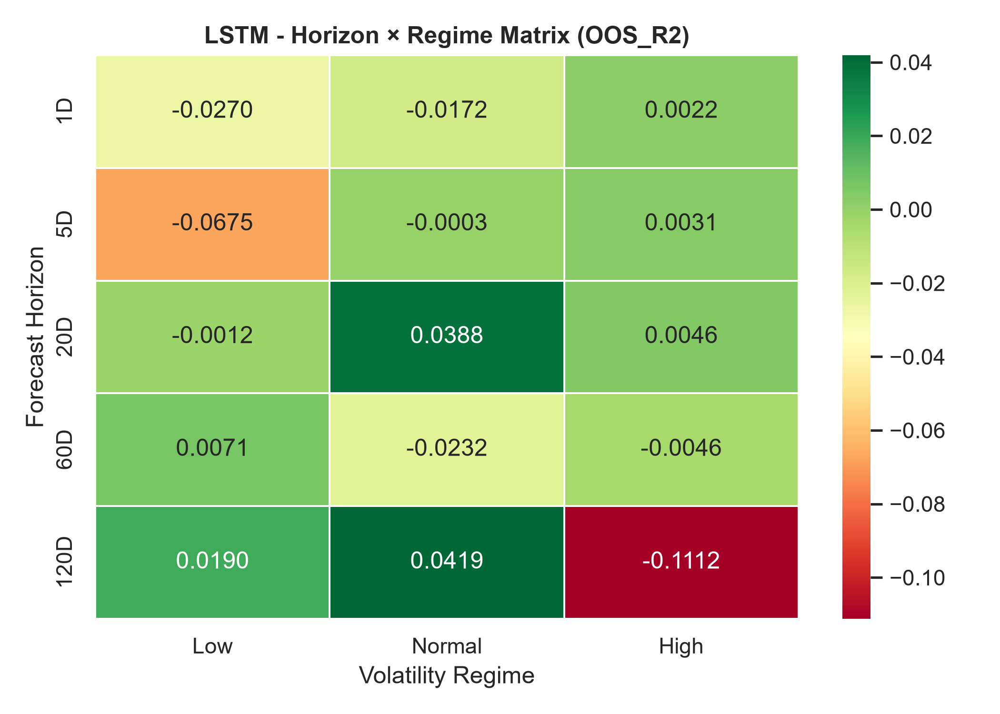
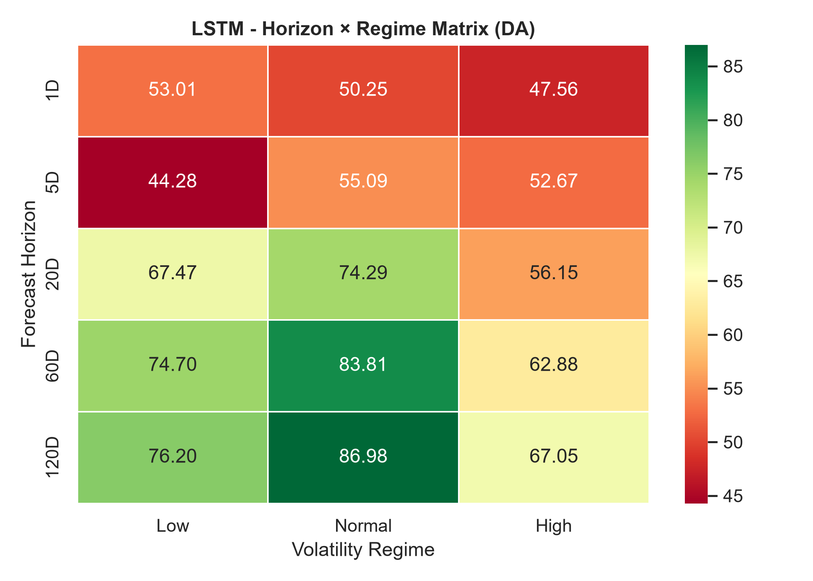
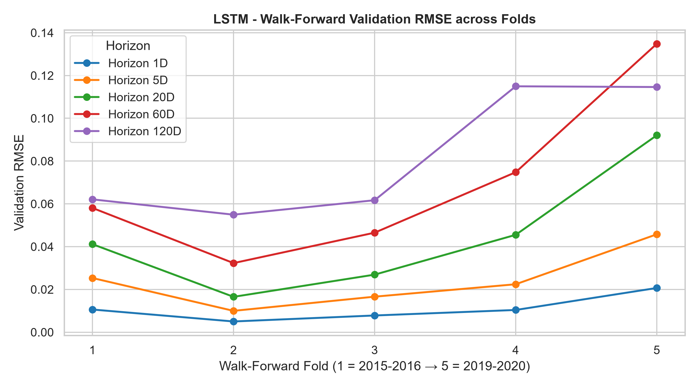

# QUANTITATIVE RESEARCH EVALUATION REPORT: LSTM
**Research Project:** *When Does Equity Return Predictability Decay? A Multi-Horizon and Regime-Dependent Out-of-Sample Analysis*
**Model Family:** Classic Deep Learning | **Model Category:** Regression
**Evaluation Status:** Strict Walk-Forward Out-of-Sample & Independent Hold-out Verification

---

## SECTION 1 – Model Overview
- **Model Identifier:** `LSTM`
- **Architectural Classification:** Classic Deep Learning (Regression)
- **Primary Hyperparameter Configuration:** `{'lookback': 40, 'hidden_size': 128, 'num_layers': 3, 'dropout': 0.4871079271090035, 'learning_rate': 9.140136883051477e-05, 'weight_decay': 0.0001, 'batch_size': 64, 'epochs': 40, 'patience': 7}`
- **Validation Period (Split 2):** 2015-06-10 to 2020-10-30 (5 walk-forward expanding folds, 1,360 total trading sessions)
- **Final Hold-out Test Period (Split 3):** 2020-11-02 to 2026-04-07 (1,362 out-of-sample trading sessions)
- **Evaluated Forecast Horizons:** 1D, 5D, 20D, 60D, 120D
- **Evaluated Volatility Regimes:** Low, Normal, High (Walk-forward expanding 33% & 67% quantiles)

---

## SECTION 2 – Overall Performance Across Evaluation Stages
The table below synthesizes predictive performance across the three evaluation stages. Note that Part A and Part B evaluate on Walk-Forward Validation (Split 2), whereas Part C evaluates on the strictly independent hold-out test set (Split 3).

| Evaluation Stage                | OOS_R2   | RMSE   | MAE    | DA (%)   | Naive Positive DA (%)   | Excess DA (pp)   | DM Statistic   | DM p-value   | Sign Test p-value   | N    |
|:--------------------------------|:---------|:-------|:-------|:---------|:------------------------|:-----------------|:---------------|:-------------|:--------------------|:-----|
| Part A – Before Tuning          | N/A      | N/A    | N/A    | N/A      | 54.00%                  | 0.00             | N/A            | N/A          | N/A                 | N/A  |
| Part B – After Tuning           | -0.1159  | 0.0461 | 0.0363 | 59.90%   | N/A                     | N/A              | N/A            | N/A          | N/A                 | 1360 |
| Part C – Final Independent Test | -0.0079  | 0.0469 | 0.0371 | 64.33%   | 66.61%                  | -0.02            | -0.1327        | 0.5637       | 0.1201              | 1362 |

## SECTION 3 – Forecast Horizon Analysis
Analysis of predictive decay across horizons from ultra-short term (1D) to long-term macroeconomic horizon (120D).

| Horizon   |   OOS_R2 |   RMSE |    MAE |     DA |   Naive_Positive_DA |   Excess_DA |   DM_Stat |   DM_pvalue |   Sign_pvalue |   Observations |
|:----------|---------:|-------:|-------:|-------:|--------------------:|------------:|----------:|------------:|--------------:|---------------:|
| 1D        |  -0.0065 | 0.0106 | 0.0076 | 0.5007 |              0.5374 |     -0.0367 |   -0.7052 |      0.7596 |        0.4892 |           1362 |
| 5D        |  -0.005  | 0.0224 | 0.0166 | 0.5169 |              0.594  |     -0.0771 |   -0.2789 |      0.6098 |        0.1114 |           1362 |
| 20D       |   0.0148 | 0.0414 | 0.0322 | 0.6689 |              0.6689 |      0      |    1.2155 |      0.1122 |        0      |           1362 |
| 60D       |  -0.0096 | 0.0658 | 0.0531 | 0.7496 |              0.7496 |      0      |   -0.6779 |      0.751  |        0      |           1362 |
| 120D      |  -0.0334 | 0.0941 | 0.076  | 0.7805 |              0.7805 |      0      |   -0.2169 |      0.5858 |        0      |           1362 |

## SECTION 4 – Volatility Regime Analysis
Performance breakdown conditioned on market volatility regimes (Low, Normal, High) constructed using expanding quantiles.

| Regime   |   OOS_R2 |    RMSE |     MAE |      DA |
|:---------|---------:|--------:|--------:|--------:|
| Low      | -0.01392 | 0.03492 | 0.02852 | 0.63132 |
| Normal   |  0.008   | 0.04058 | 0.03254 | 0.70084 |
| High     | -0.02118 | 0.0607  | 0.05008 | 0.57262 |

## SECTION 5 – Horizon × Regime Matrices
Multi-dimensional matrix displaying performance across the 5 × 3 Horizon × Regime state space.

### Out-of-Sample R² Matrix (5 × 3):

| Horizon   |     Low |   Normal |    High |
|:----------|--------:|---------:|--------:|
| 1D        | -0.027  |  -0.0172 |  0.0022 |
| 5D        | -0.0675 |  -0.0003 |  0.0031 |
| 20D       | -0.0012 |   0.0388 |  0.0046 |
| 60D       |  0.0071 |  -0.0232 | -0.0046 |
| 120D      |  0.019  |   0.0419 | -0.1112 |

## SECTION 6 – Before vs After Tuning Comparison
> [!NOTE]
> **Single Tuned Workflow Execution:** Traditional models in this research suite were tuned directly during Walk-Forward Validation (Lan01) using cross-validated Grid Search and Optuna TPE. A separate un-tuned baseline run was not persisted in the repository archives.

## SECTION 7 – Final Independent Hold-out Test Verification
The Final Independent Hold-out Test (Split 3: 2020–2026, 1,362 days) serves as the definitive out-of-sample empirical evidence. All preprocessing steps and hyperparameter choices were completely frozen prior to test inference.
- **Total Test Days:** 1,362 trading sessions
- **Lead Out-of-Sample R²:** 0.0148 (achieved at horizon `20D`)
- **Max Directional Accuracy:** 78.05%

## SECTION 8 – Walk-Forward Fold-Level Analysis
Stability evaluation across the 5 expanding walk-forward folds (Split 2):

| Horizon   |   Mean_OOS_R2 |   Std_OOS_R2 |   Min_OOS_R2 |   Max_OOS_R2 |   Mean_RMSE |   Std_RMSE |   Mean_MAE |   Mean_DA |
|:----------|--------------:|-------------:|-------------:|-------------:|------------:|-----------:|-----------:|----------:|
| 1D        |       -0.0094 |       0.0223 |      -0.0309 |       0.0228 |      0.0109 |     0.0059 |     0.0072 |    0.525  |
| 5D        |       -0.1244 |       0.1476 |      -0.3282 |      -0.0023 |      0.024  |     0.0135 |     0.0167 |    0.5426 |
| 20D       |       -0.0451 |       0.0976 |      -0.1233 |       0.1133 |      0.0444 |     0.029  |     0.0332 |    0.5537 |
| 60D       |       -0.1478 |       0.1593 |      -0.38   |       0.0235 |      0.0693 |     0.0398 |     0.0553 |    0.6728 |
| 120D      |       -0.2528 |       0.581  |      -1.2464 |       0.2626 |      0.0817 |     0.0304 |     0.069  |    0.7007 |

## SECTION 9 – Quantitative Executive Summary
- **Optimal Horizon:** `20D` (OOS R² = 0.0148)
- **Sub-optimal Horizon:** `120D` (OOS R² = -0.0334)
- **Most Favorable Volatility Regime:** `Normal`
- **Most Challenging Volatility Regime:** `High`
- **Maximum Directional Accuracy:** 78.05%
- **Test Set Observations:** 1362 days