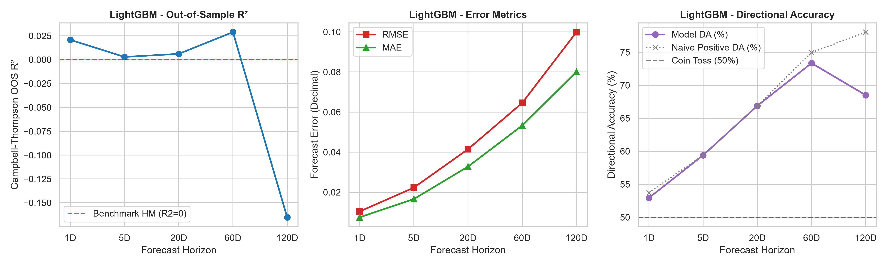
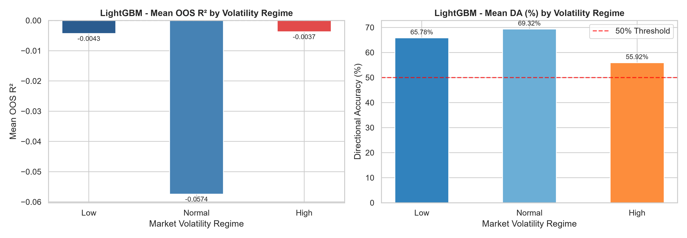
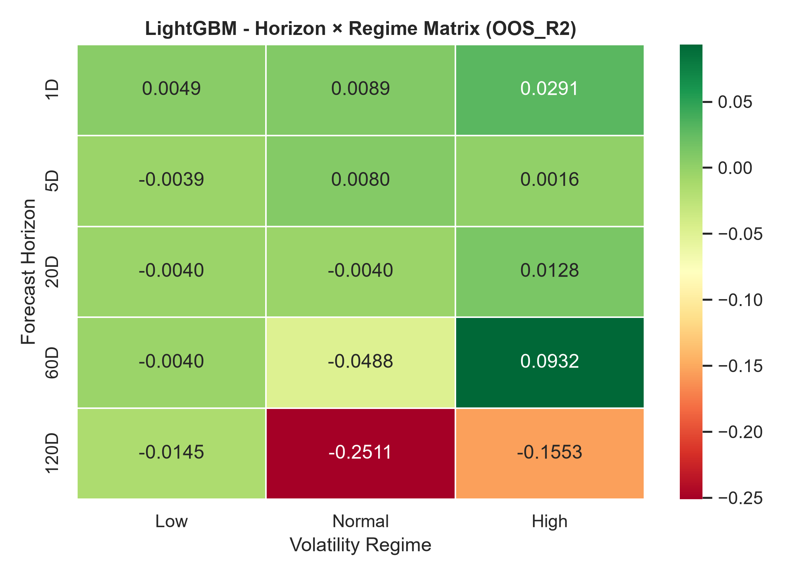
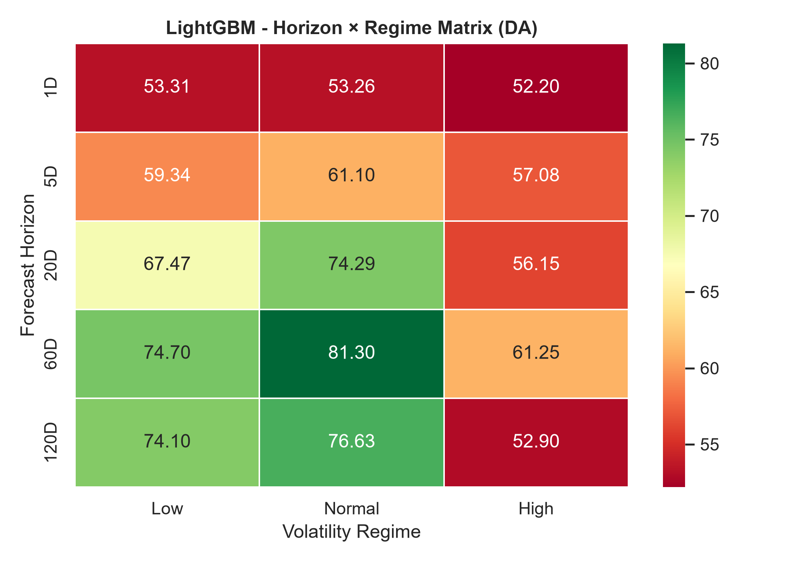
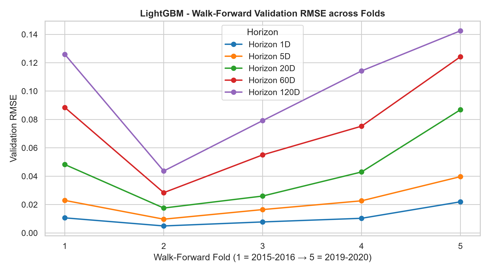

# QUANTITATIVE RESEARCH EVALUATION REPORT: LIGHTGBM
**Research Project:** *When Does Equity Return Predictability Decay? A Multi-Horizon and Regime-Dependent Out-of-Sample Analysis*
**Model Family:** Kernel & Tree-based ML | **Model Category:** Regression
**Evaluation Status:** Strict Walk-Forward Out-of-Sample & Independent Hold-out Verification

---

## SECTION 1 – Model Overview
- **Model Identifier:** `LightGBM`
- **Architectural Classification:** Kernel & Tree-based ML (Regression)
- **Primary Hyperparameter Configuration:** `{'n_estimators': 400, 'learning_rate': 0.11049890000613266, 'num_leaves': 49, 'max_depth': 10, 'min_child_samples': 34, 'subsample': 0.7840602059905246, 'colsample_bytree': 0.7428464775168512, 'reg_alpha': 0.44766655633145197, 'reg_lambda': 1.1488808987955952}`
- **Validation Period (Split 2):** 2015-06-10 to 2020-10-30 (5 walk-forward expanding folds, 1,360 total trading sessions)
- **Final Hold-out Test Period (Split 3):** 2020-11-02 to 2026-04-07 (1,362 out-of-sample trading sessions)
- **Evaluated Forecast Horizons:** 1D, 5D, 20D, 60D, 120D
- **Evaluated Volatility Regimes:** Low, Normal, High (Walk-forward expanding 33% & 67% quantiles)

---

## SECTION 2 – Overall Performance Across Evaluation Stages
The table below synthesizes predictive performance across the three evaluation stages. Note that Part A and Part B evaluate on Walk-Forward Validation (Split 2), whereas Part C evaluates on the strictly independent hold-out test set (Split 3).

| Evaluation Stage                | OOS_R2   | RMSE   | MAE    | DA (%)   | Naive Positive DA (%)   | Excess DA (pp)   | DM Statistic   | DM p-value   | Sign Test p-value   | N    |
|:--------------------------------|:---------|:-------|:-------|:---------|:------------------------|:-----------------|:---------------|:-------------|:--------------------|:-----|
| Part A – Before Tuning          | N/A      | N/A    | N/A    | N/A      | 54.00%                  | 0.00             | N/A            | N/A          | N/A                 | N/A  |
| Part B – After Tuning           | -0.3026  | 0.0506 | 0.0391 | 58.60%   | N/A                     | N/A              | N/A            | N/A          | N/A                 | 1360 |
| Part C – Final Independent Test | -0.0213  | 0.0477 | 0.0381 | 64.22%   | 66.61%                  | -0.02            | 0.3612         | 0.3534       | 0.0032              | 1362 |

## SECTION 3 – Forecast Horizon Analysis
Analysis of predictive decay across horizons from ultra-short term (1D) to long-term macroeconomic horizon (120D).

| Horizon   |   OOS_R2 |   RMSE |    MAE |     DA |   Naive_Positive_DA |   Excess_DA |   DM_Stat |   DM_pvalue |   Sign_pvalue |   Observations |
|:----------|---------:|-------:|-------:|-------:|--------------------:|------------:|----------:|------------:|--------------:|---------------:|
| 1D        |   0.0208 | 0.0104 | 0.0075 | 0.5294 |              0.5374 |     -0.0081 |    1.075  |      0.1413 |        0.0161 |           1362 |
| 5D        |   0.0029 | 0.0223 | 0.0166 | 0.594  |              0.594  |      0      |    0.6631 |      0.2537 |        0      |           1362 |
| 20D       |   0.0061 | 0.0415 | 0.0328 | 0.6689 |              0.6689 |      0      |    1.0061 |      0.1573 |        0      |           1362 |
| 60D       |   0.0289 | 0.0646 | 0.0533 | 0.7335 |              0.7496 |     -0.0162 |    0.5888 |      0.278  |        0      |           1362 |
| 120D      |  -0.1652 | 0.0999 | 0.0801 | 0.685  |              0.7805 |     -0.0954 |   -1.527  |      0.9365 |        0      |           1362 |

## SECTION 4 – Volatility Regime Analysis
Performance breakdown conditioned on market volatility regimes (Low, Normal, High) constructed using expanding quantiles.

| Regime   |   OOS_R2 |    RMSE |     MAE |      DA |
|:---------|---------:|--------:|--------:|--------:|
| Low      | -0.0043  | 0.03516 | 0.02906 | 0.65784 |
| Normal   | -0.0574  | 0.04318 | 0.03472 | 0.69316 |
| High     | -0.00372 | 0.06026 | 0.04962 | 0.55916 |

## SECTION 5 – Horizon × Regime Matrices
Multi-dimensional matrix displaying performance across the 5 × 3 Horizon × Regime state space.

### Out-of-Sample R² Matrix (5 × 3):

| Horizon   |     Low |   Normal |    High |
|:----------|--------:|---------:|--------:|
| 1D        |  0.0049 |   0.0089 |  0.0291 |
| 5D        | -0.0039 |   0.008  |  0.0016 |
| 20D       | -0.004  |  -0.004  |  0.0128 |
| 60D       | -0.004  |  -0.0488 |  0.0932 |
| 120D      | -0.0145 |  -0.2511 | -0.1553 |

## SECTION 6 – Before vs After Tuning Comparison
> [!NOTE]
> **Single Tuned Workflow Execution:** Traditional models in this research suite were tuned directly during Walk-Forward Validation (Lan01) using cross-validated Grid Search and Optuna TPE. A separate un-tuned baseline run was not persisted in the repository archives.

## SECTION 7 – Final Independent Hold-out Test Verification
The Final Independent Hold-out Test (Split 3: 2020–2026, 1,362 days) serves as the definitive out-of-sample empirical evidence. All preprocessing steps and hyperparameter choices were completely frozen prior to test inference.
- **Total Test Days:** 1,362 trading sessions
- **Lead Out-of-Sample R²:** 0.0289 (achieved at horizon `60D`)
- **Max Directional Accuracy:** 73.35%

## SECTION 8 – Walk-Forward Fold-Level Analysis
Stability evaluation across the 5 expanding walk-forward folds (Split 2):

| Horizon   |   Mean_OOS_R2 |   Std_OOS_R2 |   Min_OOS_R2 |   Max_OOS_R2 |   Mean_RMSE |   Std_RMSE |   Mean_MAE |   Mean_DA |
|:----------|--------------:|-------------:|-------------:|-------------:|------------:|-----------:|-----------:|----------:|
| 1D        |       -0.0237 |       0.0441 |      -0.1021 |       0.0022 |      0.0111 |     0.0065 |     0.0073 |    0.5368 |
| 5D        |       -0.0039 |       0.0233 |      -0.0231 |       0.0346 |      0.0223 |     0.0111 |     0.0156 |    0.5493 |
| 20D       |       -0.0814 |       0.182  |      -0.4069 |       0      |      0.0443 |     0.0268 |     0.0327 |    0.6382 |
| 60D       |       -0.402  |       0.5375 |      -1.2655 |       0.0588 |      0.0743 |     0.036  |     0.0585 |    0.6235 |
| 120D      |       -1.0021 |       1.3133 |      -3.1266 |       0.2387 |      0.1011 |     0.0396 |     0.0816 |    0.5824 |

## SECTION 9 – Quantitative Executive Summary
- **Optimal Horizon:** `60D` (OOS R² = 0.0289)
- **Sub-optimal Horizon:** `120D` (OOS R² = -0.1652)
- **Most Favorable Volatility Regime:** `High`
- **Most Challenging Volatility Regime:** `Normal`
- **Maximum Directional Accuracy:** 73.35%
- **Test Set Observations:** 1362 days