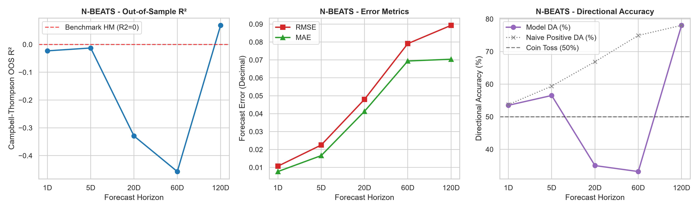
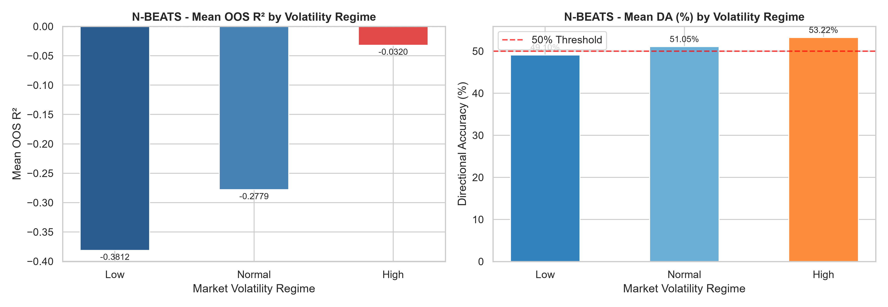
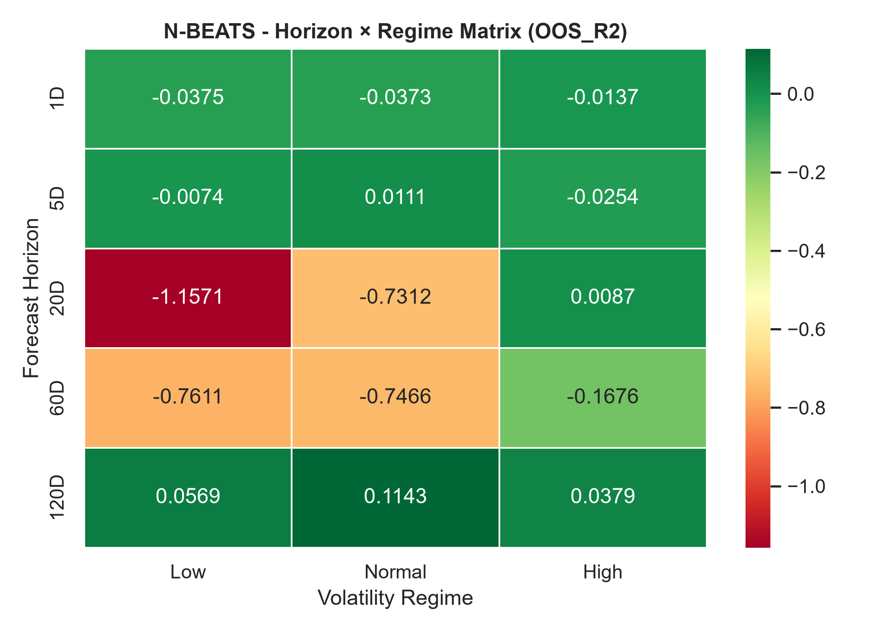
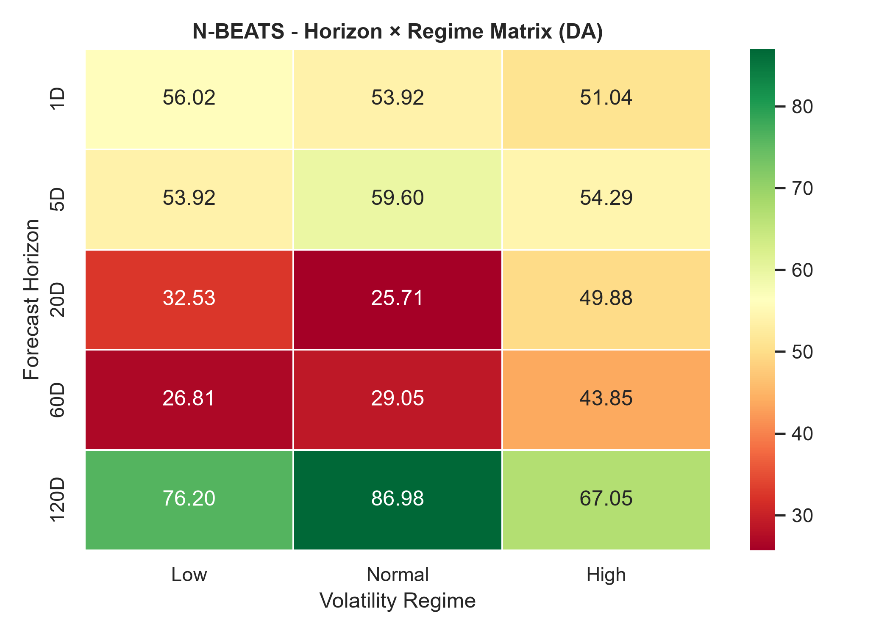
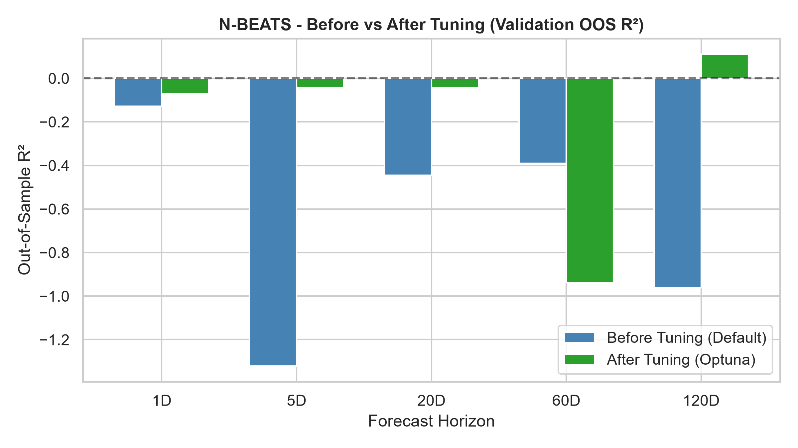
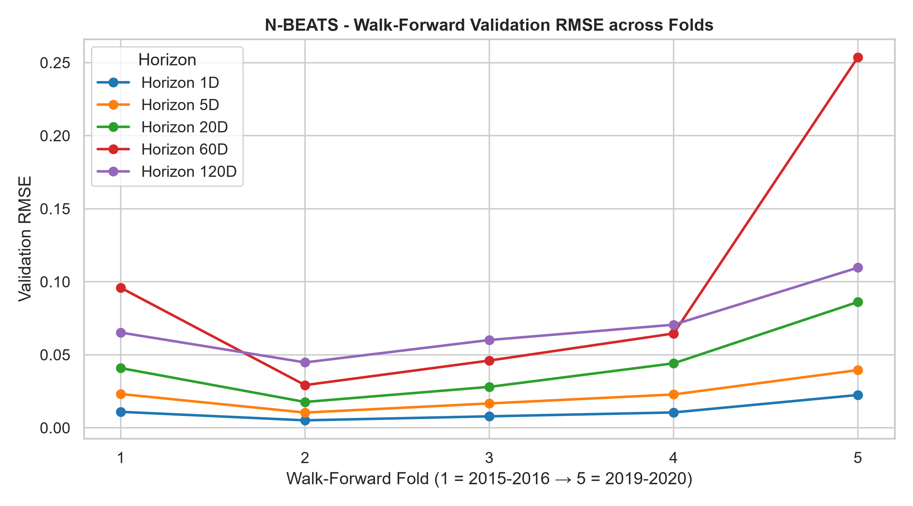

# QUANTITATIVE RESEARCH EVALUATION REPORT: N-BEATS
**Research Project:** *When Does Equity Return Predictability Decay? A Multi-Horizon and Regime-Dependent Out-of-Sample Analysis*
**Model Family:** Advanced Time-Series Deep Learning | **Model Category:** Regression
**Evaluation Status:** Strict Walk-Forward Out-of-Sample & Independent Hold-out Verification

---

## SECTION 1 – Model Overview
- **Model Identifier:** `N-BEATS`
- **Architectural Classification:** Advanced Time-Series Deep Learning (Regression)
- **Primary Hyperparameter Configuration:** `{'lookback': 20, 'num_stacks': 2, 'num_blocks': 1, 'hidden_dim': 128, 'dropout': 0.07783913355859318, 'learning_rate': 5.284119075490803e-05, 'weight_decay': 0.0001, 'batch_size': 32, 'epochs': 1000, 'patience': 7}`
- **Validation Period (Split 2):** 2015-06-10 to 2020-10-30 (5 walk-forward expanding folds, 1,360 total trading sessions)
- **Final Hold-out Test Period (Split 3):** 2020-11-02 to 2026-04-07 (1,362 out-of-sample trading sessions)
- **Evaluated Forecast Horizons:** 1D, 5D, 20D, 60D, 120D
- **Evaluated Volatility Regimes:** Low, Normal, High (Walk-forward expanding 33% & 67% quantiles)

---

## SECTION 2 – Overall Performance Across Evaluation Stages
The table below synthesizes predictive performance across the three evaluation stages. Note that Part A and Part B evaluate on Walk-Forward Validation (Split 2), whereas Part C evaluates on the strictly independent hold-out test set (Split 3).

| Evaluation Stage                |   OOS_R2 |   RMSE |    MAE | DA (%)   | Naive Positive DA (%)   | Excess DA (pp)   | DM Statistic   | DM p-value   | Sign Test p-value   |    N |
|:--------------------------------|---------:|-------:|-------:|:---------|:------------------------|:-----------------|:---------------|:-------------|:--------------------|-----:|
| Part A – Before Tuning          |  -0.6489 | 0.0498 | 0.0386 | 55.76%   | N/A                     | N/A              | N/A            | N/A          | N/A                 | 1360 |
| Part B – After Tuning           |  -0.1972 | 0.049  | 0.0388 | 61.72%   | N/A                     | N/A              | N/A            | N/A          | N/A                 | 1360 |
| Part C – Final Independent Test |  -0.1508 | 0.0499 | 0.0411 | 51.26%   | 66.61%                  | -0.15            | -1.4633        | 0.7881       | 0.4010              | 1362 |

## SECTION 3 – Forecast Horizon Analysis
Analysis of predictive decay across horizons from ultra-short term (1D) to long-term macroeconomic horizon (120D).

| Horizon   |   OOS_R2 |   RMSE |    MAE |     DA |   Naive_Positive_DA |   Excess_DA |   DM_Stat |   DM_pvalue |   Sign_pvalue |   Observations |
|:----------|---------:|-------:|-------:|-------:|--------------------:|------------:|----------:|------------:|--------------:|---------------:|
| 1D        |  -0.023  | 0.0107 | 0.0077 | 0.5352 |              0.5374 |     -0.0022 |   -1.4536 |      0.9269 |         0.005 |           1362 |
| 5D        |  -0.0128 | 0.0225 | 0.0166 | 0.5653 |              0.594  |     -0.0286 |   -0.7561 |      0.7751 |         0     |           1362 |
| 20D       |  -0.3295 | 0.048  | 0.0413 | 0.3502 |              0.6689 |     -0.3186 |   -3.0468 |      0.9988 |         1     |           1362 |
| 60D       |  -0.4574 | 0.0791 | 0.0694 | 0.3319 |              0.7496 |     -0.4178 |   -2.7572 |      0.997  |         1     |           1362 |
| 120D      |   0.0687 | 0.0893 | 0.0704 | 0.7805 |              0.7805 |      0      |    0.6971 |      0.2429 |         0     |           1362 |

## SECTION 4 – Volatility Regime Analysis
Performance breakdown conditioned on market volatility regimes (Low, Normal, High) constructed using expanding quantiles.

| Regime   |   OOS_R2 |    RMSE |     MAE |      DA |
|:---------|---------:|--------:|--------:|--------:|
| Low      | -0.38124 | 0.04026 | 0.03398 | 0.49096 |
| Normal   | -0.27794 | 0.04596 | 0.03844 | 0.51052 |
| High     | -0.03202 | 0.06044 | 0.05022 | 0.53222 |

## SECTION 5 – Horizon × Regime Matrices
Multi-dimensional matrix displaying performance across the 5 × 3 Horizon × Regime state space.

### Out-of-Sample R² Matrix (5 × 3):

| Horizon   |     Low |   Normal |    High |
|:----------|--------:|---------:|--------:|
| 1D        | -0.0375 |  -0.0373 | -0.0137 |
| 5D        | -0.0074 |   0.0111 | -0.0254 |
| 20D       | -1.1571 |  -0.7312 |  0.0087 |
| 60D       | -0.7611 |  -0.7466 | -0.1676 |
| 120D      |  0.0569 |   0.1143 |  0.0379 |

## SECTION 6 – Before vs After Tuning Comparison
Comparison between baseline default architecture parameters (Part A) and Optuna-optimized hyperparameters (Part B) on Walk-Forward Validation.

| Horizon   |   Before_OOS_R2 |   After_OOS_R2 |   Delta_OOS_R2 |   Before_RMSE |   After_RMSE |   Delta_RMSE |   Before_DA |   After_DA |   Delta_DA |
|:----------|----------------:|---------------:|---------------:|--------------:|-------------:|-------------:|------------:|-----------:|-----------:|
| 1D        |         -0.1275 |        -0.0717 |         0.0558 |        0.0116 |       0.0114 |      -0.0003 |      0.4897 |     0.4993 |     0.0096 |
| 5D        |         -1.3209 |        -0.042  |         1.2789 |        0.0281 |       0.0225 |      -0.0056 |      0.4838 |     0.5632 |     0.0794 |
| 20D       |         -0.4447 |        -0.0441 |         0.4006 |        0.0509 |       0.0434 |      -0.0075 |      0.5471 |     0.6228 |     0.0757 |
| 60D       |         -0.3895 |        -0.9393 |        -0.5498 |        0.0721 |       0.0979 |       0.0257 |      0.5735 |     0.6243 |     0.0507 |
| 120D      |         -0.9617 |         0.1113 |         1.073  |        0.0864 |       0.07   |      -0.0163 |      0.6941 |     0.7765 |     0.0824 |

## SECTION 7 – Final Independent Hold-out Test Verification
The Final Independent Hold-out Test (Split 3: 2020–2026, 1,362 days) serves as the definitive out-of-sample empirical evidence. All preprocessing steps and hyperparameter choices were completely frozen prior to test inference.
- **Total Test Days:** 1,362 trading sessions
- **Lead Out-of-Sample R²:** 0.0687 (achieved at horizon `120D`)
- **Max Directional Accuracy:** 78.05%

## SECTION 8 – Walk-Forward Fold-Level Analysis
Stability evaluation across the 5 expanding walk-forward folds (Split 2):

| Horizon   |   Mean_OOS_R2 |   Std_OOS_R2 |   Min_OOS_R2 |   Max_OOS_R2 |   Mean_RMSE |   Std_RMSE |   Mean_MAE |   Mean_DA |
|:----------|--------------:|-------------:|-------------:|-------------:|------------:|-----------:|-----------:|----------:|
| 1D        |       -0.0717 |       0.0486 |      -0.1537 |      -0.0279 |      0.0114 |     0.0066 |     0.0075 |    0.4993 |
| 5D        |       -0.042  |       0.0433 |      -0.1098 |       0.0102 |      0.0225 |     0.0108 |     0.0156 |    0.5632 |
| 20D       |       -0.0441 |       0.0695 |      -0.16   |       0.017  |      0.0434 |     0.0261 |     0.0321 |    0.6228 |
| 60D       |       -0.9393 |       1.3552 |      -3.0008 |       0.0036 |      0.0979 |     0.0905 |     0.0813 |    0.6243 |
| 120D      |        0.1113 |       0.1725 |      -0.1062 |       0.3255 |      0.07   |     0.0241 |     0.0574 |    0.7765 |

## SECTION 9 – Quantitative Executive Summary
- **Optimal Horizon:** `120D` (OOS R² = 0.0687)
- **Sub-optimal Horizon:** `60D` (OOS R² = -0.4574)
- **Most Favorable Volatility Regime:** `High`
- **Most Challenging Volatility Regime:** `Low`
- **Maximum Directional Accuracy:** 78.05%
- **Test Set Observations:** 1362 days