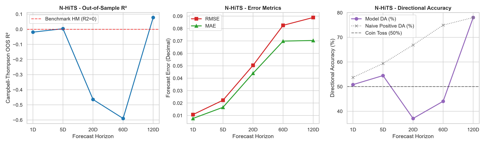
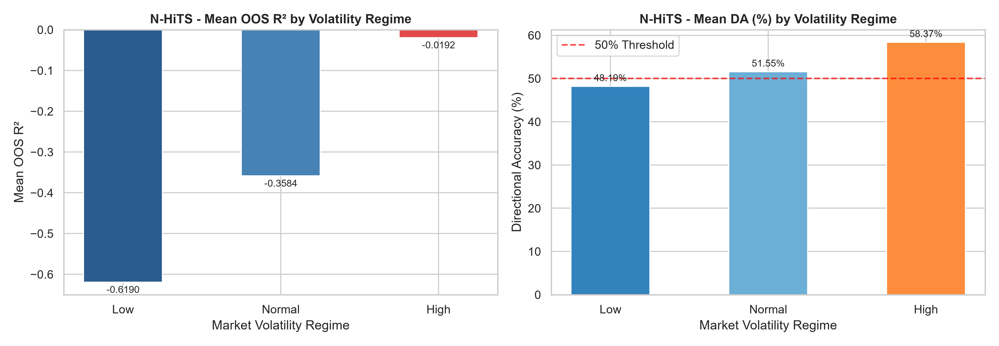
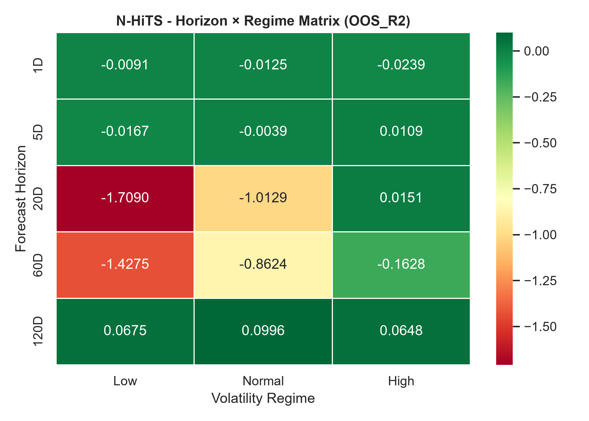
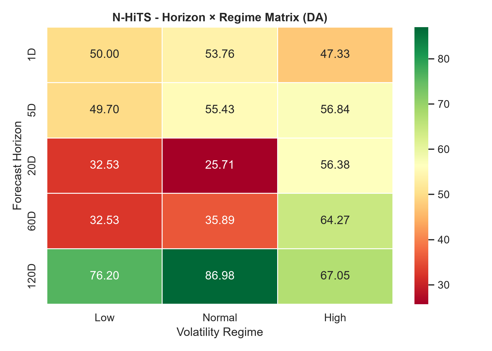
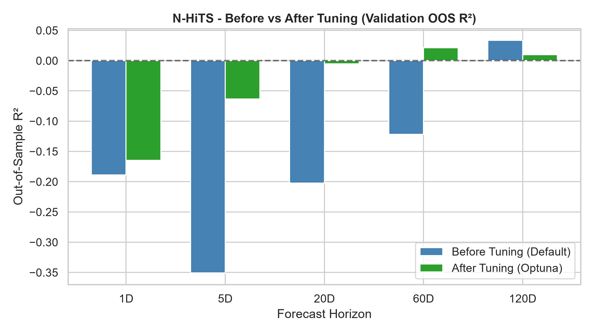
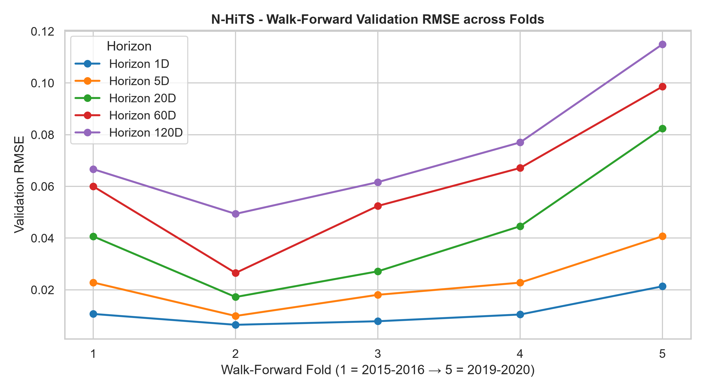

# QUANTITATIVE RESEARCH EVALUATION REPORT: N-HITS
**Research Project:** *When Does Equity Return Predictability Decay? A Multi-Horizon and Regime-Dependent Out-of-Sample Analysis*
**Model Family:** Advanced Time-Series Deep Learning | **Model Category:** Regression
**Evaluation Status:** Strict Walk-Forward Out-of-Sample & Independent Hold-out Verification

---

## SECTION 1 – Model Overview
- **Model Identifier:** `N-HiTS`
- **Architectural Classification:** Advanced Time-Series Deep Learning (Regression)
- **Primary Hyperparameter Configuration:** `{'lookback': 40, 'pooling_kernels': (8, 4, 1), 'num_blocks_per_stack': 1, 'hidden_dim': 64, 'dropout': 0.22701814444901136, 'learning_rate': 1.0838581269344744e-05, 'weight_decay': 0.0001, 'batch_size': 16, 'epochs': 1000, 'patience': 7, 'pooling_mode': 0}`
- **Validation Period (Split 2):** 2015-06-10 to 2020-10-30 (5 walk-forward expanding folds, 1,360 total trading sessions)
- **Final Hold-out Test Period (Split 3):** 2020-11-02 to 2026-04-07 (1,362 out-of-sample trading sessions)
- **Evaluated Forecast Horizons:** 1D, 5D, 20D, 60D, 120D
- **Evaluated Volatility Regimes:** Low, Normal, High (Walk-forward expanding 33% & 67% quantiles)

---

## SECTION 2 – Overall Performance Across Evaluation Stages
The table below synthesizes predictive performance across the three evaluation stages. Note that Part A and Part B evaluate on Walk-Forward Validation (Split 2), whereas Part C evaluates on the strictly independent hold-out test set (Split 3).

| Evaluation Stage                |   OOS_R2 |   RMSE |    MAE | DA (%)   | Naive Positive DA (%)   | Excess DA (pp)   | DM Statistic   | DM p-value   | Sign Test p-value   |    N |
|:--------------------------------|---------:|-------:|-------:|:---------|:------------------------|:-----------------|:---------------|:-------------|:--------------------|-----:|
| Part A – Before Tuning          |  -0.1659 | 0.0446 | 0.034  | 60.63%   | N/A                     | N/A              | N/A            | N/A          | N/A                 | 1360 |
| Part B – After Tuning           |  -0.0403 | 0.0423 | 0.0323 | 64.00%   | N/A                     | N/A              | N/A            | N/A          | N/A                 | 1360 |
| Part C – Final Independent Test |  -0.1983 | 0.051  | 0.0417 | 52.89%   | 66.61%                  | -0.14            | -1.1312        | 0.6908       | 0.4570              | 1362 |

## SECTION 3 – Forecast Horizon Analysis
Analysis of predictive decay across horizons from ultra-short term (1D) to long-term macroeconomic horizon (120D).

| Horizon   |   OOS_R2 |   RMSE |    MAE |     DA |   Naive_Positive_DA |   Excess_DA |   DM_Stat |   DM_pvalue |   Sign_pvalue |   Observations |
|:----------|---------:|-------:|-------:|-------:|--------------------:|------------:|----------:|------------:|--------------:|---------------:|
| 1D        |  -0.019  | 0.0107 | 0.0076 | 0.5081 |              0.5374 |     -0.0294 |   -1.5034 |      0.9335 |        0.2847 |           1362 |
| 5D        |   0.0037 | 0.0223 | 0.0166 | 0.5448 |              0.594  |     -0.0492 |    0.2175 |      0.4139 |        0.0005 |           1362 |
| 20D       |  -0.4644 | 0.0504 | 0.044  | 0.3708 |              0.6689 |     -0.2981 |   -3.5469 |      0.9998 |        1      |           1362 |
| 60D       |  -0.5898 | 0.0826 | 0.0699 | 0.4405 |              0.7496 |     -0.3091 |   -1.9344 |      0.9734 |        1      |           1362 |
| 120D      |   0.0778 | 0.0889 | 0.0704 | 0.7805 |              0.7805 |      0      |    1.111  |      0.1334 |        0      |           1362 |

## SECTION 4 – Volatility Regime Analysis
Performance breakdown conditioned on market volatility regimes (Low, Normal, High) constructed using expanding quantiles.

| Regime   |   OOS_R2 |    RMSE |     MAE |      DA |
|:---------|---------:|--------:|--------:|--------:|
| Low      | -0.61896 | 0.04334 | 0.03652 | 0.48192 |
| Normal   | -0.35842 | 0.04732 | 0.03974 | 0.51554 |
| High     | -0.01918 | 0.05996 | 0.04836 | 0.58374 |

## SECTION 5 – Horizon × Regime Matrices
Multi-dimensional matrix displaying performance across the 5 × 3 Horizon × Regime state space.

### Out-of-Sample R² Matrix (5 × 3):

| Horizon   |     Low |   Normal |    High |
|:----------|--------:|---------:|--------:|
| 1D        | -0.0091 |  -0.0125 | -0.0239 |
| 5D        | -0.0167 |  -0.0039 |  0.0109 |
| 20D       | -1.709  |  -1.0129 |  0.0151 |
| 60D       | -1.4275 |  -0.8624 | -0.1628 |
| 120D      |  0.0675 |   0.0996 |  0.0648 |

## SECTION 6 – Before vs After Tuning Comparison
Comparison between baseline default architecture parameters (Part A) and Optuna-optimized hyperparameters (Part B) on Walk-Forward Validation.

| Horizon   |   Before_OOS_R2 |   After_OOS_R2 |   Delta_OOS_R2 |   Before_RMSE |   After_RMSE |   Delta_RMSE |   Before_DA |   After_DA |   Delta_DA |
|:----------|----------------:|---------------:|---------------:|--------------:|-------------:|-------------:|------------:|-----------:|-----------:|
| 1D        |         -0.1887 |        -0.1645 |         0.0242 |        0.0117 |       0.0114 |      -0.0003 |      0.5257 |     0.5265 |     0.0007 |
| 5D        |         -0.3506 |        -0.0631 |         0.2875 |        0.0246 |       0.0229 |      -0.0017 |      0.4993 |     0.5265 |     0.0272 |
| 20D       |         -0.2023 |        -0.0053 |         0.197  |        0.047  |       0.0424 |      -0.0046 |      0.5632 |     0.6074 |     0.0441 |
| 60D       |         -0.1217 |         0.0215 |         0.1432 |        0.0682 |       0.0609 |      -0.0072 |      0.6985 |     0.7618 |     0.0632 |
| 120D      |          0.0336 |         0.01   |        -0.0237 |        0.0718 |       0.0739 |       0.0021 |      0.7449 |     0.7779 |     0.0331 |

## SECTION 7 – Final Independent Hold-out Test Verification
The Final Independent Hold-out Test (Split 3: 2020–2026, 1,362 days) serves as the definitive out-of-sample empirical evidence. All preprocessing steps and hyperparameter choices were completely frozen prior to test inference.
- **Total Test Days:** 1,362 trading sessions
- **Lead Out-of-Sample R²:** 0.0778 (achieved at horizon `120D`)
- **Max Directional Accuracy:** 78.05%

## SECTION 8 – Walk-Forward Fold-Level Analysis
Stability evaluation across the 5 expanding walk-forward folds (Split 2):

| Horizon   |   Mean_OOS_R2 |   Std_OOS_R2 |   Min_OOS_R2 |   Max_OOS_R2 |   Mean_RMSE |   Std_RMSE |   Mean_MAE |   Mean_DA |
|:----------|--------------:|-------------:|-------------:|-------------:|------------:|-----------:|-----------:|----------:|
| 1D        |       -0.1645 |       0.3068 |      -0.7128 |      -0.0074 |      0.0114 |     0.0059 |     0.0076 |    0.5265 |
| 5D        |       -0.0631 |       0.0935 |      -0.2259 |      -0.001  |      0.0229 |     0.0113 |     0.0158 |    0.5265 |
| 20D       |       -0.0053 |       0.0793 |      -0.0893 |       0.0998 |      0.0424 |     0.0249 |     0.0313 |    0.6074 |
| 60D       |        0.0215 |       0.2732 |      -0.3132 |       0.3953 |      0.0609 |     0.0261 |     0.0467 |    0.7618 |
| 120D      |        0.01   |       0.1551 |      -0.1568 |       0.2579 |      0.0739 |     0.025  |     0.0599 |    0.7779 |

## SECTION 9 – Quantitative Executive Summary
- **Optimal Horizon:** `120D` (OOS R² = 0.0778)
- **Sub-optimal Horizon:** `60D` (OOS R² = -0.5898)
- **Most Favorable Volatility Regime:** `High`
- **Most Challenging Volatility Regime:** `Low`
- **Maximum Directional Accuracy:** 78.05%
- **Test Set Observations:** 1362 days