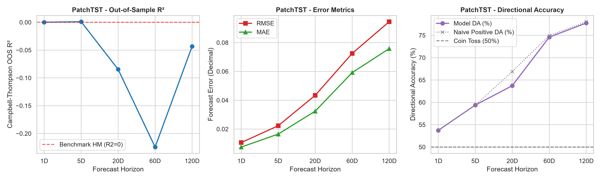
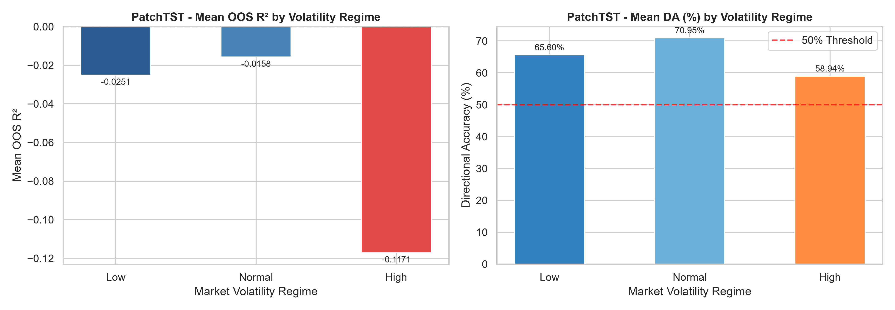
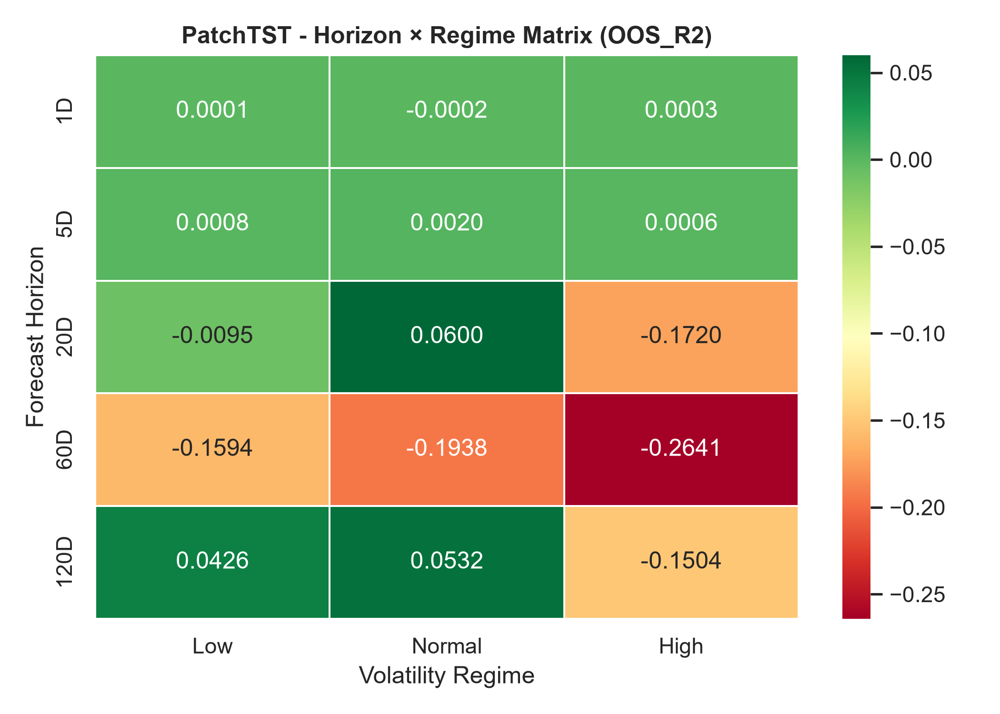
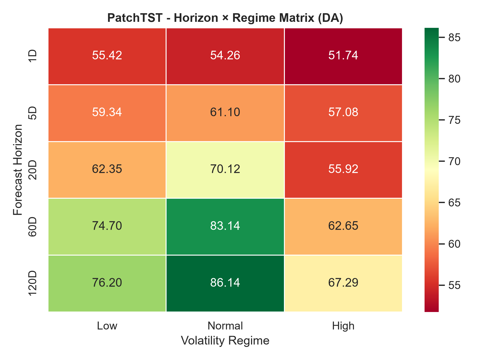
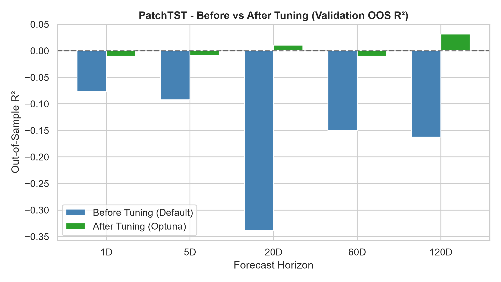
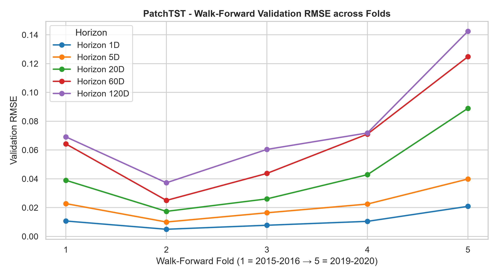

# QUANTITATIVE RESEARCH EVALUATION REPORT: PATCHTST
**Research Project:** *When Does Equity Return Predictability Decay? A Multi-Horizon and Regime-Dependent Out-of-Sample Analysis*
**Model Family:** Advanced Time-Series Deep Learning | **Model Category:** Regression
**Evaluation Status:** Strict Walk-Forward Out-of-Sample & Independent Hold-out Verification

---

## SECTION 1 – Model Overview
- **Model Identifier:** `PatchTST`
- **Architectural Classification:** Advanced Time-Series Deep Learning (Regression)
- **Primary Hyperparameter Configuration:** `{'lookback': 60, 'patch_len': 16, 'stride': 8, 'd_model': 64, 'nhead': 2, 'num_layers': 1, 'dim_feedforward': 128, 'dropout': 0.267057471542213, 'learning_rate': 0.00046996429360211513, 'weight_decay': 0.0001, 'batch_size': 16, 'epochs': 1000, 'patience': 7}`
- **Validation Period (Split 2):** 2015-06-10 to 2020-10-30 (5 walk-forward expanding folds, 1,360 total trading sessions)
- **Final Hold-out Test Period (Split 3):** 2020-11-02 to 2026-04-07 (1,362 out-of-sample trading sessions)
- **Evaluated Forecast Horizons:** 1D, 5D, 20D, 60D, 120D
- **Evaluated Volatility Regimes:** Low, Normal, High (Walk-forward expanding 33% & 67% quantiles)

---

## SECTION 2 – Overall Performance Across Evaluation Stages
The table below synthesizes predictive performance across the three evaluation stages. Note that Part A and Part B evaluate on Walk-Forward Validation (Split 2), whereas Part C evaluates on the strictly independent hold-out test set (Split 3).

| Evaluation Stage                |   OOS_R2 |   RMSE |    MAE | DA (%)   | Naive Positive DA (%)   | Excess DA (pp)   | DM Statistic   | DM p-value   | Sign Test p-value   |    N |
|:--------------------------------|---------:|-------:|-------:|:---------|:------------------------|:-----------------|:---------------|:-------------|:--------------------|-----:|
| Part A – Before Tuning          |  -0.1641 | 0.0457 | 0.0349 | 58.18%   | N/A                     | N/A              | N/A            | N/A          | N/A                 | 1360 |
| Part B – After Tuning           |   0.0027 | 0.0436 | 0.0336 | 66.04%   | N/A                     | N/A              | N/A            | N/A          | N/A                 | 1360 |
| Part C – Final Independent Test |  -0.0703 | 0.0487 | 0.0383 | 65.84%   | 66.61%                  | -0.01            | -0.5444        | 0.8724       | 0.0006              | 1362 |

## SECTION 3 – Forecast Horizon Analysis
Analysis of predictive decay across horizons from ultra-short term (1D) to long-term macroeconomic horizon (120D).

| Horizon   |   OOS_R2 |   RMSE |    MAE |     DA |   Naive_Positive_DA |   Excess_DA |   DM_Stat |   DM_pvalue |   Sign_pvalue |   Observations |
|:----------|---------:|-------:|-------:|-------:|--------------------:|------------:|----------:|------------:|--------------:|---------------:|
| 1D        |   0.0001 | 0.0106 | 0.0075 | 0.5374 |              0.5374 |      0      |    0      |      1      |        0.0031 |           1362 |
| 5D        |   0.001  | 0.0223 | 0.0165 | 0.594  |              0.594  |      0      |    0      |      1      |        0      |           1362 |
| 20D       |  -0.0847 | 0.0434 | 0.0324 | 0.6373 |              0.6689 |     -0.0316 |   -0.7985 |      0.7877 |        0      |           1362 |
| 60D       |  -0.2243 | 0.0725 | 0.0592 | 0.746  |              0.7496 |     -0.0037 |   -1.5904 |      0.944  |        0      |           1362 |
| 120D      |  -0.0434 | 0.0945 | 0.0758 | 0.7775 |              0.7805 |     -0.0029 |   -0.3331 |      0.6304 |        0      |           1362 |

## SECTION 4 – Volatility Regime Analysis
Performance breakdown conditioned on market volatility regimes (Low, Normal, High) constructed using expanding quantiles.

| Regime   |   OOS_R2 |    RMSE |     MAE |      DA |
|:---------|---------:|--------:|--------:|--------:|
| Low      | -0.02508 | 0.03542 | 0.02964 | 0.65602 |
| Normal   | -0.01576 | 0.04134 | 0.0336  | 0.70952 |
| High     | -0.11712 | 0.06412 | 0.0515  | 0.58936 |

## SECTION 5 – Horizon × Regime Matrices
Multi-dimensional matrix displaying performance across the 5 × 3 Horizon × Regime state space.

### Out-of-Sample R² Matrix (5 × 3):

| Horizon   |     Low |   Normal |    High |
|:----------|--------:|---------:|--------:|
| 1D        |  0.0001 |  -0.0002 |  0.0003 |
| 5D        |  0.0008 |   0.002  |  0.0006 |
| 20D       | -0.0095 |   0.06   | -0.172  |
| 60D       | -0.1594 |  -0.1938 | -0.2641 |
| 120D      |  0.0426 |   0.0532 | -0.1504 |

## SECTION 6 – Before vs After Tuning Comparison
Comparison between baseline default architecture parameters (Part A) and Optuna-optimized hyperparameters (Part B) on Walk-Forward Validation.

| Horizon   |   Before_OOS_R2 |   After_OOS_R2 |   Delta_OOS_R2 |   Before_RMSE |   After_RMSE |   Delta_RMSE |   Before_DA |   After_DA |   Delta_DA |
|:----------|----------------:|---------------:|---------------:|--------------:|-------------:|-------------:|------------:|-----------:|-----------:|
| 1D        |         -0.0772 |        -0.01   |         0.0672 |        0.0112 |       0.0109 |      -0.0003 |      0.5243 |     0.5382 |     0.014  |
| 5D        |         -0.0922 |        -0.0087 |         0.0835 |        0.0232 |       0.0223 |      -0.0009 |      0.5522 |     0.5971 |     0.0449 |
| 20D       |         -0.3383 |         0.0108 |         0.3491 |        0.0483 |       0.0428 |      -0.0055 |      0.5544 |     0.6824 |     0.1279 |
| 60D       |         -0.1504 |        -0.0102 |         0.1402 |        0.0687 |       0.0658 |      -0.003  |      0.6404 |     0.7191 |     0.0787 |
| 120D      |         -0.1625 |         0.0316 |         0.1941 |        0.0768 |       0.0762 |      -0.0006 |      0.6375 |     0.7654 |     0.1279 |

## SECTION 7 – Final Independent Hold-out Test Verification
The Final Independent Hold-out Test (Split 3: 2020–2026, 1,362 days) serves as the definitive out-of-sample empirical evidence. All preprocessing steps and hyperparameter choices were completely frozen prior to test inference.
- **Total Test Days:** 1,362 trading sessions
- **Lead Out-of-Sample R²:** 0.0010 (achieved at horizon `5D`)
- **Max Directional Accuracy:** 77.75%

## SECTION 8 – Walk-Forward Fold-Level Analysis
Stability evaluation across the 5 expanding walk-forward folds (Split 2):

| Horizon   |   Mean_OOS_R2 |   Std_OOS_R2 |   Min_OOS_R2 |   Max_OOS_R2 |   Mean_RMSE |   Std_RMSE |   Mean_MAE |   Mean_DA |
|:----------|--------------:|-------------:|-------------:|-------------:|------------:|-----------:|-----------:|----------:|
| 1D        |       -0.01   |       0.0157 |      -0.0353 |       0.0035 |      0.0109 |     0.006  |     0.0072 |    0.5382 |
| 5D        |       -0.0087 |       0.0088 |      -0.0227 |       0.0016 |      0.0223 |     0.0111 |     0.0156 |    0.5971 |
| 20D       |        0.0108 |       0.0472 |      -0.0491 |       0.0814 |      0.0428 |     0.0277 |     0.0309 |    0.6824 |
| 60D       |       -0.0102 |       0.2114 |      -0.2452 |       0.2706 |      0.0658 |     0.0376 |     0.0526 |    0.7191 |
| 120D      |        0.0316 |       0.2688 |      -0.2443 |       0.4462 |      0.0762 |     0.0395 |     0.0616 |    0.7654 |

## SECTION 9 – Quantitative Executive Summary
- **Optimal Horizon:** `5D` (OOS R² = 0.0010)
- **Sub-optimal Horizon:** `60D` (OOS R² = -0.2243)
- **Most Favorable Volatility Regime:** `Normal`
- **Most Challenging Volatility Regime:** `High`
- **Maximum Directional Accuracy:** 77.75%
- **Test Set Observations:** 1362 days