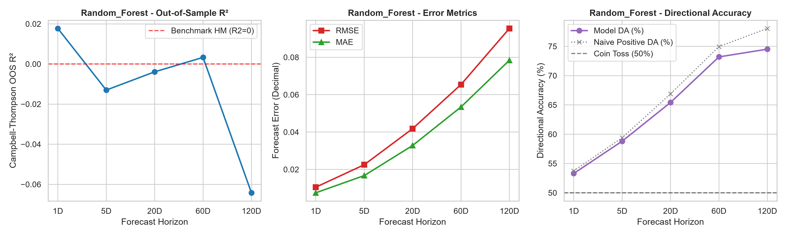
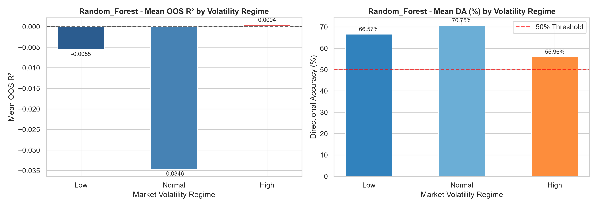
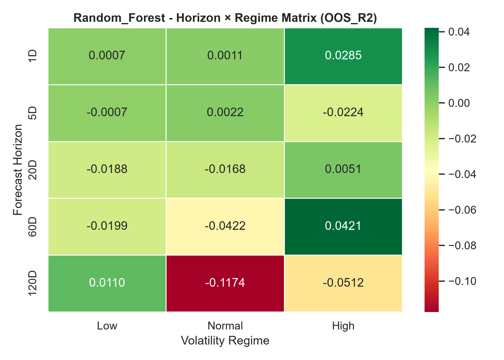
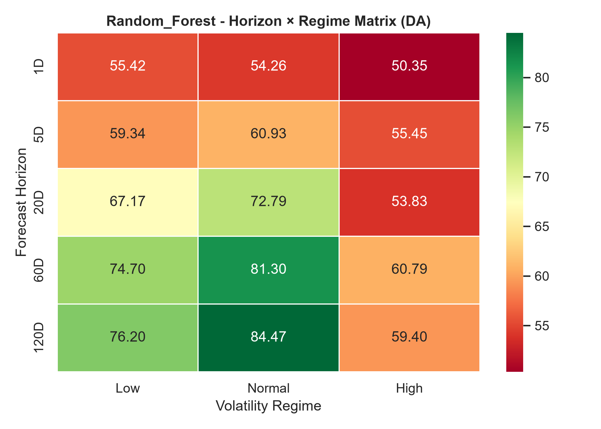
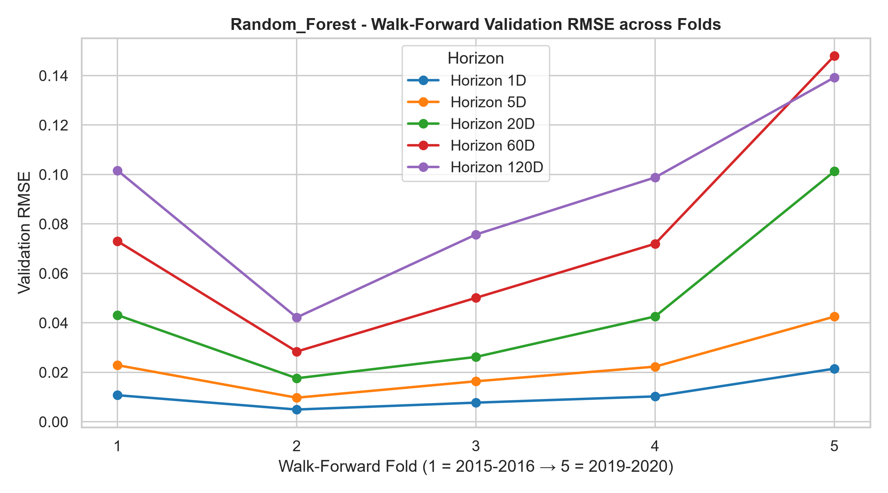

# QUANTITATIVE RESEARCH EVALUATION REPORT: RANDOM_FOREST
**Research Project:** *When Does Equity Return Predictability Decay? A Multi-Horizon and Regime-Dependent Out-of-Sample Analysis*
**Model Family:** Kernel & Tree-based ML | **Model Category:** Regression
**Evaluation Status:** Strict Walk-Forward Out-of-Sample & Independent Hold-out Verification

---

## SECTION 1 – Model Overview
- **Model Identifier:** `Random_Forest`
- **Architectural Classification:** Kernel & Tree-based ML (Regression)
- **Primary Hyperparameter Configuration:** `{'n_estimators': 200, 'max_depth': 10, 'min_samples_split': 2, 'min_samples_leaf': 5, 'max_features': 0.5}`
- **Validation Period (Split 2):** 2015-06-10 to 2020-10-30 (5 walk-forward expanding folds, 1,360 total trading sessions)
- **Final Hold-out Test Period (Split 3):** 2020-11-02 to 2026-04-07 (1,362 out-of-sample trading sessions)
- **Evaluated Forecast Horizons:** 1D, 5D, 20D, 60D, 120D
- **Evaluated Volatility Regimes:** Low, Normal, High (Walk-forward expanding 33% & 67% quantiles)

---

## SECTION 2 – Overall Performance Across Evaluation Stages
The table below synthesizes predictive performance across the three evaluation stages. Note that Part A and Part B evaluate on Walk-Forward Validation (Split 2), whereas Part C evaluates on the strictly independent hold-out test set (Split 3).

| Evaluation Stage                | OOS_R2   | RMSE   | MAE    | DA (%)   | Naive Positive DA (%)   | Excess DA (pp)   | DM Statistic   | DM p-value   | Sign Test p-value   | N    |
|:--------------------------------|:---------|:-------|:-------|:---------|:------------------------|:-----------------|:---------------|:-------------|:--------------------|:-----|
| Part A – Before Tuning          | N/A      | N/A    | N/A    | N/A      | 54.00%                  | 0.00             | N/A            | N/A          | N/A                 | N/A  |
| Part B – After Tuning           | -0.1900  | 0.0491 | 0.0381 | 59.72%   | N/A                     | N/A              | N/A            | N/A          | N/A                 | 1360 |
| Part C – Final Independent Test | -0.0120  | 0.0471 | 0.0378 | 65.05%   | 66.61%                  | -0.02            | -0.1313        | 0.5544       | 0.0016              | 1362 |

## SECTION 3 – Forecast Horizon Analysis
Analysis of predictive decay across horizons from ultra-short term (1D) to long-term macroeconomic horizon (120D).

| Horizon   |   OOS_R2 |   RMSE |    MAE |     DA |   Naive_Positive_DA |   Excess_DA |   DM_Stat |   DM_pvalue |   Sign_pvalue |   Observations |
|:----------|---------:|-------:|-------:|-------:|--------------------:|------------:|----------:|------------:|--------------:|---------------:|
| 1D        |   0.0177 | 0.0105 | 0.0075 | 0.533  |              0.5374 |     -0.0044 |    1.2868 |      0.0992 |        0.0079 |           1362 |
| 5D        |  -0.013  | 0.0225 | 0.0167 | 0.5881 |              0.594  |     -0.0059 |   -0.818  |      0.7932 |        0      |           1362 |
| 20D       |  -0.0039 | 0.0418 | 0.0328 | 0.6542 |              0.6689 |     -0.0147 |   -0.1714 |      0.568  |        0      |           1362 |
| 60D       |   0.0033 | 0.0654 | 0.0534 | 0.732  |              0.7496 |     -0.0176 |    0.1159 |      0.4539 |        0      |           1362 |
| 120D      |  -0.0642 | 0.0954 | 0.0784 | 0.7452 |              0.7805 |     -0.0352 |   -1.0696 |      0.8575 |        0      |           1362 |

## SECTION 4 – Volatility Regime Analysis
Performance breakdown conditioned on market volatility regimes (Low, Normal, High) constructed using expanding quantiles.

| Regime   |   OOS_R2 |    RMSE |     MAE |      DA |
|:---------|---------:|--------:|--------:|--------:|
| Low      | -0.00554 | 0.03506 | 0.02916 | 0.66566 |
| Normal   | -0.03462 | 0.0422  | 0.03424 | 0.7075  |
| High     |  0.00042 | 0.05972 | 0.04926 | 0.55964 |

## SECTION 5 – Horizon × Regime Matrices
Multi-dimensional matrix displaying performance across the 5 × 3 Horizon × Regime state space.

### Out-of-Sample R² Matrix (5 × 3):

| Horizon   |     Low |   Normal |    High |
|:----------|--------:|---------:|--------:|
| 1D        |  0.0007 |   0.0011 |  0.0285 |
| 5D        | -0.0007 |   0.0022 | -0.0224 |
| 20D       | -0.0188 |  -0.0168 |  0.0051 |
| 60D       | -0.0199 |  -0.0422 |  0.0421 |
| 120D      |  0.011  |  -0.1174 | -0.0512 |

## SECTION 6 – Before vs After Tuning Comparison
> [!NOTE]
> **Single Tuned Workflow Execution:** Traditional models in this research suite were tuned directly during Walk-Forward Validation (Lan01) using cross-validated Grid Search and Optuna TPE. A separate un-tuned baseline run was not persisted in the repository archives.

## SECTION 7 – Final Independent Hold-out Test Verification
The Final Independent Hold-out Test (Split 3: 2020–2026, 1,362 days) serves as the definitive out-of-sample empirical evidence. All preprocessing steps and hyperparameter choices were completely frozen prior to test inference.
- **Total Test Days:** 1,362 trading sessions
- **Lead Out-of-Sample R²:** 0.0177 (achieved at horizon `1D`)
- **Max Directional Accuracy:** 74.52%

## SECTION 8 – Walk-Forward Fold-Level Analysis
Stability evaluation across the 5 expanding walk-forward folds (Split 2):

| Horizon   |   Mean_OOS_R2 |   Std_OOS_R2 |   Min_OOS_R2 |   Max_OOS_R2 |   Mean_RMSE |   Std_RMSE |   Mean_MAE |   Mean_DA |
|:----------|--------------:|-------------:|-------------:|-------------:|------------:|-----------:|-----------:|----------:|
| 1D        |       -0.0126 |       0.0251 |      -0.0535 |       0.0055 |      0.011  |     0.0063 |     0.0072 |    0.5404 |
| 5D        |       -0.0235 |       0.0703 |      -0.1462 |       0.0312 |      0.0227 |     0.0123 |     0.016  |    0.5904 |
| 20D       |       -0.097  |       0.1569 |      -0.3595 |       0.0184 |      0.0462 |     0.0327 |     0.0345 |    0.6235 |
| 60D       |       -0.2647 |       0.2221 |      -0.5437 |       0.0602 |      0.0743 |     0.0451 |     0.0588 |    0.6125 |
| 120D      |       -0.5522 |       0.7469 |      -1.6893 |       0.2894 |      0.0915 |     0.0358 |     0.0738 |    0.6191 |

## SECTION 9 – Quantitative Executive Summary
- **Optimal Horizon:** `1D` (OOS R² = 0.0177)
- **Sub-optimal Horizon:** `120D` (OOS R² = -0.0642)
- **Most Favorable Volatility Regime:** `High`
- **Most Challenging Volatility Regime:** `Normal`
- **Maximum Directional Accuracy:** 74.52%
- **Test Set Observations:** 1362 days