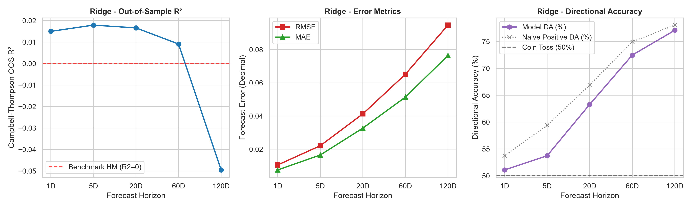
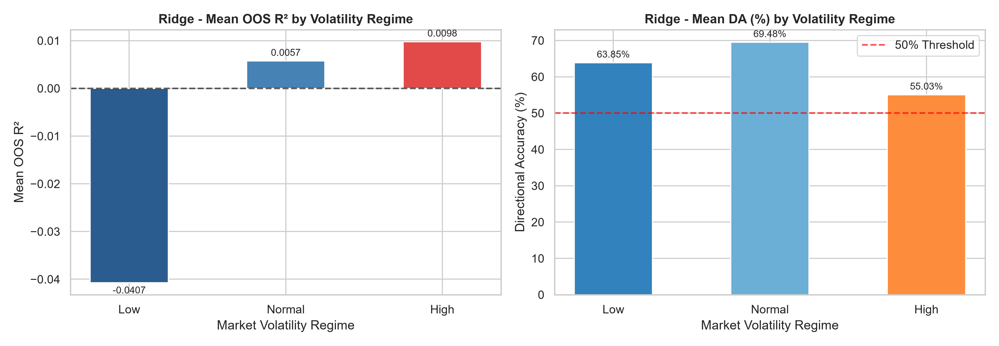
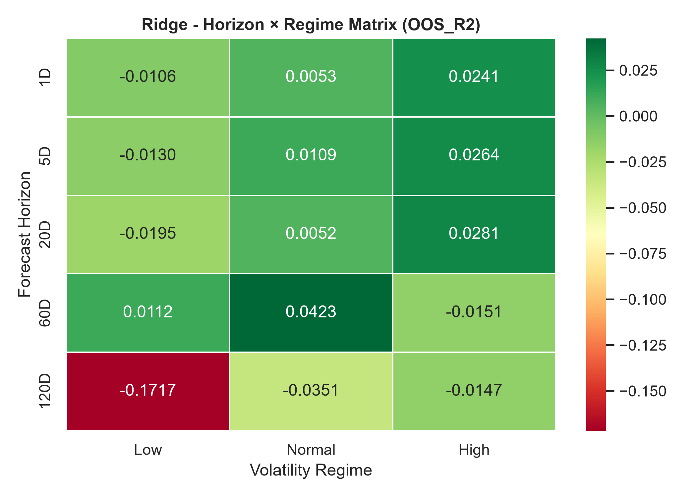
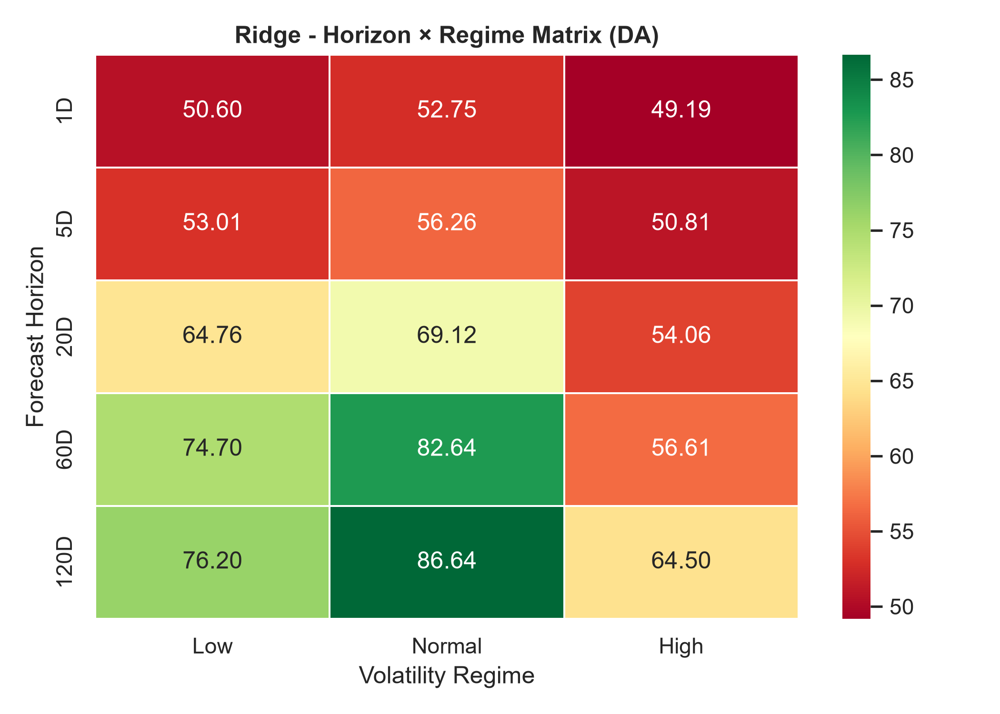
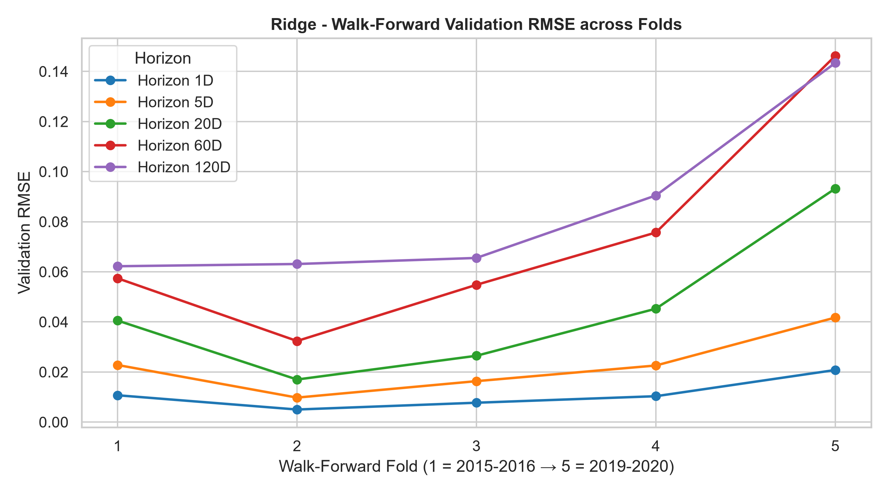

# QUANTITATIVE RESEARCH EVALUATION REPORT: RIDGE
**Research Project:** *When Does Equity Return Predictability Decay? A Multi-Horizon and Regime-Dependent Out-of-Sample Analysis*
**Model Family:** Linear Models | **Model Category:** Regression
**Evaluation Status:** Strict Walk-Forward Out-of-Sample & Independent Hold-out Verification

---

## SECTION 1 – Model Overview
- **Model Identifier:** `Ridge`
- **Architectural Classification:** Linear Models (Regression)
- **Primary Hyperparameter Configuration:** `{'alpha': 100}`
- **Validation Period (Split 2):** 2015-06-10 to 2020-10-30 (5 walk-forward expanding folds, 1,360 total trading sessions)
- **Final Hold-out Test Period (Split 3):** 2020-11-02 to 2026-04-07 (1,362 out-of-sample trading sessions)
- **Evaluated Forecast Horizons:** 1D, 5D, 20D, 60D, 120D
- **Evaluated Volatility Regimes:** Low, Normal, High (Walk-forward expanding 33% & 67% quantiles)

---

## SECTION 2 – Overall Performance Across Evaluation Stages
The table below synthesizes predictive performance across the three evaluation stages. Note that Part A and Part B evaluate on Walk-Forward Validation (Split 2), whereas Part C evaluates on the strictly independent hold-out test set (Split 3).

| Evaluation Stage                | OOS_R2   | RMSE   | MAE    | DA (%)   | Naive Positive DA (%)   | Excess DA (pp)   | DM Statistic   | DM p-value   | Sign Test p-value   | N    |
|:--------------------------------|:---------|:-------|:-------|:---------|:------------------------|:-----------------|:---------------|:-------------|:--------------------|:-----|
| Part A – Before Tuning          | N/A      | N/A    | N/A    | N/A      | 54.00%                  | 0.00             | N/A            | N/A          | N/A                 | N/A  |
| Part B – After Tuning           | -0.1226  | 0.0473 | 0.0372 | 55.78%   | N/A                     | N/A              | N/A            | N/A          | N/A                 | 1360 |
| Part C – Final Independent Test | 0.0018   | 0.0468 | 0.0369 | 63.54%   | 66.61%                  | -0.03            | 0.5818         | 0.3137       | 0.0438              | 1362 |

## SECTION 3 – Forecast Horizon Analysis
Analysis of predictive decay across horizons from ultra-short term (1D) to long-term macroeconomic horizon (120D).

| Horizon   |   OOS_R2 |   RMSE |    MAE |     DA |   Naive_Positive_DA |   Excess_DA |   DM_Stat |   DM_pvalue |   Sign_pvalue |   Observations |
|:----------|---------:|-------:|-------:|-------:|--------------------:|------------:|----------:|------------:|--------------:|---------------:|
| 1D        |   0.015  | 0.0105 | 0.0075 | 0.511  |              0.5374 |     -0.0264 |    1.0719 |      0.142  |        0.216  |           1362 |
| 5D        |   0.0179 | 0.0221 | 0.0165 | 0.5374 |              0.594  |     -0.0565 |    1.3682 |      0.0857 |        0.0031 |           1362 |
| 20D       |   0.0166 | 0.0413 | 0.0327 | 0.6329 |              0.6689 |     -0.036  |    0.8672 |      0.193  |        0      |           1362 |
| 60D       |   0.0091 | 0.0652 | 0.0514 | 0.7247 |              0.7496 |     -0.025  |    0.1648 |      0.4346 |        0      |           1362 |
| 120D      |  -0.0495 | 0.0948 | 0.0765 | 0.7709 |              0.7805 |     -0.0095 |   -0.5629 |      0.7132 |        0      |           1362 |

## SECTION 4 – Volatility Regime Analysis
Performance breakdown conditioned on market volatility regimes (Low, Normal, High) constructed using expanding quantiles.

| Regime   |   OOS_R2 |    RMSE |     MAE |      DA |
|:---------|---------:|--------:|--------:|--------:|
| Low      | -0.04072 | 0.03632 | 0.02952 | 0.63854 |
| Normal   |  0.00572 | 0.04092 | 0.03272 | 0.69482 |
| High     |  0.00976 | 0.05948 | 0.04852 | 0.55034 |

## SECTION 5 – Horizon × Regime Matrices
Multi-dimensional matrix displaying performance across the 5 × 3 Horizon × Regime state space.

### Out-of-Sample R² Matrix (5 × 3):

| Horizon   |     Low |   Normal |    High |
|:----------|--------:|---------:|--------:|
| 1D        | -0.0106 |   0.0053 |  0.0241 |
| 5D        | -0.013  |   0.0109 |  0.0264 |
| 20D       | -0.0195 |   0.0052 |  0.0281 |
| 60D       |  0.0112 |   0.0423 | -0.0151 |
| 120D      | -0.1717 |  -0.0351 | -0.0147 |

## SECTION 6 – Before vs After Tuning Comparison
> [!NOTE]
> **Single Tuned Workflow Execution:** Traditional models in this research suite were tuned directly during Walk-Forward Validation (Lan01) using cross-validated Grid Search and Optuna TPE. A separate un-tuned baseline run was not persisted in the repository archives.

## SECTION 7 – Final Independent Hold-out Test Verification
The Final Independent Hold-out Test (Split 3: 2020–2026, 1,362 days) serves as the definitive out-of-sample empirical evidence. All preprocessing steps and hyperparameter choices were completely frozen prior to test inference.
- **Total Test Days:** 1,362 trading sessions
- **Lead Out-of-Sample R²:** 0.0179 (achieved at horizon `5D`)
- **Max Directional Accuracy:** 77.09%

## SECTION 8 – Walk-Forward Fold-Level Analysis
Stability evaluation across the 5 expanding walk-forward folds (Split 2):

| Horizon   |   Mean_OOS_R2 |   Std_OOS_R2 |   Min_OOS_R2 |   Max_OOS_R2 |   Mean_RMSE |   Std_RMSE |   Mean_MAE |   Mean_DA |
|:----------|--------------:|-------------:|-------------:|-------------:|------------:|-----------:|-----------:|----------:|
| 1D        |       -0.0068 |       0.0158 |      -0.027  |       0.012  |      0.0109 |     0.006  |     0.0072 |    0.5147 |
| 5D        |       -0.02   |       0.0495 |      -0.1048 |       0.0227 |      0.0226 |     0.0119 |     0.0161 |    0.5015 |
| 20D       |       -0.045  |       0.087  |      -0.1519 |       0.0645 |      0.0445 |     0.0295 |     0.0338 |    0.5581 |
| 60D       |       -0.2707 |       0.1958 |      -0.4344 |       0.0462 |      0.0733 |     0.0436 |     0.0592 |    0.5581 |
| 120D      |       -0.2704 |       0.2255 |      -0.5904 |      -0.0077 |      0.0849 |     0.0347 |     0.0697 |    0.6566 |

## SECTION 9 – Quantitative Executive Summary
- **Optimal Horizon:** `5D` (OOS R² = 0.0179)
- **Sub-optimal Horizon:** `120D` (OOS R² = -0.0495)
- **Most Favorable Volatility Regime:** `High`
- **Most Challenging Volatility Regime:** `Low`
- **Maximum Directional Accuracy:** 77.09%
- **Test Set Observations:** 1362 days