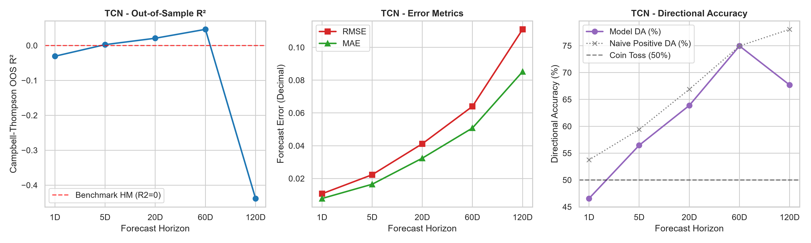
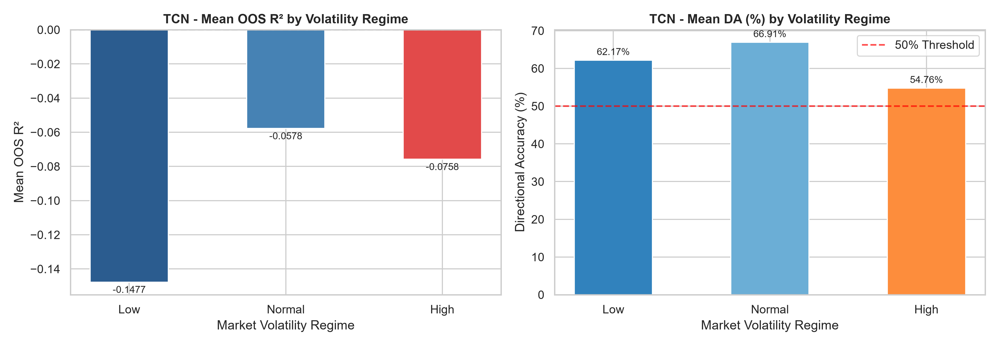
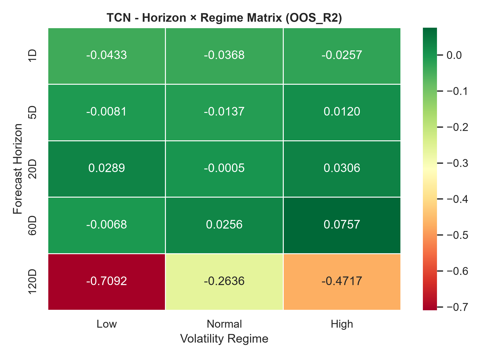
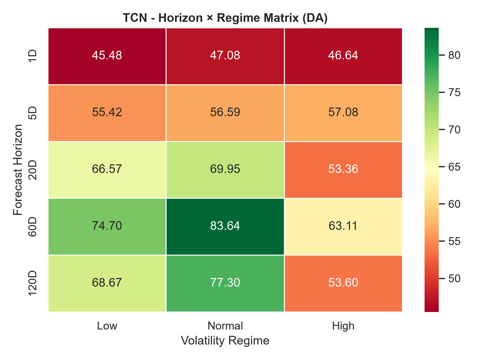
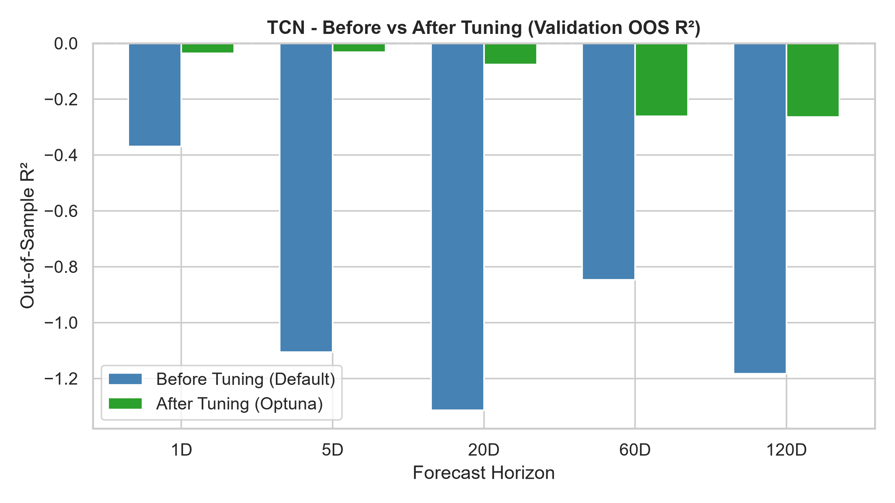
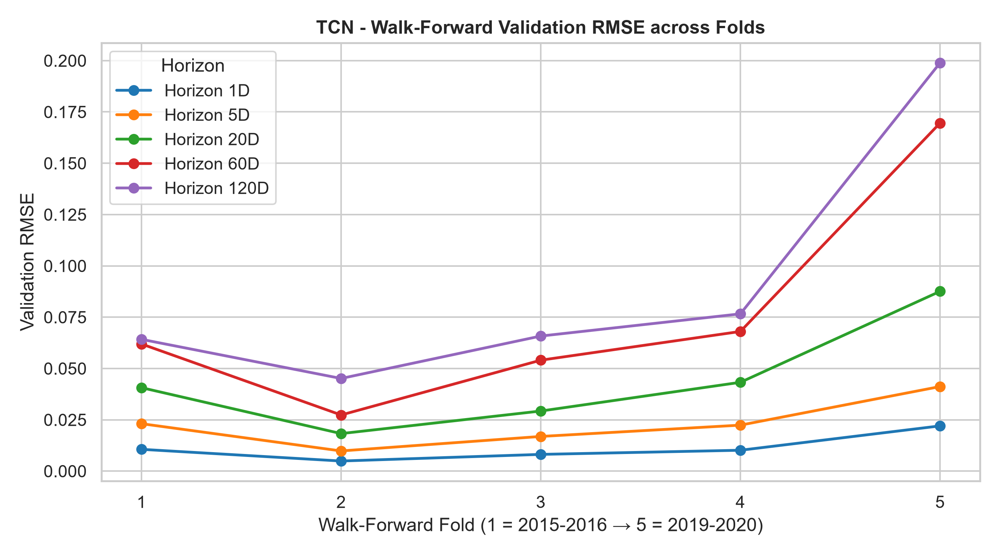

# QUANTITATIVE RESEARCH EVALUATION REPORT: TCN
**Research Project:** *When Does Equity Return Predictability Decay? A Multi-Horizon and Regime-Dependent Out-of-Sample Analysis*
**Model Family:** Advanced Time-Series Deep Learning | **Model Category:** Regression
**Evaluation Status:** Strict Walk-Forward Out-of-Sample & Independent Hold-out Verification

---

## SECTION 1 – Model Overview
- **Model Identifier:** `TCN`
- **Architectural Classification:** Advanced Time-Series Deep Learning (Regression)
- **Primary Hyperparameter Configuration:** `{'lookback': 20, 'hidden_size': 32, 'num_levels': 3, 'kernel_size': 3, 'dropout': 0.2559612698728292, 'learning_rate': 0.0002588496894717813, 'weight_decay': 0.0001, 'batch_size': 32, 'epochs': 1000, 'patience': 7, 'num_channels': [32, 32, 32]}`
- **Validation Period (Split 2):** 2015-06-10 to 2020-10-30 (5 walk-forward expanding folds, 1,360 total trading sessions)
- **Final Hold-out Test Period (Split 3):** 2020-11-02 to 2026-04-07 (1,362 out-of-sample trading sessions)
- **Evaluated Forecast Horizons:** 1D, 5D, 20D, 60D, 120D
- **Evaluated Volatility Regimes:** Low, Normal, High (Walk-forward expanding 33% & 67% quantiles)

---

## SECTION 2 – Overall Performance Across Evaluation Stages
The table below synthesizes predictive performance across the three evaluation stages. Note that Part A and Part B evaluate on Walk-Forward Validation (Split 2), whereas Part C evaluates on the strictly independent hold-out test set (Split 3).

| Evaluation Stage                |   OOS_R2 |   RMSE |    MAE | DA (%)   | Naive Positive DA (%)   | Excess DA (pp)   | DM Statistic   | DM p-value   | Sign Test p-value   |    N |
|:--------------------------------|---------:|-------:|-------:|:---------|:------------------------|:-----------------|:---------------|:-------------|:--------------------|-----:|
| Part A – Before Tuning          |  -0.9639 | 0.0637 | 0.0475 | 53.99%   | N/A                     | N/A              | N/A            | N/A          | N/A                 | 1360 |
| Part B – After Tuning           |  -0.1342 | 0.0488 | 0.0381 | 59.00%   | N/A                     | N/A              | N/A            | N/A          | N/A                 | 1360 |
| Part C – Final Independent Test |  -0.08   | 0.0498 | 0.0385 | 61.91%   | 66.61%                  | -0.05            | -0.5661        | 0.5932       | 0.1990              | 1362 |

## SECTION 3 – Forecast Horizon Analysis
Analysis of predictive decay across horizons from ultra-short term (1D) to long-term macroeconomic horizon (120D).

| Horizon   |   OOS_R2 |   RMSE |    MAE |     DA |   Naive_Positive_DA |   Excess_DA |   DM_Stat |   DM_pvalue |   Sign_pvalue |   Observations |
|:----------|---------:|-------:|-------:|-------:|--------------------:|------------:|----------:|------------:|--------------:|---------------:|
| 1D        |  -0.0308 | 0.0107 | 0.0078 | 0.4655 |              0.5374 |     -0.072  |   -2.2647 |      0.9882 |         0.995 |           1362 |
| 5D        |   0.0024 | 0.0223 | 0.0165 | 0.5646 |              0.594  |     -0.0294 |    0.0992 |      0.4605 |         0     |           1362 |
| 20D       |   0.0207 | 0.0412 | 0.0324 | 0.6388 |              0.6689 |     -0.0301 |    0.5687 |      0.2848 |         0     |           1362 |
| 60D       |   0.0462 | 0.064  | 0.0508 | 0.7496 |              0.7496 |      0      |    0.6326 |      0.2635 |         0     |           1362 |
| 120D      |  -0.4383 | 0.111  | 0.0852 | 0.6769 |              0.7805 |     -0.1035 |   -1.8664 |      0.9689 |         0     |           1362 |

## SECTION 4 – Volatility Regime Analysis
Performance breakdown conditioned on market volatility regimes (Low, Normal, High) constructed using expanding quantiles.

| Regime   |   OOS_R2 |    RMSE |     MAE |      DA |
|:---------|---------:|--------:|--------:|--------:|
| Low      | -0.1477  | 0.03982 | 0.03066 | 0.62168 |
| Normal   | -0.0578  | 0.0429  | 0.03318 | 0.66912 |
| High     | -0.07582 | 0.06346 | 0.05204 | 0.54758 |

## SECTION 5 – Horizon × Regime Matrices
Multi-dimensional matrix displaying performance across the 5 × 3 Horizon × Regime state space.

### Out-of-Sample R² Matrix (5 × 3):

| Horizon   |     Low |   Normal |    High |
|:----------|--------:|---------:|--------:|
| 1D        | -0.0433 |  -0.0368 | -0.0257 |
| 5D        | -0.0081 |  -0.0137 |  0.012  |
| 20D       |  0.0289 |  -0.0005 |  0.0306 |
| 60D       | -0.0068 |   0.0256 |  0.0757 |
| 120D      | -0.7092 |  -0.2636 | -0.4717 |

## SECTION 6 – Before vs After Tuning Comparison
Comparison between baseline default architecture parameters (Part A) and Optuna-optimized hyperparameters (Part B) on Walk-Forward Validation.

| Horizon   |   Before_OOS_R2 |   After_OOS_R2 |   Delta_OOS_R2 |   Before_RMSE |   After_RMSE |   Delta_RMSE |   Before_DA |   After_DA |   Delta_DA |
|:----------|----------------:|---------------:|---------------:|--------------:|-------------:|-------------:|------------:|-----------:|-----------:|
| 1D        |         -0.3701 |        -0.0361 |         0.334  |        0.0124 |       0.0112 |      -0.0012 |      0.5154 |     0.5    |    -0.0154 |
| 5D        |         -1.1056 |        -0.0326 |         1.073  |        0.0332 |       0.0227 |      -0.0105 |      0.4824 |     0.5404 |     0.0581 |
| 20D       |         -1.3135 |        -0.0757 |         1.2378 |        0.0692 |       0.0438 |      -0.0254 |      0.5338 |     0.6154 |     0.0816 |
| 60D       |         -0.8465 |        -0.2618 |         0.5847 |        0.0898 |       0.0762 |      -0.0136 |      0.5772 |     0.6007 |     0.0235 |
| 120D      |         -1.1838 |        -0.2648 |         0.919  |        0.1139 |       0.0901 |      -0.0237 |      0.5904 |     0.6934 |     0.1029 |

## SECTION 7 – Final Independent Hold-out Test Verification
The Final Independent Hold-out Test (Split 3: 2020–2026, 1,362 days) serves as the definitive out-of-sample empirical evidence. All preprocessing steps and hyperparameter choices were completely frozen prior to test inference.
- **Total Test Days:** 1,362 trading sessions
- **Lead Out-of-Sample R²:** 0.0462 (achieved at horizon `60D`)
- **Max Directional Accuracy:** 74.96%

## SECTION 8 – Walk-Forward Fold-Level Analysis
Stability evaluation across the 5 expanding walk-forward folds (Split 2):

| Horizon   |   Mean_OOS_R2 |   Std_OOS_R2 |   Min_OOS_R2 |   Max_OOS_R2 |   Mean_RMSE |   Std_RMSE |   Mean_MAE |   Mean_DA |
|:----------|--------------:|-------------:|-------------:|-------------:|------------:|-----------:|-----------:|----------:|
| 1D        |       -0.0361 |       0.0655 |      -0.1092 |       0.0204 |      0.0112 |     0.0065 |     0.0074 |    0.5    |
| 5D        |       -0.0326 |       0.0398 |      -0.0761 |       0.0113 |      0.0227 |     0.0116 |     0.0157 |    0.5404 |
| 20D       |       -0.0757 |       0.1115 |      -0.2664 |       0.0007 |      0.0438 |     0.0264 |     0.0314 |    0.6154 |
| 60D       |       -0.2618 |       0.3477 |      -0.7885 |       0.1271 |      0.0762 |     0.0545 |     0.0623 |    0.6007 |
| 120D      |       -0.2648 |       0.5542 |      -1.2212 |       0.1865 |      0.0901 |     0.0619 |     0.0735 |    0.6934 |

## SECTION 9 – Quantitative Executive Summary
- **Optimal Horizon:** `60D` (OOS R² = 0.0462)
- **Sub-optimal Horizon:** `120D` (OOS R² = -0.4383)
- **Most Favorable Volatility Regime:** `Normal`
- **Most Challenging Volatility Regime:** `Low`
- **Maximum Directional Accuracy:** 74.96%
- **Test Set Observations:** 1362 days