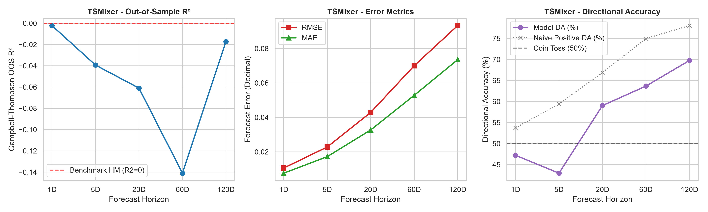
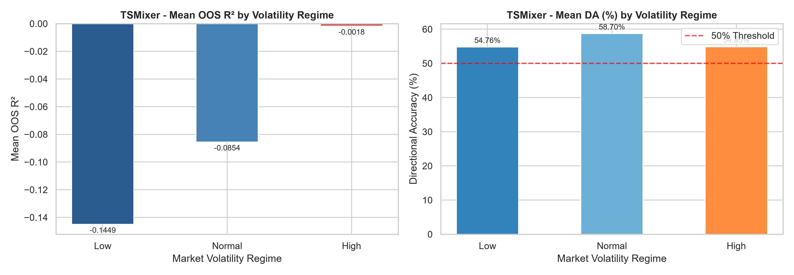
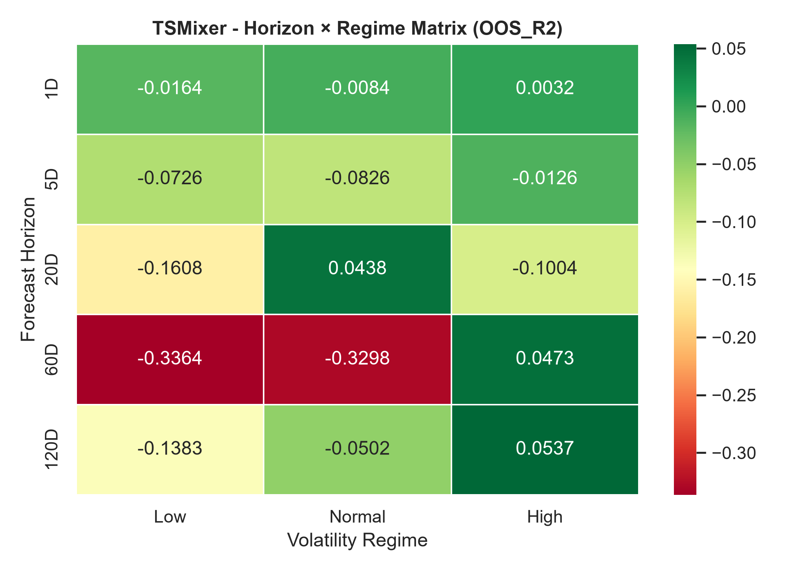
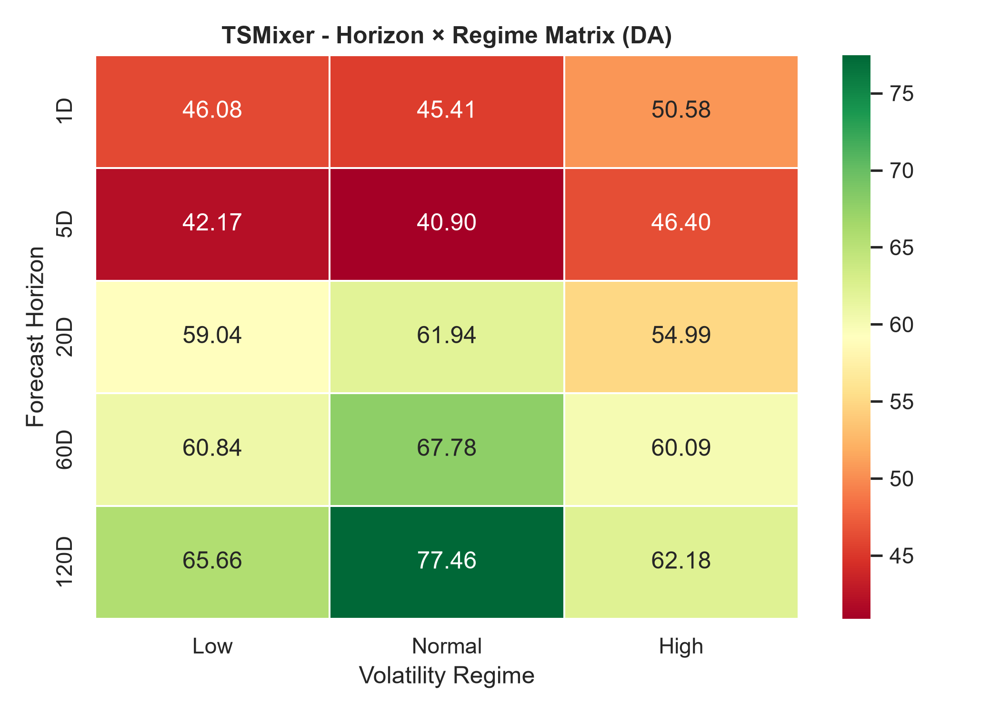
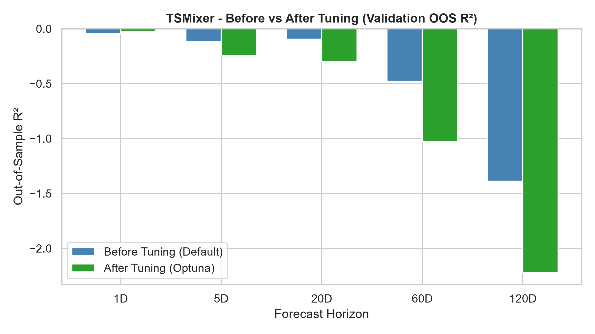
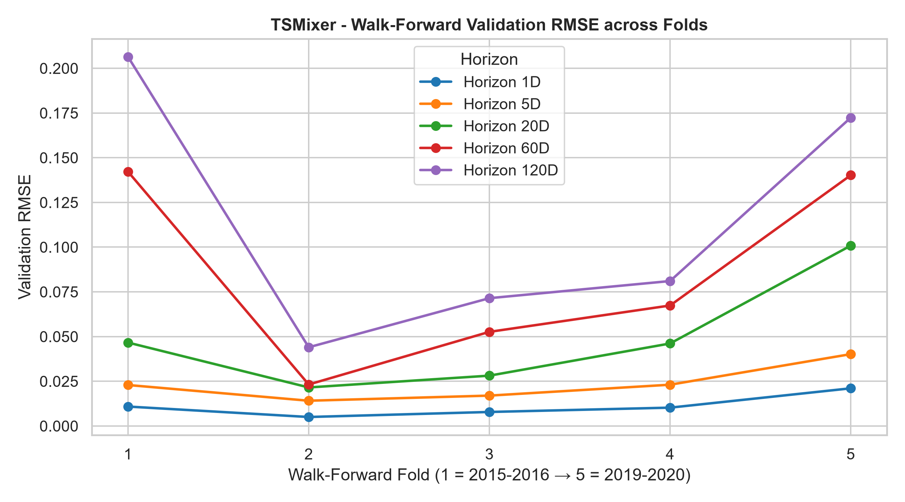

# QUANTITATIVE RESEARCH EVALUATION REPORT: TSMIXER
**Research Project:** *When Does Equity Return Predictability Decay? A Multi-Horizon and Regime-Dependent Out-of-Sample Analysis*
**Model Family:** Advanced Time-Series Deep Learning | **Model Category:** Regression
**Evaluation Status:** Strict Walk-Forward Out-of-Sample & Independent Hold-out Verification

---

## SECTION 1 – Model Overview
- **Model Identifier:** `TSMixer`
- **Architectural Classification:** Advanced Time-Series Deep Learning (Regression)
- **Primary Hyperparameter Configuration:** `{'lookback': 20, 'num_blocks': 3, 'ff_dim': 64, 'dropout': 0.14615383223623649, 'learning_rate': 0.00042861556186142986, 'weight_decay': 0.0001, 'batch_size': 16, 'epochs': 1000, 'patience': 7}`
- **Validation Period (Split 2):** 2015-06-10 to 2020-10-30 (5 walk-forward expanding folds, 1,360 total trading sessions)
- **Final Hold-out Test Period (Split 3):** 2020-11-02 to 2026-04-07 (1,362 out-of-sample trading sessions)
- **Evaluated Forecast Horizons:** 1D, 5D, 20D, 60D, 120D
- **Evaluated Volatility Regimes:** Low, Normal, High (Walk-forward expanding 33% & 67% quantiles)

---

## SECTION 2 – Overall Performance Across Evaluation Stages
The table below synthesizes predictive performance across the three evaluation stages. Note that Part A and Part B evaluate on Walk-Forward Validation (Split 2), whereas Part C evaluates on the strictly independent hold-out test set (Split 3).

| Evaluation Stage                |   OOS_R2 |   RMSE |    MAE | DA (%)   | Naive Positive DA (%)   | Excess DA (pp)   | DM Statistic   | DM p-value   | Sign Test p-value   |    N |
|:--------------------------------|---------:|-------:|-------:|:---------|:------------------------|:-----------------|:---------------|:-------------|:--------------------|-----:|
| Part A – Before Tuning          |  -0.4247 | 0.0518 | 0.0397 | 57.85%   | N/A                     | N/A              | N/A            | N/A          | N/A                 | 1360 |
| Part B – After Tuning           |  -0.7628 | 0.0567 | 0.0448 | 56.21%   | N/A                     | N/A              | N/A            | N/A          | N/A                 | 1360 |
| Part C – Final Independent Test |  -0.0521 | 0.0479 | 0.0368 | 56.52%   | 66.61%                  | -0.10            | -0.8165        | 0.8144       | 0.3963              | 1362 |

## SECTION 3 – Forecast Horizon Analysis
Analysis of predictive decay across horizons from ultra-short term (1D) to long-term macroeconomic horizon (120D).

| Horizon   |   OOS_R2 |   RMSE |    MAE |     DA |   Naive_Positive_DA |   Excess_DA |   DM_Stat |   DM_pvalue |   Sign_pvalue |   Observations |
|:----------|---------:|-------:|-------:|-------:|--------------------:|------------:|----------:|------------:|--------------:|---------------:|
| 1D        |  -0.0022 | 0.0106 | 0.0076 | 0.4721 |              0.5374 |     -0.0653 |    0      |      1      |        0.9815 |           1362 |
| 5D        |  -0.0393 | 0.0228 | 0.0172 | 0.4295 |              0.594  |     -0.1645 |   -2.5094 |      0.9939 |        1      |           1362 |
| 20D       |  -0.061  | 0.0429 | 0.0327 | 0.5903 |              0.6689 |     -0.0786 |   -0.6402 |      0.7389 |        0      |           1362 |
| 60D       |  -0.141  | 0.07   | 0.0528 | 0.6366 |              0.7496 |     -0.1131 |   -0.8151 |      0.7924 |        0      |           1362 |
| 120D      |  -0.0172 | 0.0933 | 0.0735 | 0.6975 |              0.7805 |     -0.083  |   -0.1179 |      0.5469 |        0      |           1362 |

## SECTION 4 – Volatility Regime Analysis
Performance breakdown conditioned on market volatility regimes (Low, Normal, High) constructed using expanding quantiles.

| Regime   |   OOS_R2 |    RMSE |     MAE |      DA |
|:---------|---------:|--------:|--------:|--------:|
| Low      | -0.1449  | 0.03814 | 0.03004 | 0.54758 |
| Normal   | -0.08544 | 0.04314 | 0.0333  | 0.58698 |
| High     | -0.00176 | 0.05908 | 0.0468  | 0.54848 |

## SECTION 5 – Horizon × Regime Matrices
Multi-dimensional matrix displaying performance across the 5 × 3 Horizon × Regime state space.

### Out-of-Sample R² Matrix (5 × 3):

| Horizon   |     Low |   Normal |    High |
|:----------|--------:|---------:|--------:|
| 1D        | -0.0164 |  -0.0084 |  0.0032 |
| 5D        | -0.0726 |  -0.0826 | -0.0126 |
| 20D       | -0.1608 |   0.0438 | -0.1004 |
| 60D       | -0.3364 |  -0.3298 |  0.0473 |
| 120D      | -0.1383 |  -0.0502 |  0.0537 |

## SECTION 6 – Before vs After Tuning Comparison
Comparison between baseline default architecture parameters (Part A) and Optuna-optimized hyperparameters (Part B) on Walk-Forward Validation.

| Horizon   |   Before_OOS_R2 |   After_OOS_R2 |   Delta_OOS_R2 |   Before_RMSE |   After_RMSE |   Delta_RMSE |   Before_DA |   After_DA |   Delta_DA |
|:----------|----------------:|---------------:|---------------:|--------------:|-------------:|-------------:|------------:|-----------:|-----------:|
| 1D        |         -0.0459 |        -0.0237 |         0.0222 |        0.0112 |       0.011  |      -0.0002 |      0.5029 |     0.5044 |     0.0015 |
| 5D        |         -0.1185 |        -0.2448 |        -0.1263 |        0.0237 |       0.0235 |      -0.0003 |      0.5463 |     0.5507 |     0.0044 |
| 20D       |         -0.0944 |        -0.2985 |        -0.2042 |        0.0451 |       0.0487 |       0.0035 |      0.6081 |     0.5493 |    -0.0588 |
| 60D       |         -0.4766 |        -1.0295 |        -0.5529 |        0.0776 |       0.0851 |       0.0075 |      0.6213 |     0.6103 |    -0.011  |
| 120D      |         -1.388  |        -2.2175 |        -0.8294 |        0.1013 |       0.1151 |       0.0138 |      0.614  |     0.5956 |    -0.0184 |

## SECTION 7 – Final Independent Hold-out Test Verification
The Final Independent Hold-out Test (Split 3: 2020–2026, 1,362 days) serves as the definitive out-of-sample empirical evidence. All preprocessing steps and hyperparameter choices were completely frozen prior to test inference.
- **Total Test Days:** 1,362 trading sessions
- **Lead Out-of-Sample R²:** -0.0022 (achieved at horizon `1D`)
- **Max Directional Accuracy:** 69.75%

## SECTION 8 – Walk-Forward Fold-Level Analysis
Stability evaluation across the 5 expanding walk-forward folds (Split 2):

| Horizon   |   Mean_OOS_R2 |   Std_OOS_R2 |   Min_OOS_R2 |   Max_OOS_R2 |   Mean_RMSE |   Std_RMSE |   Mean_MAE |   Mean_DA |
|:----------|--------------:|-------------:|-------------:|-------------:|------------:|-----------:|-----------:|----------:|
| 1D        |       -0.0237 |       0.0188 |      -0.046  |       0.0027 |      0.011  |     0.0061 |     0.0073 |    0.5044 |
| 5D        |       -0.2448 |       0.4479 |      -1.0443 |      -0.0103 |      0.0235 |     0.0101 |     0.0165 |    0.5507 |
| 20D       |       -0.2985 |       0.1448 |      -0.5065 |      -0.1517 |      0.0487 |     0.0312 |     0.0361 |    0.5493 |
| 60D       |       -1.0295 |       2.1539 |      -4.8528 |       0.3714 |      0.0851 |     0.0536 |     0.0693 |    0.6103 |
| 120D      |       -2.2175 |       4.4146 |     -10.0916 |       0.2262 |      0.1151 |     0.0702 |     0.095  |    0.5956 |

## SECTION 9 – Quantitative Executive Summary
- **Optimal Horizon:** `1D` (OOS R² = -0.0022)
- **Sub-optimal Horizon:** `60D` (OOS R² = -0.1410)
- **Most Favorable Volatility Regime:** `High`
- **Most Challenging Volatility Regime:** `Low`
- **Maximum Directional Accuracy:** 69.75%
- **Test Set Observations:** 1362 days