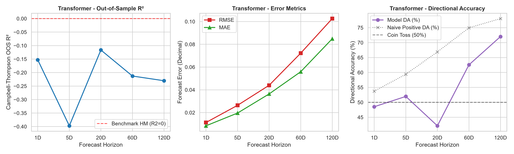
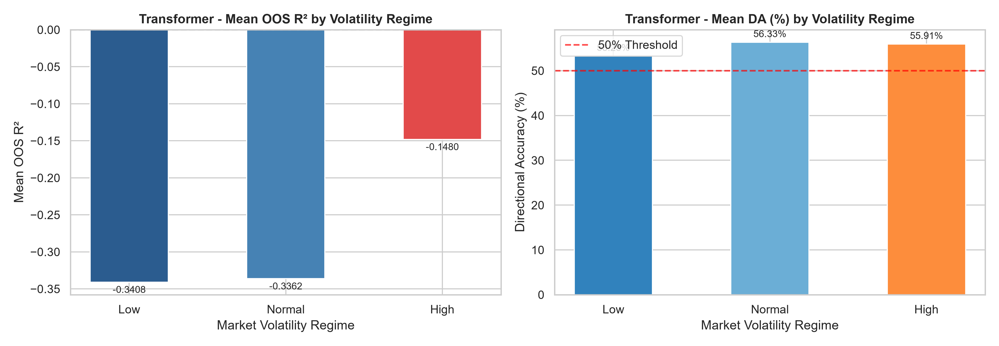
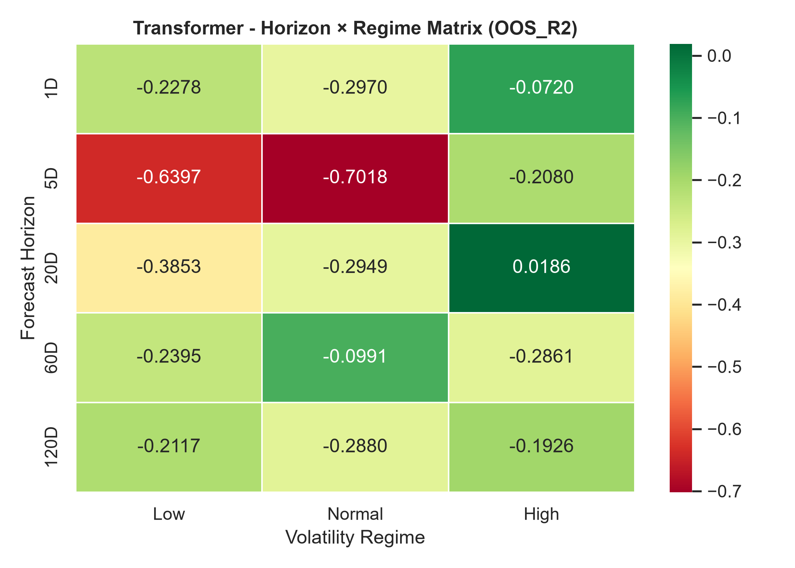
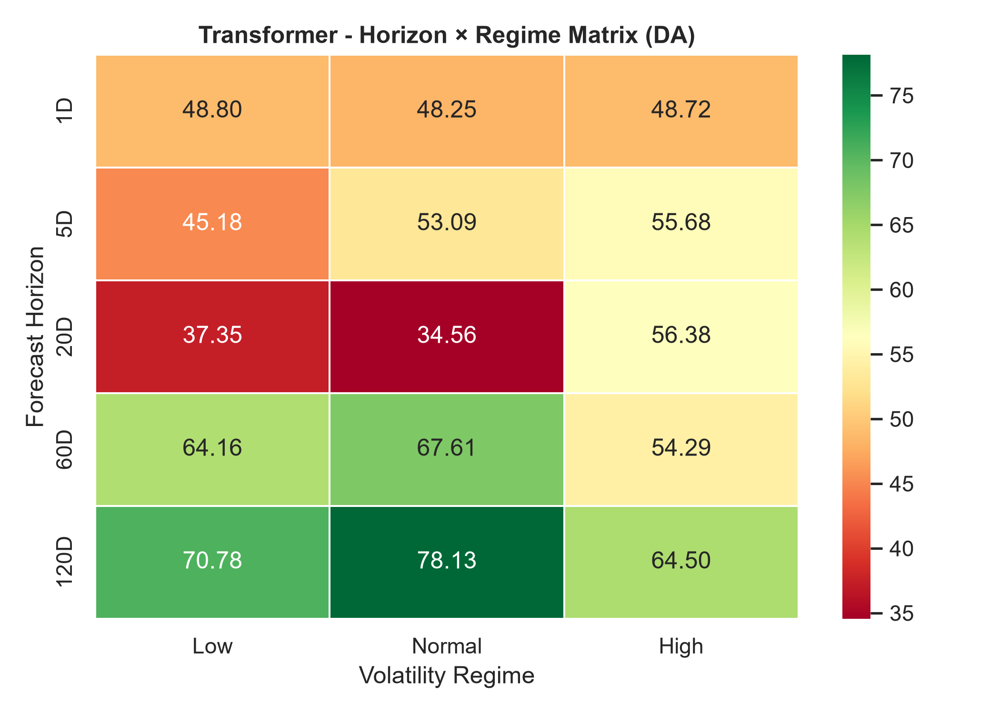
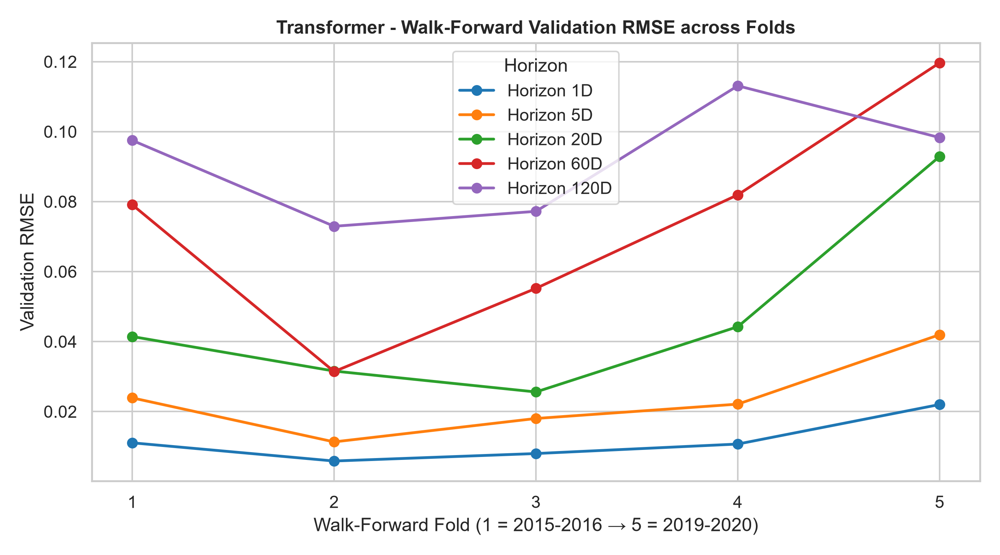

# QUANTITATIVE RESEARCH EVALUATION REPORT: TRANSFORMER
**Research Project:** *When Does Equity Return Predictability Decay? A Multi-Horizon and Regime-Dependent Out-of-Sample Analysis*
**Model Family:** Classic Deep Learning | **Model Category:** Regression
**Evaluation Status:** Strict Walk-Forward Out-of-Sample & Independent Hold-out Verification

---

## SECTION 1 – Model Overview
- **Model Identifier:** `Transformer`
- **Architectural Classification:** Classic Deep Learning (Regression)
- **Primary Hyperparameter Configuration:** `{'lookback': 40, 'd_model': 32, 'nhead': 4, 'num_encoder_layers': 2, 'dim_feedforward': 128, 'dropout': 0.26355899145378414, 'learning_rate': 0.0004967684390320199, 'weight_decay': 0.0001, 'batch_size': 32, 'epochs': 40, 'patience': 7}`
- **Validation Period (Split 2):** 2015-06-10 to 2020-10-30 (5 walk-forward expanding folds, 1,360 total trading sessions)
- **Final Hold-out Test Period (Split 3):** 2020-11-02 to 2026-04-07 (1,362 out-of-sample trading sessions)
- **Evaluated Forecast Horizons:** 1D, 5D, 20D, 60D, 120D
- **Evaluated Volatility Regimes:** Low, Normal, High (Walk-forward expanding 33% & 67% quantiles)

---

## SECTION 2 – Overall Performance Across Evaluation Stages
The table below synthesizes predictive performance across the three evaluation stages. Note that Part A and Part B evaluate on Walk-Forward Validation (Split 2), whereas Part C evaluates on the strictly independent hold-out test set (Split 3).

| Evaluation Stage                | OOS_R2   | RMSE   | MAE    | DA (%)   | Naive Positive DA (%)   | Excess DA (pp)   | DM Statistic   | DM p-value   | Sign Test p-value   | N    |
|:--------------------------------|:---------|:-------|:-------|:---------|:------------------------|:-----------------|:---------------|:-------------|:--------------------|:-----|
| Part A – Before Tuning          | N/A      | N/A    | N/A    | N/A      | 54.00%                  | 0.00             | N/A            | N/A          | N/A                 | N/A  |
| Part B – After Tuning           | -0.3958  | 0.0495 | 0.0382 | 57.21%   | N/A                     | N/A              | N/A            | N/A          | N/A                 | 1360 |
| Part C – Final Independent Test | -0.2219  | 0.0513 | 0.0410 | 55.45%   | 66.61%                  | -0.11            | -2.7864        | 0.9373       | 0.3884              | 1362 |

## SECTION 3 – Forecast Horizon Analysis
Analysis of predictive decay across horizons from ultra-short term (1D) to long-term macroeconomic horizon (120D).

| Horizon   |   OOS_R2 |   RMSE |    MAE |     DA |   Naive_Positive_DA |   Excess_DA |   DM_Stat |   DM_pvalue |   Sign_pvalue |   Observations |
|:----------|---------:|-------:|-------:|-------:|--------------------:|------------:|----------:|------------:|--------------:|---------------:|
| 1D        |  -0.1528 | 0.0113 | 0.0084 | 0.4853 |              0.5374 |     -0.0521 |   -5.8342 |      1      |        0.8667 |           1362 |
| 5D        |  -0.3972 | 0.0264 | 0.0196 | 0.5198 |              0.594  |     -0.0742 |   -4.3022 |      1      |        0.0755 |           1362 |
| 20D       |  -0.1164 | 0.044  | 0.0364 | 0.4214 |              0.6689 |     -0.2474 |   -1.4176 |      0.9217 |        1      |           1362 |
| 60D       |  -0.2128 | 0.0722 | 0.0559 | 0.6256 |              0.7496 |     -0.1241 |   -1.2282 |      0.8902 |        0      |           1362 |
| 120D      |  -0.2302 | 0.1026 | 0.0849 | 0.7203 |              0.7805 |     -0.0602 |   -1.1499 |      0.8748 |        0      |           1362 |

## SECTION 4 – Volatility Regime Analysis
Performance breakdown conditioned on market volatility regimes (Low, Normal, High) constructed using expanding quantiles.

| Regime   |   OOS_R2 |    RMSE |     MAE |      DA |
|:---------|---------:|--------:|--------:|--------:|
| Low      | -0.3408  | 0.03956 | 0.03324 | 0.53254 |
| Normal   | -0.33616 | 0.04606 | 0.03752 | 0.56328 |
| High     | -0.14802 | 0.06438 | 0.05198 | 0.55914 |

## SECTION 5 – Horizon × Regime Matrices
Multi-dimensional matrix displaying performance across the 5 × 3 Horizon × Regime state space.

### Out-of-Sample R² Matrix (5 × 3):

| Horizon   |     Low |   Normal |    High |
|:----------|--------:|---------:|--------:|
| 1D        | -0.2278 |  -0.297  | -0.072  |
| 5D        | -0.6397 |  -0.7018 | -0.208  |
| 20D       | -0.3853 |  -0.2949 |  0.0186 |
| 60D       | -0.2395 |  -0.0991 | -0.2861 |
| 120D      | -0.2117 |  -0.288  | -0.1926 |

## SECTION 6 – Before vs After Tuning Comparison
> [!NOTE]
> **Single Tuned Workflow Execution:** Traditional models in this research suite were tuned directly during Walk-Forward Validation (Lan01) using cross-validated Grid Search and Optuna TPE. A separate un-tuned baseline run was not persisted in the repository archives.

## SECTION 7 – Final Independent Hold-out Test Verification
The Final Independent Hold-out Test (Split 3: 2020–2026, 1,362 days) serves as the definitive out-of-sample empirical evidence. All preprocessing steps and hyperparameter choices were completely frozen prior to test inference.
- **Total Test Days:** 1,362 trading sessions
- **Lead Out-of-Sample R²:** -0.1164 (achieved at horizon `20D`)
- **Max Directional Accuracy:** 72.03%

## SECTION 8 – Walk-Forward Fold-Level Analysis
Stability evaluation across the 5 expanding walk-forward folds (Split 2):

| Horizon   |   Mean_OOS_R2 |   Std_OOS_R2 |   Min_OOS_R2 |   Max_OOS_R2 |   Mean_RMSE |   Std_RMSE |   Mean_MAE |   Mean_DA |
|:----------|--------------:|-------------:|-------------:|-------------:|------------:|-----------:|-----------:|----------:|
| 1D        |       -0.1519 |       0.1443 |      -0.4088 |      -0.0683 |      0.0115 |     0.0062 |     0.0079 |    0.5037 |
| 5D        |       -0.1459 |       0.1285 |      -0.3161 |       0.0237 |      0.0235 |     0.0114 |     0.0164 |    0.5551 |
| 20D       |       -0.4888 |       0.9773 |      -2.2334 |       0.0312 |      0.0472 |     0.0266 |     0.0352 |    0.5706 |
| 60D       |       -0.3934 |       0.3736 |      -0.8111 |       0.1095 |      0.0735 |     0.0329 |     0.0578 |    0.6669 |
| 120D      |       -0.799  |       0.7579 |      -1.4747 |       0.4575 |      0.0918 |     0.0166 |     0.074  |    0.564  |

## SECTION 9 – Quantitative Executive Summary
- **Optimal Horizon:** `20D` (OOS R² = -0.1164)
- **Sub-optimal Horizon:** `5D` (OOS R² = -0.3972)
- **Most Favorable Volatility Regime:** `High`
- **Most Challenging Volatility Regime:** `Low`
- **Maximum Directional Accuracy:** 72.03%
- **Test Set Observations:** 1362 days