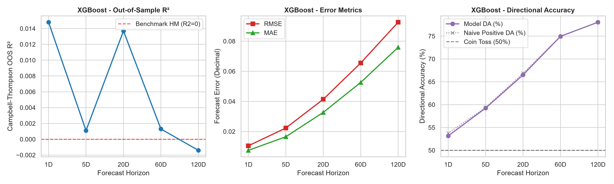
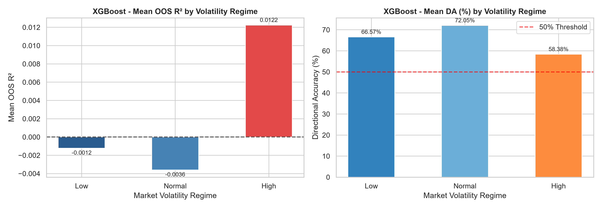
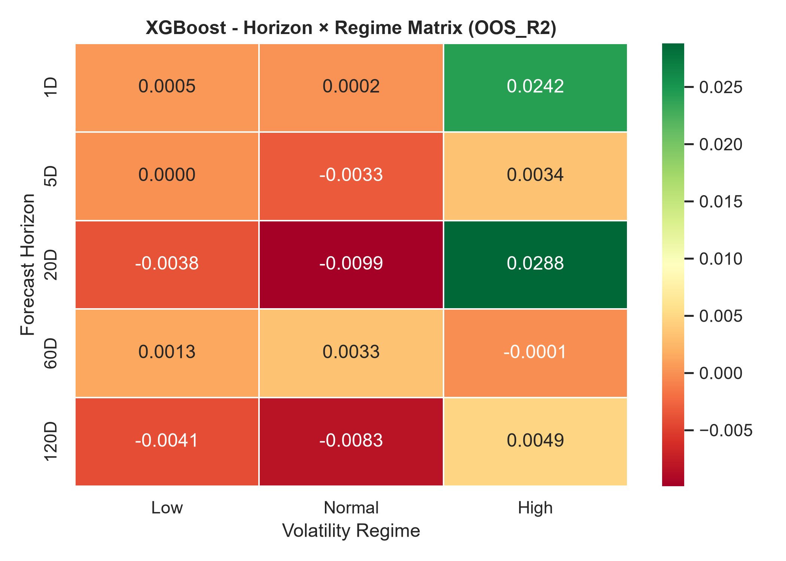
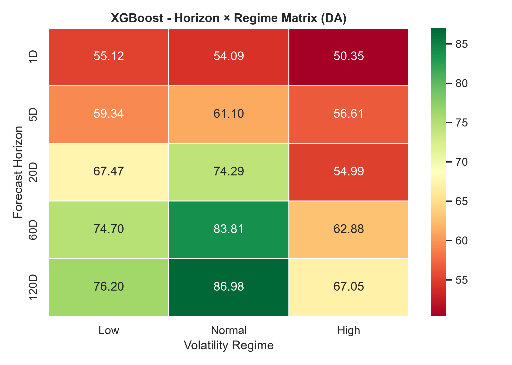
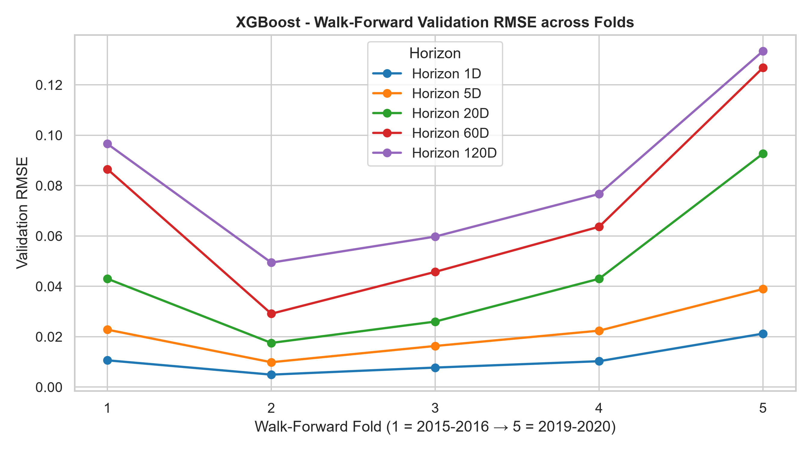

# QUANTITATIVE RESEARCH EVALUATION REPORT: XGBOOST
**Research Project:** *When Does Equity Return Predictability Decay? A Multi-Horizon and Regime-Dependent Out-of-Sample Analysis*
**Model Family:** Kernel & Tree-based ML | **Model Category:** Regression
**Evaluation Status:** Strict Walk-Forward Out-of-Sample & Independent Hold-out Verification

---

## SECTION 1 – Model Overview
- **Model Identifier:** `XGBoost`
- **Architectural Classification:** Kernel & Tree-based ML (Regression)
- **Primary Hyperparameter Configuration:** `{'n_estimators': 200, 'learning_rate': 0.16482980845075787, 'max_depth': 9, 'min_child_weight': 2, 'subsample': 0.7299728847064147, 'colsample_bytree': 0.67498834754586, 'gamma': 0.6907781506070934, 'reg_alpha': 0.012006821319579775, 'reg_lambda': 12.464577340414984}`
- **Validation Period (Split 2):** 2015-06-10 to 2020-10-30 (5 walk-forward expanding folds, 1,360 total trading sessions)
- **Final Hold-out Test Period (Split 3):** 2020-11-02 to 2026-04-07 (1,362 out-of-sample trading sessions)
- **Evaluated Forecast Horizons:** 1D, 5D, 20D, 60D, 120D
- **Evaluated Volatility Regimes:** Low, Normal, High (Walk-forward expanding 33% & 67% quantiles)

---

## SECTION 2 – Overall Performance Across Evaluation Stages
The table below synthesizes predictive performance across the three evaluation stages. Note that Part A and Part B evaluate on Walk-Forward Validation (Split 2), whereas Part C evaluates on the strictly independent hold-out test set (Split 3).

| Evaluation Stage                | OOS_R2   | RMSE   | MAE    | DA (%)   | Naive Positive DA (%)   | Excess DA (pp)   | DM Statistic   | DM p-value   | Sign Test p-value   | N    |
|:--------------------------------|:---------|:-------|:-------|:---------|:------------------------|:-----------------|:---------------|:-------------|:--------------------|:-----|
| Part A – Before Tuning          | N/A      | N/A    | N/A    | N/A      | 54.00%                  | 0.00             | N/A            | N/A          | N/A                 | N/A  |
| Part B – After Tuning           | -0.1121  | 0.0462 | 0.0360 | 64.32%   | N/A                     | N/A              | N/A            | N/A          | N/A                 | 1360 |
| Part C – Final Independent Test | 0.0059   | 0.0465 | 0.0370 | 66.39%   | 66.61%                  | -0.00            | 0.5803         | 0.3035       | 0.0021              | 1362 |

## SECTION 3 – Forecast Horizon Analysis
Analysis of predictive decay across horizons from ultra-short term (1D) to long-term macroeconomic horizon (120D).

| Horizon   |   OOS_R2 |   RMSE |    MAE |     DA |   Naive_Positive_DA |   Excess_DA |   DM_Stat |   DM_pvalue |   Sign_pvalue |   Observations |
|:----------|---------:|-------:|-------:|-------:|--------------------:|------------:|----------:|------------:|--------------:|---------------:|
| 1D        |   0.0148 | 0.0105 | 0.0075 | 0.5316 |              0.5374 |     -0.0059 |    1.0848 |      0.1391 |        0.0106 |           1362 |
| 5D        |   0.0011 | 0.0223 | 0.0165 | 0.5925 |              0.594  |     -0.0015 |    0.279  |      0.3902 |        0      |           1362 |
| 20D       |   0.0137 | 0.0414 | 0.0327 | 0.6652 |              0.6689 |     -0.0037 |    0.995  |      0.1599 |        0      |           1362 |
| 60D       |   0.0013 | 0.0655 | 0.0526 | 0.7496 |              0.7496 |      0      |    0.9432 |      0.1729 |        0      |           1362 |
| 120D      |  -0.0014 | 0.0926 | 0.0759 | 0.7805 |              0.7805 |      0      |   -0.4004 |      0.6555 |        0      |           1362 |

## SECTION 4 – Volatility Regime Analysis
Performance breakdown conditioned on market volatility regimes (Low, Normal, High) constructed using expanding quantiles.

| Regime   |   OOS_R2 |    RMSE |     MAE |      DA |
|:---------|---------:|--------:|--------:|--------:|
| Low      | -0.00122 | 0.03504 | 0.02916 | 0.66566 |
| Normal   | -0.0036  | 0.041   | 0.03314 | 0.72054 |
| High     |  0.01224 | 0.05922 | 0.04858 | 0.58376 |

## SECTION 5 – Horizon × Regime Matrices
Multi-dimensional matrix displaying performance across the 5 × 3 Horizon × Regime state space.

### Out-of-Sample R² Matrix (5 × 3):

| Horizon   |     Low |   Normal |    High |
|:----------|--------:|---------:|--------:|
| 1D        |  0.0005 |   0.0002 |  0.0242 |
| 5D        |  0      |  -0.0033 |  0.0034 |
| 20D       | -0.0038 |  -0.0099 |  0.0288 |
| 60D       |  0.0013 |   0.0033 | -0.0001 |
| 120D      | -0.0041 |  -0.0083 |  0.0049 |

## SECTION 6 – Before vs After Tuning Comparison
> [!NOTE]
> **Single Tuned Workflow Execution:** Traditional models in this research suite were tuned directly during Walk-Forward Validation (Lan01) using cross-validated Grid Search and Optuna TPE. A separate un-tuned baseline run was not persisted in the repository archives.

## SECTION 7 – Final Independent Hold-out Test Verification
The Final Independent Hold-out Test (Split 3: 2020–2026, 1,362 days) serves as the definitive out-of-sample empirical evidence. All preprocessing steps and hyperparameter choices were completely frozen prior to test inference.
- **Total Test Days:** 1,362 trading sessions
- **Lead Out-of-Sample R²:** 0.0148 (achieved at horizon `1D`)
- **Max Directional Accuracy:** 78.05%

## SECTION 8 – Walk-Forward Fold-Level Analysis
Stability evaluation across the 5 expanding walk-forward folds (Split 2):

| Horizon   |   Mean_OOS_R2 |   Std_OOS_R2 |   Min_OOS_R2 |   Max_OOS_R2 |   Mean_RMSE |   Std_RMSE |   Mean_MAE |   Mean_DA |
|:----------|--------------:|-------------:|-------------:|-------------:|------------:|-----------:|-----------:|----------:|
| 1D        |       -0.0058 |       0.0134 |      -0.0297 |       0.0008 |      0.011  |     0.0062 |     0.0072 |    0.5434 |
| 5D        |        0.0085 |       0.0172 |      -0.0004 |       0.0392 |      0.0221 |     0.0108 |     0.0154 |    0.6199 |
| 20D       |       -0.0509 |       0.0714 |      -0.1389 |       0.0034 |      0.0444 |     0.0291 |     0.033  |    0.6257 |
| 60D       |       -0.2311 |       0.5232 |      -1.167  |       0.0099 |      0.0704 |     0.0381 |     0.0556 |    0.711  |
| 120D      |       -0.2811 |       0.6409 |      -1.4275 |       0.0248 |      0.0832 |     0.0333 |     0.0689 |    0.7162 |

## SECTION 9 – Quantitative Executive Summary
- **Optimal Horizon:** `1D` (OOS R² = 0.0148)
- **Sub-optimal Horizon:** `120D` (OOS R² = -0.0014)
- **Most Favorable Volatility Regime:** `High`
- **Most Challenging Volatility Regime:** `Normal`
- **Maximum Directional Accuracy:** 78.05%
- **Test Set Observations:** 1362 days