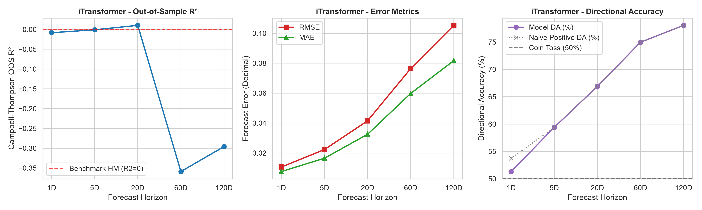
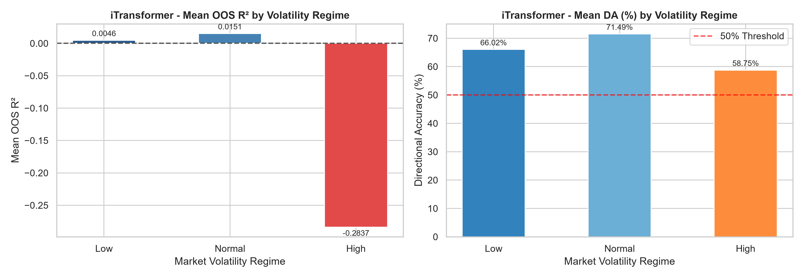
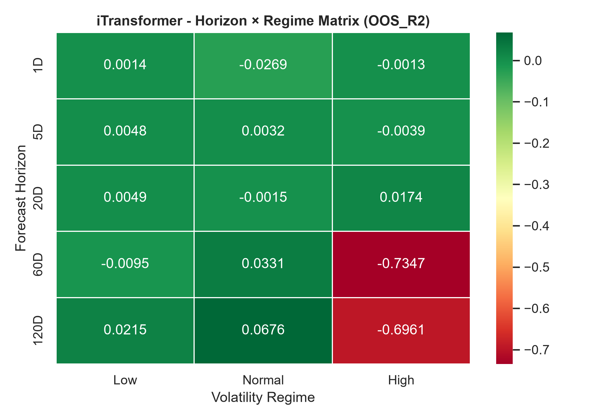
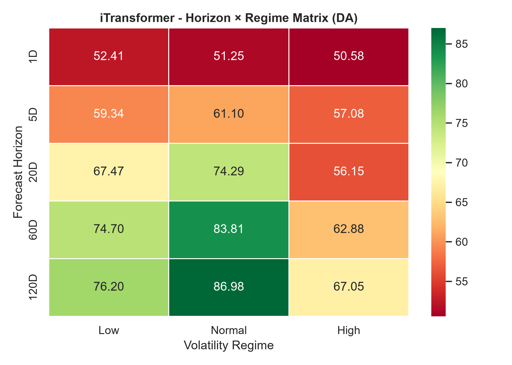
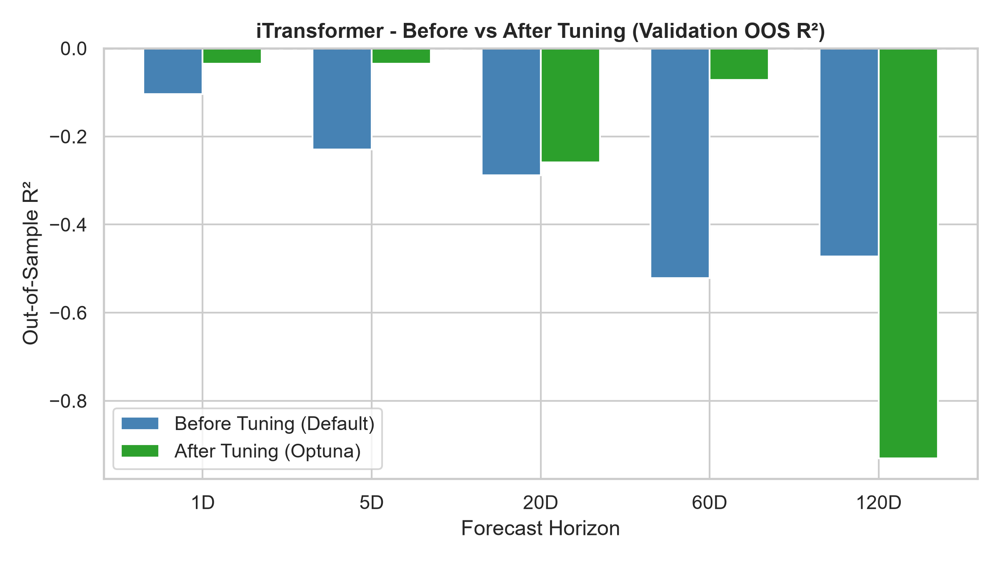
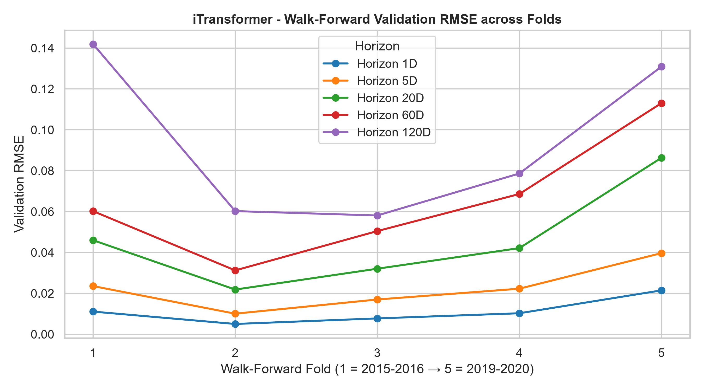

# QUANTITATIVE RESEARCH EVALUATION REPORT: ITRANSFORMER
**Research Project:** *When Does Equity Return Predictability Decay? A Multi-Horizon and Regime-Dependent Out-of-Sample Analysis*
**Model Family:** Advanced Time-Series Deep Learning | **Model Category:** Regression
**Evaluation Status:** Strict Walk-Forward Out-of-Sample & Independent Hold-out Verification

---

## SECTION 1 – Model Overview
- **Model Identifier:** `iTransformer`
- **Architectural Classification:** Advanced Time-Series Deep Learning (Regression)
- **Primary Hyperparameter Configuration:** `{'lookback': 40, 'd_model': 32, 'nhead': 2, 'num_layers': 2, 'dim_feedforward': 64, 'dropout': 0.21319076464081066, 'learning_rate': 0.0004941640299715253, 'weight_decay': 0.0001, 'batch_size': 16, 'epochs': 1000, 'patience': 7}`
- **Validation Period (Split 2):** 2015-06-10 to 2020-10-30 (5 walk-forward expanding folds, 1,360 total trading sessions)
- **Final Hold-out Test Period (Split 3):** 2020-11-02 to 2026-04-07 (1,362 out-of-sample trading sessions)
- **Evaluated Forecast Horizons:** 1D, 5D, 20D, 60D, 120D
- **Evaluated Volatility Regimes:** Low, Normal, High (Walk-forward expanding 33% & 67% quantiles)

---

## SECTION 2 – Overall Performance Across Evaluation Stages
The table below synthesizes predictive performance across the three evaluation stages. Note that Part A and Part B evaluate on Walk-Forward Validation (Split 2), whereas Part C evaluates on the strictly independent hold-out test set (Split 3).

| Evaluation Stage                |   OOS_R2 |   RMSE |    MAE | DA (%)   | Naive Positive DA (%)   | Excess DA (pp)   | DM Statistic   | DM p-value   | Sign Test p-value   |    N |
|:--------------------------------|---------:|-------:|-------:|:---------|:------------------------|:-----------------|:---------------|:-------------|:--------------------|-----:|
| Part A – Before Tuning          |  -0.323  | 0.0487 | 0.0372 | 57.29%   | N/A                     | N/A              | N/A            | N/A          | N/A                 | 1360 |
| Part B – After Tuning           |  -0.2659 | 0.0476 | 0.0371 | 60.88%   | N/A                     | N/A              | N/A            | N/A          | N/A                 | 1360 |
| Part C – Final Independent Test |  -0.1308 | 0.0512 | 0.0396 | 66.12%   | 66.61%                  | -0.00            | -0.2143        | 0.6737       | 0.0343              | 1362 |

## SECTION 3 – Forecast Horizon Analysis
Analysis of predictive decay across horizons from ultra-short term (1D) to long-term macroeconomic horizon (120D).

| Horizon   |   OOS_R2 |   RMSE |    MAE |     DA |   Naive_Positive_DA |   Excess_DA |   DM_Stat |   DM_pvalue |   Sign_pvalue |   Observations |
|:----------|---------:|-------:|-------:|-------:|--------------------:|------------:|----------:|------------:|--------------:|---------------:|
| 1D        |  -0.0083 | 0.0106 | 0.0076 | 0.5132 |              0.5374 |     -0.0242 |    0      |      1      |        0.1715 |           1362 |
| 5D        |  -0.0009 | 0.0223 | 0.0165 | 0.594  |              0.594  |      0      |   -0.0564 |      0.5225 |        0      |           1362 |
| 20D       |   0.0103 | 0.0415 | 0.0325 | 0.6689 |              0.6689 |      0      |    0.6143 |      0.2696 |        0      |           1362 |
| 60D       |  -0.359  | 0.0764 | 0.0598 | 0.7496 |              0.7496 |      0      |   -1.0038 |      0.8422 |        0      |           1362 |
| 120D      |  -0.296  | 0.1053 | 0.0817 | 0.7805 |              0.7805 |      0      |   -0.6256 |      0.7342 |        0      |           1362 |

## SECTION 4 – Volatility Regime Analysis
Performance breakdown conditioned on market volatility regimes (Low, Normal, High) constructed using expanding quantiles.

| Regime   |   OOS_R2 |    RMSE |     MAE |      DA |
|:---------|---------:|--------:|--------:|--------:|
| Low      |  0.00462 | 0.03484 | 0.02918 | 0.66024 |
| Normal   |  0.0151  | 0.04014 | 0.03232 | 0.71486 |
| High     | -0.28372 | 0.07144 | 0.05786 | 0.58748 |

## SECTION 5 – Horizon × Regime Matrices
Multi-dimensional matrix displaying performance across the 5 × 3 Horizon × Regime state space.

### Out-of-Sample R² Matrix (5 × 3):

| Horizon   |     Low |   Normal |    High |
|:----------|--------:|---------:|--------:|
| 1D        |  0.0014 |  -0.0269 | -0.0013 |
| 5D        |  0.0048 |   0.0032 | -0.0039 |
| 20D       |  0.0049 |  -0.0015 |  0.0174 |
| 60D       | -0.0095 |   0.0331 | -0.7347 |
| 120D      |  0.0215 |   0.0676 | -0.6961 |

## SECTION 6 – Before vs After Tuning Comparison
Comparison between baseline default architecture parameters (Part A) and Optuna-optimized hyperparameters (Part B) on Walk-Forward Validation.

| Horizon   |   Before_OOS_R2 |   After_OOS_R2 |   Delta_OOS_R2 |   Before_RMSE |   After_RMSE |   Delta_RMSE |   Before_DA |   After_DA |   Delta_DA |
|:----------|----------------:|---------------:|---------------:|--------------:|-------------:|-------------:|------------:|-----------:|-----------:|
| 1D        |         -0.1036 |        -0.0347 |         0.0688 |        0.0113 |       0.0111 |      -0.0002 |      0.5162 |     0.5272 |     0.011  |
| 5D        |         -0.2296 |        -0.0348 |         0.1948 |        0.0249 |       0.0225 |      -0.0024 |      0.5287 |     0.5551 |     0.0265 |
| 20D       |         -0.2885 |        -0.2584 |         0.0301 |        0.0472 |       0.0457 |      -0.0015 |      0.5463 |     0.5721 |     0.0257 |
| 60D       |         -0.5214 |        -0.0717 |         0.4498 |        0.076  |       0.0647 |      -0.0113 |      0.6118 |     0.7081 |     0.0963 |
| 120D      |         -0.4721 |        -0.9301 |        -0.458  |        0.0839 |       0.0939 |       0.01   |      0.6618 |     0.6816 |     0.0199 |

## SECTION 7 – Final Independent Hold-out Test Verification
The Final Independent Hold-out Test (Split 3: 2020–2026, 1,362 days) serves as the definitive out-of-sample empirical evidence. All preprocessing steps and hyperparameter choices were completely frozen prior to test inference.
- **Total Test Days:** 1,362 trading sessions
- **Lead Out-of-Sample R²:** 0.0103 (achieved at horizon `20D`)
- **Max Directional Accuracy:** 78.05%

## SECTION 8 – Walk-Forward Fold-Level Analysis
Stability evaluation across the 5 expanding walk-forward folds (Split 2):

| Horizon   |   Mean_OOS_R2 |   Std_OOS_R2 |   Min_OOS_R2 |   Max_OOS_R2 |   Mean_RMSE |   Std_RMSE |   Mean_MAE |   Mean_DA |
|:----------|--------------:|-------------:|-------------:|-------------:|------------:|-----------:|-----------:|----------:|
| 1D        |       -0.0347 |       0.0365 |      -0.0856 |       0.0006 |      0.0111 |     0.0062 |     0.0073 |    0.5272 |
| 5D        |       -0.0348 |       0.0413 |      -0.084  |       0.0101 |      0.0225 |     0.011  |     0.0158 |    0.5551 |
| 20D       |       -0.2584 |       0.2802 |      -0.548  |       0.0394 |      0.0457 |     0.0246 |     0.0332 |    0.5721 |
| 60D       |       -0.0717 |       0.1661 |      -0.2158 |       0.2053 |      0.0647 |     0.0304 |     0.0494 |    0.7081 |
| 120D      |       -0.9301 |       1.8614 |      -4.2399 |       0.0507 |      0.0939 |     0.0398 |     0.0798 |    0.6816 |

## SECTION 9 – Quantitative Executive Summary
- **Optimal Horizon:** `20D` (OOS R² = 0.0103)
- **Sub-optimal Horizon:** `60D` (OOS R² = -0.3590)
- **Most Favorable Volatility Regime:** `Normal`
- **Most Challenging Volatility Regime:** `High`
- **Maximum Directional Accuracy:** 78.05%
- **Test Set Observations:** 1362 days