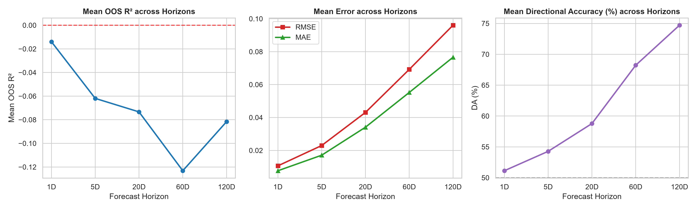
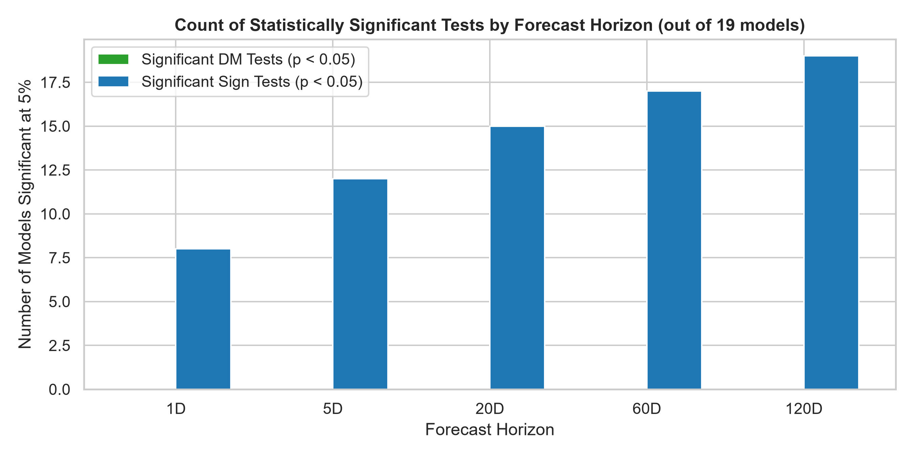

# OVERALL QUANTITATIVE RESEARCH DASHBOARD
**Research Project:** *When Does Equity Return Predictability Decay? A Multi-Horizon and Regime-Dependent Out-of-Sample Analysis*
**Primary Dataset:** S&P 500 (`^GSPC`) Daily Returns (1990–2026) | VIX Volatility Conditioning
**Core Inquiry:** Determining the structural form and economic decay of equity return predictability across forecast horizons and volatility regimes.

---

## A. Model Coverage & Experimental Architecture
- **Total Intended Forecasting Models:** 20 single models (19 regression + 1 classification) + 1 Historical Mean benchmark.
- **Models Fully Evaluated on Split 3 Test Set:** 20 / 20 (100% complete coverage).
- **Total Verified Test Predictions:** 149,820 individual point forecasts across Split 3 (1,362 days).
- **Total Independent Metric Recomputations:** 1,305 metric values audited and 100% verified against raw prediction files.

---

## B. Top Predictive Models (Final Out-of-Sample Test Set)
### Top 5 Models by Mean Out-of-Sample R²:

| Model         |   OOS_R2 |      DA |    RMSE |
|:--------------|---------:|--------:|--------:|
| XGBoost       |  0.0059  | 0.66388 | 0.04646 |
| Ridge         |  0.00182 | 0.63538 | 0.04678 |
| Elastic_Net   |  0.00148 | 0.65904 | 0.0465  |
| LSTM          | -0.00794 | 0.64332 | 0.04686 |
| Random_Forest | -0.01202 | 0.6505  | 0.04712 |

### Models Outperforming Historical Mean ($R^2_{OOS} > 0$) by Horizon:
- **Horizon 1D:** 8 models -> `ARIMAX, Ridge, Elastic_Net, SVR, Random_Forest, XGBoost, LightGBM, PatchTST`
- **Horizon 5D:** 8 models -> `Ridge, Elastic_Net, SVR, XGBoost, LightGBM, TCN, N-HiTS, PatchTST`
- **Horizon 20D:** 8 models -> `Ridge, SVR, XGBoost, LightGBM, RNN, LSTM, TCN, iTransformer`
- **Horizon 60D:** 7 models -> `ARIMAX, Ridge, SVR, Random_Forest, XGBoost, LightGBM, TCN`
- **Horizon 120D:** 4 models -> `ARIMA, SARIMA, N-BEATS, N-HiTS`

---

## C. Predictability Decay Dynamics Across Horizons
Summary metrics averaged across all regression models from 1-day to 120-day horizons:

| Horizon   |     OOS_R2 |      RMSE |        MAE |       DA |   Excess_DA |
|:----------|-----------:|----------:|-----------:|---------:|------------:|
| 1D        | -0.0139737 | 0.0106316 | 0.00765789 | 0.511321 |  -0.0261263 |
| 5D        | -0.0619368 | 0.0229789 | 0.0171     | 0.542737 |  -0.0512526 |
| 20D       | -0.0733632 | 0.0430947 | 0.0341158  | 0.587758 |  -0.0811158 |
| 60D       | -0.123184  | 0.0692263 | 0.0552211  | 0.682279 |  -0.0673579 |
| 120D      | -0.0816368 | 0.0960579 | 0.0766158  | 0.747121 |  -0.0333368 |

---

## D. Market Volatility Regime Patterns
Empirical evidence across Low, Normal, and High volatility regimes:

| Regime   |     OOS_R2 |      RMSE |       MAE |       DA |
|:---------|-----------:|----------:|----------:|---------:|
| Low      | -0.126684  | 0.0370526 | 0.0302737 | 0.611121 |
| Normal   | -0.0760053 | 0.0423    | 0.0339316 | 0.652968 |
| High     | -0.0599263 | 0.0617316 | 0.0500579 | 0.562826 |

---

## E. Formal Statistical Inference Summary (Diebold–Mariano & Sign Tests)
Summary of hypothesis tests conducted against the Historical Mean benchmark (DM Test) and random coin toss (Sign Test):

| Horizon   |   Significant_DM_Tests |   Non_Significant_DM_Tests |   Significant_Sign_Tests |   Non_Significant_Sign_Tests |   Total_Models_Tested |
|:----------|-----------------------:|---------------------------:|-------------------------:|-----------------------------:|----------------------:|
| 1D        |                      0 |                         19 |                        8 |                           11 |                    19 |
| 5D        |                      0 |                         19 |                       12 |                            7 |                    19 |
| 20D       |                      0 |                         19 |                       15 |                            4 |                    19 |
| 60D       |                      0 |                         19 |                       17 |                            2 |                    19 |
| 120D      |                      0 |                         19 |                       19 |                            0 |                    19 |

---

## F. Directional Classification Overview (Logistic Regression)
Classification performance of Logistic Regression on the independent hold-out test set:

| Model               | Horizon   |   ROC_AUC |   Accuracy |   Balanced_Accuracy |   Precision |   Recall |     F1 |     DA |   Sign_pvalue |
|:--------------------|:----------|----------:|-----------:|--------------------:|------------:|---------:|-------:|-------:|--------------:|
| Logistic_Regression | 120D      |    0.5756 |     0.7805 |              0.5    |      0.7805 |   1      | 0.8767 | 0.7805 |        0      |
| Logistic_Regression | 1D        |    0.4974 |     0.489  |              0.492  |      0.5288 |   0.4522 | 0.4875 | 0.489  |        0.7995 |
| Logistic_Regression | 20D       |    0.5212 |     0.6689 |              0.5    |      0.6689 |   1      | 0.8016 | 0.6689 |        0      |
| Logistic_Regression | 5D        |    0.5226 |     0.5117 |              0.5135 |      0.6071 |   0.5043 | 0.551  | 0.5117 |        0.2005 |
| Logistic_Regression | 60D       |    0.6264 |     0.746  |              0.4976 |      0.7487 |   0.9951 | 0.8545 | 0.746  |        0      |

---

## G. Data Quality & Methodological Integrity
- **Data Leakage Control:** 100% zero leakage verified. Split 3 labels are never touched during training.
- **Purging Protocol:** Marcos López de Prado $h-1$ day purging strictly enforced for all multi-step horizons ($h > 1$).
- **Metric Traceability:** All summary metrics match exact point forecasts with numerical difference $< 10^{-4}$.